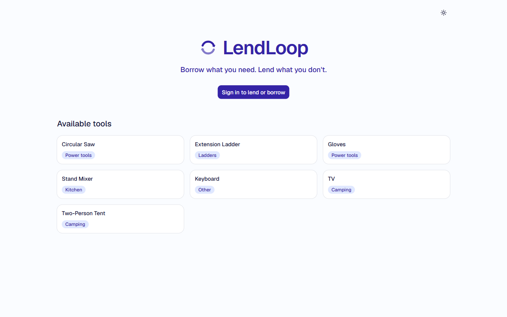
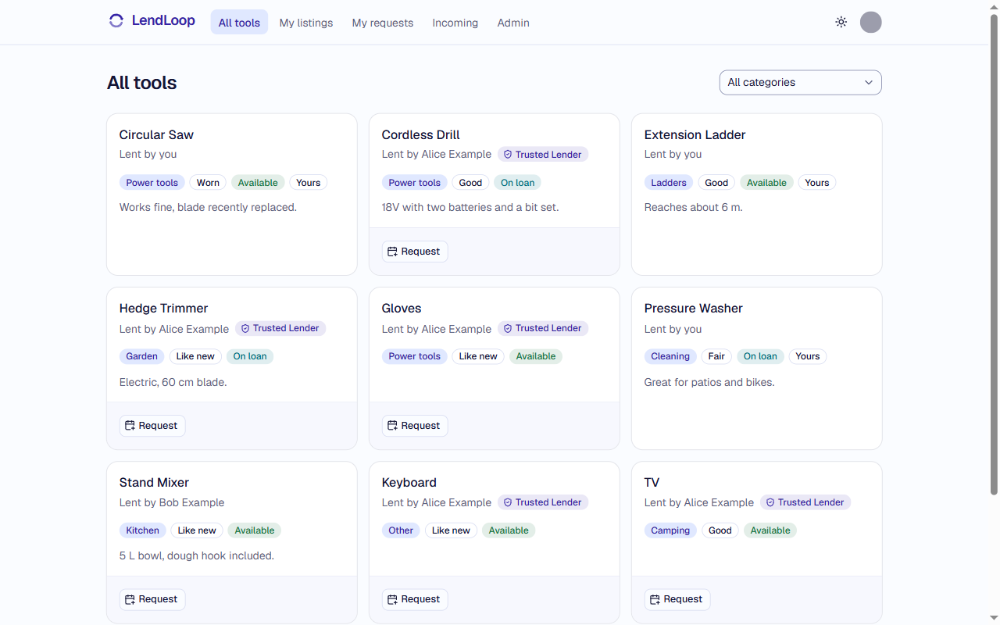
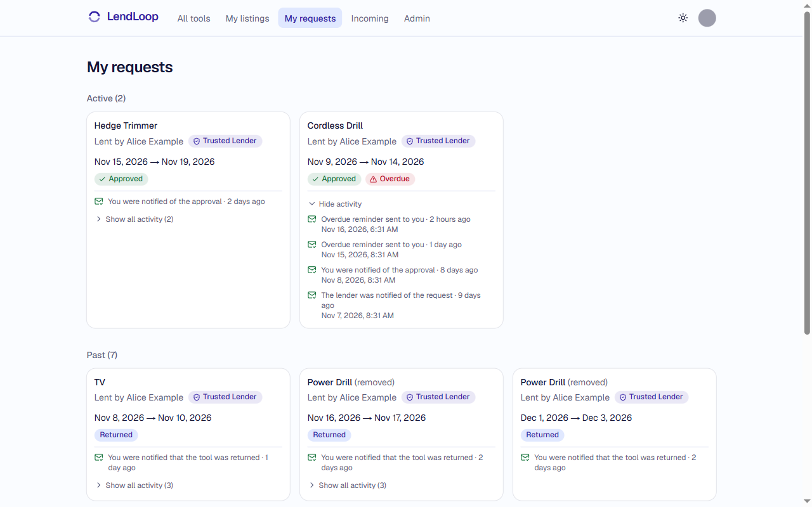
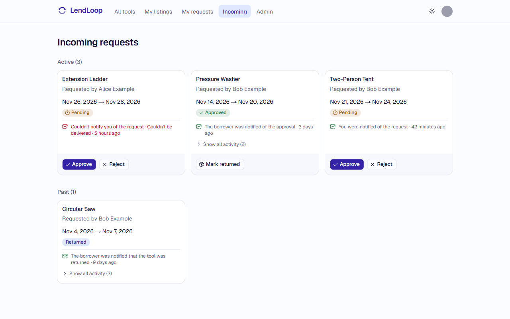
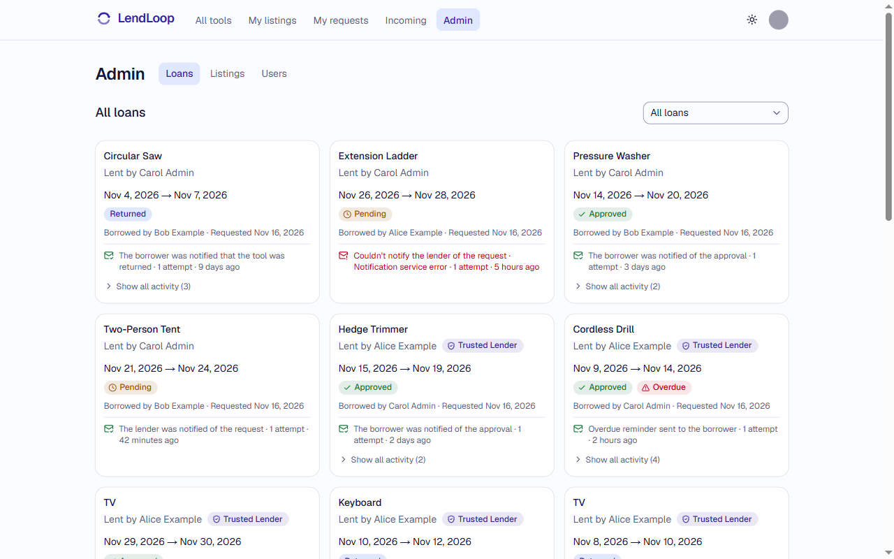
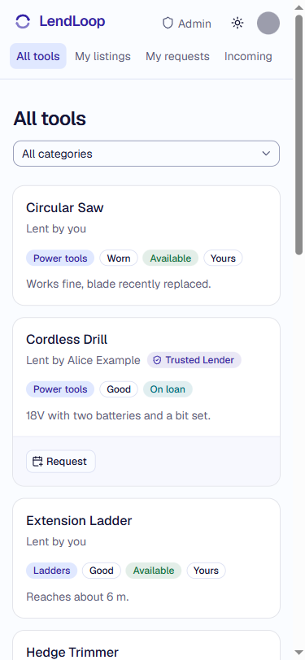
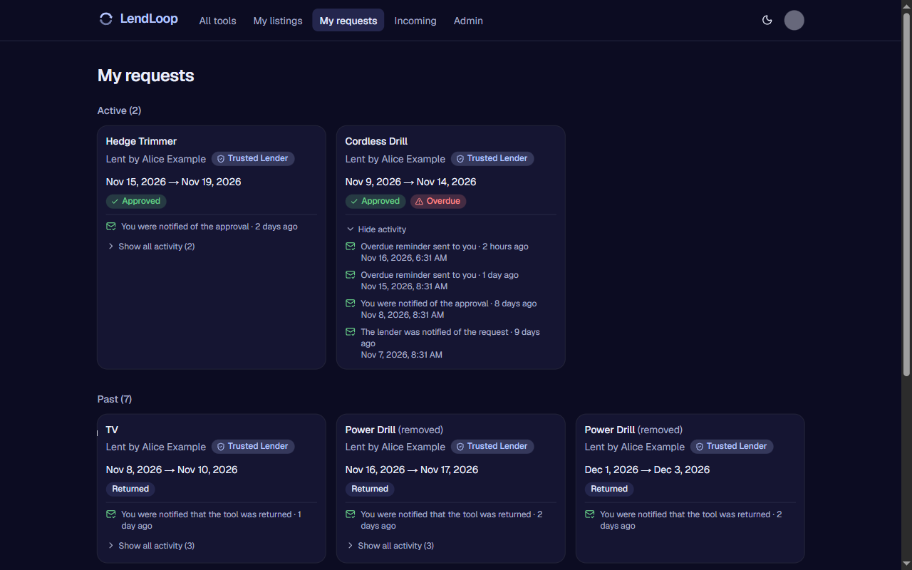
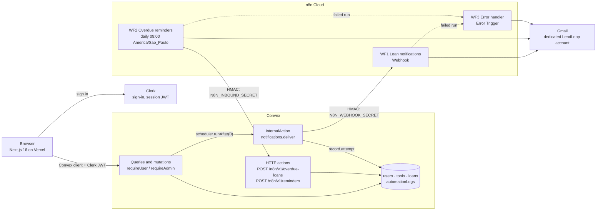

# LendLoop

***Borrow what you need. Lend what you don't.***

Neighbors own tools they rarely use, while others buy tools they need only once. LendLoop is a simple neighborhood board where neighbors list tools they are willing to lend, request loans from each other, and get automated notifications and overdue reminders orchestrated by n8n.

**Live demo: [lendloop-tawny.vercel.app](https://lendloop-tawny.vercel.app)**. Sign in with email or Google. The live demo runs on a Clerk *development* instance (see [Known limitations](#known-limitations)), so it shows Clerk's development-mode badge.



## Contents

- [Features](#features)
- [Tech stack](#tech-stack)
- [Architecture](#architecture)
- [Roles and authorization](#roles-and-authorization)
- [Automation (n8n)](#automation-n8n)
- [Data model](#data-model)
- [Environment variables](#environment-variables)
- [Quick start (app only)](#quick-start-app-only)
- [Full setup (automation)](#full-setup-automation)
- [Testing](#testing)
- [Environments and deploy](#environments-and-deploy)
- [Security and data minimization](#security-and-data-minimization)
- [Known limitations](#known-limitations)
- [What I would change for production](#what-i-would-change-for-production)
- [How this project was built](#how-this-project-was-built)

## Features

- [x] **A. Public page**: tagline, a read-only list of available tools (name and category only, no owner details) and a *Sign in to lend or borrow* button wired to Clerk.
- [x] **B. Tool listings**: create, edit and remove your own listings (name, category, condition, short description).
- [x] **C. Loans**: request a tool for a date range; the owner approves or rejects; the owner marks it returned; the borrower can cancel a pending request.
- [x] **D. Views**: *All tools* with availability and a category filter, *My listings*, *My requests*, *Incoming*.
- [x] **E. Admin**: remove any listing, view all loans (filters by status and overdue), mark a lender as **Trusted Lender**.
- [x] **F. Automation activity (bonus)**: every loan card shows its latest automated message (e.g. "Overdue reminder sent to you · 2 hours ago"); the full history expands inline. Admins also see attempts and failure categories.

| | |
|---|---|
| <br>*All tools: category filter, availability, Trusted Lender* | <br>*My requests: overdue loan and automation activity* |
| <br>*Incoming: approve, reject, mark returned* | <br>*Admin: all loans with attempts and failure categories* |
| <br>*Mobile (375 px)* | <br>*Dark mode* |

## Tech stack

| Layer | Technology |
|---|---|
| Framework | Next.js 16 (App Router, React Compiler) + React 19 + TypeScript (strict) |
| UI | Tailwind CSS v4 + shadcn/ui (base-nova) + lucide-react + Sonner; Light / Dark toggle that follows the OS until the user picks |
| Auth | Clerk (email and Google sign-in) |
| Data and backend | Convex: queries, mutations, internal actions, HTTP actions, scheduler |
| Automation | n8n Cloud (3 workflows), Gmail through an n8n credential |
| Validation | Convex validators (`v.*`) on every public function, Zod in client forms |
| Testing | Vitest + convex-test |
| Hosting | Vercel (Next.js) + Convex cloud |

## Architecture



- **Browser ↔ Convex.** The React app talks to Convex through the Convex client, authenticated with the Clerk session JWT. Queries are reactive, so every view updates live without polling. There are no Next.js API routes and no Server Actions.
- **Outbox in the same transaction.** Each loan mutation (request, approve, reject, cancel, return, and the automatic rejections) inserts an `automationLogs` row and schedules delivery with `ctx.scheduler.runAfter(0, …)` **inside the same transaction**. If the mutation fails, no event exists; if it commits, the event is guaranteed to be attempted.
- **Convex → n8n (WF1).** `notifications.deliver` (an `internalAction`) POSTs the event to the WF1 webhook, signed with `N8N_WEBHOOK_SECRET`, and records each attempt through an internal mutation.
- **n8n → Convex (WF2).** WF2 calls two Convex HTTP actions signed with a **separate** secret, `N8N_INBOUND_SECRET`. A leak of one secret does not compromise the other direction.

## Roles and authorization

Every public Convex function resolves the caller with `requireUser` / `requireAdmin` (`convex/lib/auth.ts`) before reading private data or writing anything. Ownership (listing owner, borrower, lender) is checked server-side; a `userId`, `role` or `ownerId` from the client is never trusted. In the UI, every page under `src/app/(app)/` also calls `await auth.protect()`, but that is defense in depth only.

| Action | Visitor | user | admin |
|---|---|---|---|
| See available tools (name + category) | ✅ | ✅ | ✅ |
| See owners, availability, category filter | — | ✅ | ✅ |
| Create / edit / remove a listing | — | own only | own only (+ remove any) |
| Request a loan | — | ✅ (not on own tools) | ✅ (not on own tools) |
| Approve / reject / mark returned | — | lender of that loan | lender of that loan |
| Cancel a pending request | — | borrower of that loan | borrower of that loan |
| See a loan's automation activity | — | parties of that loan | ✅ all loans, with attempts |
| View all loans | — | — | ✅ |
| Mark Trusted Lender | — | — | ✅ |

Admins have **no override** on loan transitions: an admin who is not the lender cannot approve someone else's request. An admin removal of a listing follows the same rules as the owner's (blocked while the tool has an approved loan; pending requests are auto-rejected).

`role` is never writable from the client. The first admin is promoted with the **internal** mutation `users:setRole` from the Convex dashboard or CLI (see [Quick start](#quick-start-app-only), step 6).

## Automation (n8n)

Three workflows run on n8n Cloud. Sanitized exports live in [`n8n/workflows/`](n8n/workflows/) (`*.dev.json` and `*.prod.json`).

### WF1: Loan notifications

Triggered by every loan event: `loan.requested`, `loan.approved`, `loan.rejected` (including automatic rejections when an overlapping request is approved, `period_taken`, or when the tool is removed, `tool_removed`), `loan.cancelled` and `loan.returned`. The recipient is the party who **did not** act. The payload carries only what the email needs: the counterpart as a public user (name and Trusted Lender flag) and **the recipient's own email**, never the counterpart's. n8n verifies the signature (Crypto HMAC + `timingSafeEqual` + 300 s window), sends the email with Gmail and answers 200, or 400 / 401 when the request is malformed or unsigned.

### WF2: Overdue reminders

Runs daily at 09:00 `America/Sao_Paulo` (the workflow timezone is set explicitly). It calls the signed `POST /n8n/v1/overdue-loans`, which returns at most 50 overdue loans and skips loans already reminded today or reminded on 7 days already. It sends one Gmail per borrower; a failed email does not stop the others. Each result (`sent`, `email_failed`, `no_email`) is reported back through the signed, idempotent `POST /n8n/v1/reminders`.

### WF3: Error handler

The error workflow of WF1 and WF2. An Error Trigger catches any failed execution and emails the operator mailbox, so a broken run is never silent.

### Signing scheme

Both directions use the same scheme, implemented in [`convex/lib/hmac.ts`](convex/lib/hmac.ts) and mirrored in the n8n Crypto nodes.

| | Convex → n8n (WF1) | n8n → Convex (WF2) |
|---|---|---|
| Secret | `N8N_WEBHOOK_SECRET` ↔ n8n credential `HMAC DEV` / `HMAC PROD` | `N8N_INBOUND_SECRET` ↔ n8n credential `HMAC INBOUND DEV` / `HMAC INBOUND PROD` |
| Algorithm | HMAC-SHA256, secret used as its UTF-8 bytes (never hex/base64-decoded) | same |
| Signed string | `` `${timestamp}.${rawBody}` `` | same |
| Headers | `X-LendLoop-Timestamp` (Unix seconds), `X-LendLoop-Signature: v1=<hex>`, `X-LendLoop-Event-Id` | `X-LendLoop-Timestamp`, `X-LendLoop-Signature` |
| Replay window | reject if \|now − timestamp\| > 300 s | same |
| Compare | `timingSafeEqual` in n8n | `crypto.subtle.verify` (constant time) in Convex |

The signature header may list several space-separated `v1=` values (at most 5 are checked), which allows secret rotation without downtime.

The inbound pipeline ([`convex/lib/inbound.ts`](convex/lib/inbound.ts)) runs in a fixed order, and **nothing is parsed before the signature is valid**:

| Step | Check | Failure |
|---|---|---|
| 1 | `N8N_INBOUND_SECRET` configured | 503 |
| 2 | `Content-Type: application/json` | 415 |
| 3 | Body ≤ 2,048 bytes (header and actual bytes) | 413 |
| 4 | HMAC signature + timestamp window | **401** |
| 5 | Strict JSON shape for that endpoint | 400 |

Other methods get 405 with `Allow: POST`. Each signed body contains a `type` (`overdue.list` or `reminder.report`), so a captured signature for one endpoint cannot be replayed against the other.

### Idempotency, retries and visibility

- **Idempotency keys** are stored on every `automationLogs` row and checked before insert: `notification:<loanId>:<event>` and `reminder:<loanId>:<reminderDate>`. A retried WF2 report never creates a second reminder; a `sent` reminder never regresses to `failed`, while `failed` can be upgraded to `sent`.
- **WF1 delivery retries**: 15 s timeout per attempt, redirects never followed. Network errors, timeouts, 404, 408, 409, 425, 429 and 5xx are retried after 30 s, 2 min, 10 min and 30 min (± 20 % jitter, `Retry-After` respected, capped at 30 min). After 5 attempts the row is `failed`. Any other status (e.g. 401) is final at once. Missing or invalid `N8N_*` variables record `failed` / `not_configured` without any request.
- **Where failures show up**:
  - `automationLogs` stores short error codes only (`http_401`, `timeout`, `not_configured`, `email_failed`, …), never response bodies or stack traces.
  - The activity line on each loan card (feature F). A party sees their own failure reason; the other party's is shown only as "couldn't be delivered". Admins see attempts and the failure category.
  - The WF3 email for failed n8n runs.

Details: [`context/features/loan-notifications.md`](context/features/loan-notifications.md), [`context/features/overdue-reminders.md`](context/features/overdue-reminders.md), [`context/features/automation-activity.md`](context/features/automation-activity.md).

## Data model

Defined in [`convex/schema.ts`](convex/schema.ts):

| Table | Purpose | Key indexes |
|---|---|---|
| `users` | Clerk identity (`tokenIdentifier`), `name`, optional `email`, `role` (`user` / `admin`), `isTrustedLender` | `by_token` |
| `tools` | Listings: owner, name, category, condition, description, `isActive` | `by_active_category`, `by_owner_active` |
| `loans` | Tool, borrower, lender, `startDate` / `endDate` (inclusive `YYYY-MM-DD`), `status` (`pending` → `approved` / `rejected` / `cancelled`; `approved` → `returned`) | `by_tool_status_start`, `by_borrower_status`, `by_lender`, `by_status_end`, `by_status` |
| `automationLogs` | Outbox and delivery log for WF1 notifications and WF2 reminders | `by_idempotency_key`, `by_loan`, `by_kind_status` |

- **Availability is derived, not stored**: a tool is *on loan* when it has an approved loan that has started. Nothing can drift out of sync.
- **Tools are soft-deleted** (`isActive: false`), so loan history stays intact.
- Loan status changes go through a single state machine (`transitionLoan` in `convex/lib/loans.ts`), which is also where WF1 events are emitted.
- All filtered reads use indexes, and every list is bounded (`.take` or pagination).

## Environment variables

Each value lives in exactly one place. [`.env.example`](.env.example) lists the Next.js names only.

| Variable | Where it lives (DEV / PROD) | Set by | Used for |
|---|---|---|---|
| `NEXT_PUBLIC_CLERK_PUBLISHABLE_KEY` | `.env.local` / Vercel, Production scope | you, from the Clerk dashboard | Clerk in the browser |
| `CLERK_SECRET_KEY` | `.env.local` / Vercel, Production scope | you, from the Clerk dashboard | Clerk on the server (`auth.protect()`) |
| `CONVEX_DEPLOYMENT` | `.env.local` / not set | `npx convex dev` | which dev deployment the Convex CLI targets |
| `NEXT_PUBLIC_CONVEX_URL` | `.env.local` / injected at build | `npx convex dev` / `npx convex deploy` | the app's Convex client |
| `NEXT_PUBLIC_CONVEX_SITE_URL` | `.env.local` / injected at build | `npx convex dev` / `npx convex deploy` | reference only: the host for the WF2 HTTP nodes |
| `CONVEX_DEPLOY_KEY` | never local / Vercel, Production scope | you, from the Convex dashboard | the Vercel build pushing to Convex prod |
| `CLERK_JWT_ISSUER_DOMAIN` | Convex environment variables | `npx convex env set` | Convex validating Clerk tokens ([`convex/auth.config.ts`](convex/auth.config.ts)) |
| `N8N_WEBHOOK_URL` | Convex environment variables | `npx convex env set` | WF1 webhook *Production URL* (optional) |
| `N8N_WEBHOOK_SECRET` | Convex environment variables | `npx convex env set` | signing Convex → n8n calls (optional) |
| `N8N_INBOUND_SECRET` | Convex environment variables | `npx convex env set` | verifying n8n → Convex calls (optional) |

On the n8n side, the matching values are **credentials**, not variables: `HMAC DEV` / `HMAC PROD` (= `N8N_WEBHOOK_SECRET`), `HMAC INBOUND DEV` / `HMAC INBOUND PROD` (= `N8N_INBOUND_SECRET`) and `Gmail DEV` / `Gmail PROD`. Without the optional `N8N_*` variables the app still works; see the next section.

## Quick start (app only)

The app runs **without n8n**. Notifications are then recorded as `failed` / `not_configured`, and the `/n8n/v1/*` endpoints answer 503. Both are the designed failure path.

1. **Prerequisites:** Node.js ≥ 20.9 (developed on 24), npm, Git, and free accounts on [Convex](https://www.convex.dev) and [Clerk](https://clerk.com).
2. **Clone and install:**

   ```bash
   git clone <this-repo-url> lendloop
   cd lendloop
   npm install
   cp .env.example .env.local
   ```

3. **Clerk** ([Next.js quickstart](https://clerk.com/docs/nextjs/getting-started/quickstart)):
   - Create an application (email and Google sign-in) and copy its keys into `.env.local`: `NEXT_PUBLIC_CLERK_PUBLISHABLE_KEY`, `CLERK_SECRET_KEY`.
   - Activate the **Convex integration** and copy the **Frontend API URL** ([Clerk guide](https://clerk.com/docs/guides/development/integrations/databases/convex)).
   - Under *Sessions → Customize session token*, set the claims ([docs](https://clerk.com/docs/guides/sessions/customize-session-tokens)):

     ```json
     {
       "aud": "convex",
       "name": "{{user.full_name}}",
       "email": "{{user.primary_email_address}}"
     }
     ```

     `aud` must match `applicationID: "convex"` in [`convex/auth.config.ts`](convex/auth.config.ts). Without `name`, users have no display name.

4. **Convex** ([Clerk guide](https://docs.convex.dev/auth/clerk)):

   ```bash
   npx convex dev
   ```

   The first run creates a dev deployment and writes `CONVEX_DEPLOYMENT`, `NEXT_PUBLIC_CONVEX_URL` and `NEXT_PUBLIC_CONVEX_SITE_URL` into `.env.local`. Then, in another terminal:

   ```bash
   npx convex env set CLERK_JWT_ISSUER_DOMAIN <your Clerk Frontend API URL>
   ```

   Keep `npx convex dev` running; it pushes functions and schema on every save. (Clerk's guide names this variable `CLERK_FRONTEND_API_URL`; this project uses `CLERK_JWT_ISSUER_DOMAIN`, as in Convex's guide.)

5. **Run the app** in a second terminal:

   ```bash
   npm run dev
   ```

   Open http://localhost:3000. Sign in with two accounts (e.g. a normal and a private window) to play lender and borrower.

6. **First admin:** copy your user's `_id` from the Convex dashboard (*Data → users*), then run the internal mutation from *Functions → `users:setRole`* or the CLI:

   ```bash
   npx convex run users:setRole '{"userId": "<users _id>", "role": "admin"}'
   ```

   It is internal, so no browser can call it. An *Admin* link appears in the header right away.

## Full setup (automation)

Optional. You need an [n8n Cloud](https://n8n.io) account and a Gmail account for sending.

1. **Generate two different secrets**, ≥ 32 characters each, used as plain text:

   ```bash
   openssl rand -hex 32   # secret 1: Convex → n8n
   openssl rand -hex 32   # secret 2: n8n → Convex
   ```

2. **n8n credentials** ([docs](https://docs.n8n.io/credentials/add-edit-credentials/)):
   - Two **Crypto** credentials: `HMAC DEV` (secret 1) and `HMAC INBOUND DEV` (secret 2). The *Hmac Secret* field appears only with Action = Hmac ([Crypto node](https://docs.n8n.io/integrations/builtin/core-nodes/n8n-nodes-base.crypto/)).
   - One **Gmail OAuth2** credential: `Gmail DEV` ([Google credentials](https://docs.n8n.io/integrations/builtin/credentials/google/)).
3. **Import the workflows** with *Workflow menu → Import from File* ([docs](https://docs.n8n.io/workflows/export-import/)), in this order: `error-handler.dev.json`, `loan-notifications.dev.json`, `overdue-reminders.dev.json`. Then:
   - Re-select the credential on **every** Crypto and Gmail node. The exports carry the original instance's credential IDs, and an imported Crypto node may silently pick the wrong one.
   - In WF3, replace `operator@example.invalid` with your operator mailbox.
   - In WF2, replace the host in both HTTP Request nodes (*Fetch overdue*, *Report result*) with your `NEXT_PUBLIC_CONVEX_SITE_URL`, keeping the paths: `https://<deployment>.convex.site/n8n/v1/overdue-loans` and `…/n8n/v1/reminders`.
   - Publish WF3 first, then set it as *Error workflow* in the settings of WF1 and WF2 ([error handling](https://docs.n8n.io/flow-logic/error-handling/)). n8n lists an error workflow only after it is published. Publish WF1 and WF2.
4. **Convex environment variables** ([docs](https://docs.convex.dev/production/environment-variables)):

   ```bash
   npx convex env set N8N_WEBHOOK_URL <WF1 webhook Production URL>
   npx convex env set N8N_WEBHOOK_SECRET <secret 1>
   npx convex env set N8N_INBOUND_SECRET <secret 2>
   ```

   Each secret must match its n8n credential **byte for byte**. If WF1 answers 401, re-paste the same value in both places.
5. **Verify WF1:** request a loan with one account. The lender receives an email, and the activity line on the loan card turns to *sent*.
6. **Verify WF2:** make a loan overdue. In the Convex dashboard, open *Data → loans* and give an `approved` loan an `endDate` in the past (with `startDate` on or before it). Run WF2 manually in n8n. The borrower receives a reminder and the card shows "Overdue reminder sent". A second run on the same day returns no loans.
7. **Verify WF3:** temporarily break the URL of WF2's *Fetch overdue* node and run it. The operator mailbox receives an alert. Restore the URL.

### Troubleshooting

- **Turn Chrome auto-translate off** for localhost. It rewrites the DOM and breaks React updates (`removeChild` NotFoundError).
- Use `npx convex dev` (or `npx convex dev --once`) to push functions. `npx convex codegen` only regenerates types.
- Expected `ConvexError`s (for example "Those dates are already booked.") appear as "Console Error" in the Next.js dev overlay. That is dev-only noise; the user sees a toast.
- A `failed` notification is not resent after you fix the configuration. Trigger a new loan event.

## Testing

```bash
npm test           # Vitest, watch mode
npm run test:run   # Vitest, single run
npm run lint       # ESLint
npm run build      # Production build
```

**382 tests in 16 files**, all passing. They cover Convex functions and utilities only (no component tests), using [convex-test](https://docs.convex.dev/testing/convex-test) against the real schema:

- **Authorization matrix:** signed out vs user vs admin, owner vs non-owner, borrower vs lender vs third party.
- **Loan state machine:** allowed and forbidden transitions, date validation, overlap detection, automatic rejection of overlapping requests and of requests on removed tools.
- **HMAC:** an RFC 4231 vector, tampered body, wrong secret, timestamp window in both directions, malformed headers, the 5-candidate cap, and signatures computed the way n8n's Crypto node does (`node:crypto`).
- **HTTP routes** via `t.fetch`, including tests that prove the signature is verified **before** the body is parsed (503 → 415 → 413 → 401 → 400).
- **Idempotency:** notification outbox and reminder reports (duplicates, `sent` never regresses, `failed` → `sent`).
- **Delivery:** response classification, retry and backoff schedule, `Retry-After`, max attempts.
- **Activity read model:** what each party and admins can see.

Features were also reviewed by the auditor agents in [`.claude/agents/`](.claude/agents/): `auth-auditor` (Clerk + Convex RBAC) on every feature that touches data access, `webhook-auditor` (HMAC, idempotency, retries, secrets) on the n8n features; `code-scanner` is available for broader scans. No critical or high finding was left open; accepted low-severity findings are listed under [Known limitations](#known-limitations).

## Environments and deploy

| Piece | DEV | PROD |
|---|---|---|
| Next.js | `localhost:3000` | Vercel → https://lendloop-tawny.vercel.app |
| Convex | dev deployment | prod deployment |
| Clerk | app "LendLoop Dev" | app "LendLoop Prod" (Development instance, see [Known limitations](#known-limitations)) |
| n8n Cloud | `[DEV] LendLoop — …` workflows + `HMAC DEV` / `HMAC INBOUND DEV` / `Gmail DEV` | `[PROD] LendLoop — …` workflows + `HMAC PROD` / `HMAC INBOUND PROD` / `Gmail PROD` |

- **Deploy only through `main`.** Vercel builds with `npx convex deploy --cmd 'npm run build'`: it pushes the Convex functions and schema to production, then runs the Next.js build with `NEXT_PUBLIC_CONVEX_URL` / `NEXT_PUBLIC_CONVEX_SITE_URL` injected. Preview builds are disabled.
- Vercel holds only the Convex production deploy key and the Clerk "LendLoop Prod" keys, in the Production scope.
- **Rollback:** Vercel Instant Rollback restores the frontend but not the Convex functions. To roll those back, revert the commit on `main`.
- More: [`CLAUDE.md`](CLAUDE.md) → *Environments*.

## Security and data minimization

### Security

- **Authorization lives in Convex.** Every function behind sign-in resolves the caller and checks role and ownership server-side; see [Roles and authorization](#roles-and-authorization).
- **Secrets never live in the repo.** Next.js keys go in `.env.local` (DEV) and Vercel environment variables (PROD); Convex function secrets (`CLERK_JWT_ISSUER_DOMAIN`, `N8N_WEBHOOK_URL`, `N8N_WEBHOOK_SECRET`, `N8N_INBOUND_SECRET`) in Convex environment variables; HMAC and Gmail access in n8n credentials. [`.env.example`](.env.example) lists variable names only.
- **Exported workflows are sanitized:** no secrets, and the operator address is replaced with `operator@example.invalid`. Credential *names and IDs* remain, which n8n documents as not sensitive.
- **No leaks in errors:** `ConvexError` messages are user-facing text; HTTP actions return fixed JSON bodies; `automationLogs` and logs contain ids and short codes only.
- **Unsigned traffic is cheap to reject:** the HTTP actions answer 401 before parsing, and WF1 answers 401 before sending anything.

### Data minimization

Each reader gets only the fields its job needs.

| Reader | Sees | Never sees |
|---|---|---|
| Visitor (signed out) | tool name and category | owners, conditions, descriptions, loans |
| Other users | `publicUser` = `{ name, isTrustedLender }`; for booked periods, dates only | email, role, `tokenIdentifier`, who booked |
| Admins | both parties of every loan as `publicUser`, delivery attempts and failure categories | emails, `tokenIdentifier`, raw error codes |
| Loan parties (activity line) | a projected DTO: kind, event, audience, status, time, reason | ids, idempotency keys, raw codes; the other party's failure reason (shown only as "couldn't be delivered") |
| n8n WF1 | the counterpart as `publicUser` and the **recipient's own** email | the counterpart's email |
| n8n WF2 | borrower name and email, tool name, end date, days overdue | any lender data |
| Logs and `automationLogs` | ids and short codes | message bodies, response bodies, stack traces |

- **What is stored:** `users` keeps only the name and optional email from the Clerk session token, plus `role` and `isTrustedLender`. Passwords and sign-in data stay in Clerk.
- **Email is for delivery only.** Identity is Clerk's `tokenIdentifier`; an email address is never used as an auth key.

## Known limitations

- The PROD Clerk app is a **Development instance** (a Clerk Production instance cannot run on a `*.vercel.app` domain). The live demo therefore shows Clerk's development indicators and is not meant for real users.
- The PROD workflows run on an **n8n Cloud trial**. When it ends, they stop. The app keeps working, and the failures appear on each loan's activity line.
- `failed` notifications are never resent automatically (there is no replay tool); a new loan event is needed.
- Throughput caps by design: at most 50 reminders per WF2 run, an overdue scan of 200 loans, and 7 reminder days per loan. Gmail's daily sending limit applies.
- "Today" for reminders is the server's UTC day. WF2 runs at 09:00 São Paulo time (12:00 UTC).
- Accepted low-severity audit findings:
  - The activity query answers differently for unknown and for foreign loan ids (an id-existence oracle).
  - The public tool list accepts the visitor's own `today`.
  - Approved loans per tool are read without a cap when computing availability.
  - The n8n verification step checks the signature but does not fully validate the payload shape.
  - User-entered text (tool names) appears in plain-text emails.
  - WF2's Gmail node *Retry On Fail* is likely skipped when its error output is used.
- n8n lists WF1 runs that answered 401 as "Succeeded" (they end in a Respond to Webhook node).
- The theme choice is stored per browser (`localStorage`), not per account.

## What I would change for production

The live deployment works end to end, but some choices were made for an evaluation project. For real users, I would change:

- **Identity and domain:** a custom domain with a Clerk *Production* instance and dedicated Google OAuth credentials (see [Known limitations](#known-limitations)).
- **Email and automation hosting:** a transactional email provider (Resend, Postmark or Amazon SES) with SPF, DKIM and DMARC on the domain, instead of Gmail; n8n on a paid plan or self-hosted, instead of the trial; WF3 alerts to an on-call channel (Slack, PagerDuty) as well as email.
- **Recovering failures:** an admin action that resends `failed` notifications under the same idempotency key, so recovering from an outage no longer needs a new loan event.
- **Observability:** frontend error tracking (for example Sentry), Convex log streams to a log service, uptime checks on the `/n8n/v1/*` endpoints, and an alert on the `overdue scan saturated` warning.
- **Scale:** cursor pagination for overdue reminders instead of the fixed 50 / 200 caps; a bounded or denormalized availability read per tool; rate limits on public mutations (loan requests, listing creation).
- **Secrets:** scheduled rotation of the HMAC secrets and webhook paths, with receivers accepting both the old and the new secret during the switch; full payload validation in the n8n verification step.
- **Delivery pipeline:** CI on every pull request (lint, tests, build) with branch protection on `main`; a staging environment (or Convex preview deployments) wired to its own n8n workflows; backward-compatible schema changes (widen → migrate → narrow), since Vercel Instant Rollback does not revert Convex functions; scheduled Convex backups.
- **Privacy:** a privacy policy, account deletion and data export, an email opt-out, and a retention period for `automationLogs`.
- **Time zones:** the user's time zone, not the UTC day, decides when a loan is overdue and when its reminder is sent.

## How this project was built

LendLoop was built spec-first with AI assistance ([Claude Code](https://claude.com/claude-code)):

1. Each feature starts as a spec in [`context/features/`](context/features/) with decisions, acceptance criteria and the vendor docs it relies on.
2. A `/feature` skill ([`.claude/skills/feature/`](.claude/skills/feature/)) drives the lifecycle: `load` → `start` (branch) → implement against DEV → `test` → `review` → `complete`.
3. Auditor agents (`auth-auditor`, `webhook-auditor`) review each feature in their scope; findings are fixed or explicitly accepted.
4. Every feature is verified in the browser on DEV, then merged; a push to `main` is the PROD deploy, followed by a smoke test.

[`CLAUDE.md`](CLAUDE.md) and [`context/`](context/) are the project's standing instructions (overview, coding standards, workflow), and [`context/current-feature.md`](context/current-feature.md) keeps the history of every feature.
