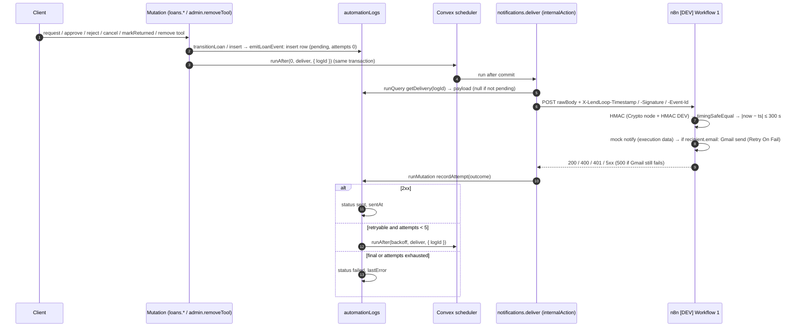

# Loan Notifications — n8n Workflow 1: Signed Webhook (DEV)

## Overview

Whenever a loan is **created** or its **status changes**, Convex records a notification event and sends it to n8n as an **HMAC-signed webhook**. n8n verifies the signature and timestamp, then notifies the relevant user in two ways: it **always writes a logged mock notification** (the message in the execution data) and it **sends a real email through Gmail** when the recipient has an email address. Delivery is:

- **Transactional**: the event is recorded and scheduled inside the same mutation that changes the loan, so an event exists only if that change commits
- **Idempotent**: one `automationLogs` row per `(loan, event)`, guarded by a unique idempotency key. A `sent` row is never sent again. Convex is the single dedupe point; n8n receives the `eventId` for traceability (Decision 8)
- **Retried** with exponential backoff on network errors, timeouts, 404, 408, 429 and 5xx responses
- **Visible when it fails**: the row ends `failed` with a short error code, Convex logs one line per attempt, and n8n keeps failed executions



Targets the **DEV environment** (Convex dev, n8n `[DEV]` workflow, `HMAC DEV` credential). The schema and functions reach Convex **prod** on the next `main` push **without** `N8N_*` env vars. In PROD every event is then logged `failed` / `not_configured` and no user flow breaks (see *PROD Impact*).

## Prerequisites

### Already done (see `context/current-feature.md` → *History*)

- `loans` with `transitionLoan(ctx, loan, to, extra)` in `convex/lib/loans.ts`, the **only writer of `status`**. Creation happens only in `loans.request` (`ctx.db.insert("loans", …)`).
- Transitions (`LOAN_TRANSITIONS`): `pending → approved | rejected | cancelled`, `approved → returned`. Terminal states have no exits, so a loan enters each status **at most once**.
- Auto-rejections run through `transitionLoan(…, "rejected", { closeReason })`:
  - `rejectOverlappingPending`, called by `loans.approve` with `period_taken`: at most `MAX_AUTO_CLOSE = 500` per approve
  - `closeLoansForRemovedTool`, called by `deactivateTool` with `tool_removed`: loops over batches of 500 until no pending request is left. `deactivateTool` is reached from `tools.remove` (owner) and `admin.removeTool` (admin).
- `deactivateTool` patches `removedAt` / `removedBy` **after** closing the loans in the same transaction. The tool doc read by the action (after commit) therefore already has `removedBy`.
- `publicUser(user)` returns `{ _id, name, isTrustedLender }`, and `missingPublicUser` is the fallback. Email is display-only and never returned about other users.
- Carry-over from schema-rbac: actions never call `requireUser`. They go through internal queries/mutations.
- Errors: `ConvexError` codes `UNAUTHENTICATED` / `FORBIDDEN` / `NOT_FOUND` / `INVALID_ARGUMENT` / `CONFLICT`.
- Tests: `convex-test` 0.0.69 + Vitest 5 with `environment: "edge-runtime"`. The loans/admin suites fake **only `Date`** (`vi.useFakeTimers({ toFake: ["Date"] })`). Fixtures are in `convex/loans.test.ts`, and there is an existing 505-pending removal test (`MAX_AUTO_CLOSE + 5`).
- Versions: `convex` 1.49.0 (installed), `convex-test` 0.0.69, `next` 16.4.6. No Convex component is installed (no `convex/convex.config.ts`). There is no `@convex-dev/*` package.
- `.env.example` already says `N8N_WEBHOOK_URL` / `N8N_WEBHOOK_SECRET` live in Convex env vars.
- `.claude/agents/webhook-auditor.md` holds the audit criteria (signing over the raw body, header names like `X-LendLoop-Signature` / `X-LendLoop-Timestamp`, internalAction, retries + final failure recorded, event id for dedupe, no secrets in exports).

### User prerequisites (before `/feature load loan-notifications`)

See *Manual Steps (User) → Before implementation*. In short:

1. An **n8n Cloud** account (a trial is enough)
2. A random secret and the **Crypto credential `HMAC DEV`**
3. A **dedicated Gmail account for LendLoop** (e.g. `lendloop.notificacoes@gmail.com`, never a personal account) and the n8n **Gmail OAuth2 credential `Gmail DEV`** connected to it ("Sign in with Google", managed OAuth on n8n Cloud)
4. The **`[DEV]` Workflow 1**, built from the guide and **published** (production URL active)
5. `N8N_WEBHOOK_URL` and `N8N_WEBHOOK_SECRET` set in Convex **DEV** env

The Convex code can be implemented and unit-tested before steps 3–4 (tests mock `fetch`). The end-to-end check needs all five.

## Requirements

- Emit one event per loan creation and per status change, including auto-rejections (`period_taken`, `tool_removed`) from approve, owner removal and admin removal
- Schedule delivery in the same mutation (`ctx.scheduler.runAfter(0, internal…)`)
- Event shape: `eventId`, `idempotencyKey`, `type`, `occurredAt`, loan facts, tool name, `recipient` (`publicUser` + its own `email`, or `null`) and `counterpart` (`publicUser` only, never an email). No `tokenIdentifier`.
- Sign with HMAC-SHA256 (`N8N_WEBHOOK_SECRET`) over `timestamp + "." + rawBody`. Send the signature, timestamp and event id headers.
- Retry with backoff. A missing env var is logged as a failure and never breaks a user mutation.
- `automationLogs` table (`kind: "notification"` now, room for `"reminder"`) with a unique idempotency key, per-loan and per-status indexes, and writes only through internal functions
- n8n `[DEV]` workflow: raw body, Crypto-node HMAC with the `HMAC DEV` credential, constant-time compare, replay window, mock notify (always) + Gmail email (when the recipient has an email) with *Retry On Fail*, explicit response codes. Export it to `n8n/workflows/` with no secrets.
- convex-test coverage (see *Testing*). webhook-auditor reports no critical/high findings.

## Decisions

| # | Topic | Options considered | Decision and why |
|---|---|---|---|
| 1 | **Event granularity for batch auto-rejections** | (a) One event per loan (each auto-rejected request is its own `loan.rejected` event); (b) one grouped event per batch (`loan.batch_rejected` with N recipients); (c) no events for system auto-rejections | **(a), with a per-transaction budget.** Each auto-rejected request has a **different borrower** who needs their own message. One row per loan also maps 1:1 to the per-loan activity of bonus F ("Notification sent 2 min ago"). (b) would push fan-out, per-recipient dedupe and partial-failure handling into n8n, and one bad recipient would retry the whole group. (c) leaves borrowers with silently rejected requests. **Scheduler limit:** a mutation may schedule at most **1,000** functions (Convex limits). Each event schedules one `deliver`. An approve emits at most 1 + 500 events (`MAX_AUTO_CLOSE`). A tool removal loops with no upper bound, so `closeLoansForRemovedTool` counts its events and, past `MAX_EVENTS_PER_TRANSACTION = 900`, still inserts the row but marks it `failed` / `event_budget` without scheduling it. That is visible, never silent, and never breaks the removal. Realistically this never triggers: a neighborhood tool with 900 pending requests is not a real case, and the existing 505-pending test stays under budget. Writes per event = loan patch + log insert + scheduled job, so 505 × 3 is far below the 16,000-writes-per-transaction limit. |
| 2 | **Recipients** | (a) Only the "other" party of each event; (b) both parties on every event | **(a) — notify whoever did not act.** `requested` → lender. `approved` / `rejected` (manual or auto) → borrower. `cancelled` → lender. `returned` → borrower (closure receipt; the lender clicked it). The actor already sees the result in the UI, and (b) doubles executions (n8n counts every execution) for no information. Each event has **exactly one recipient**, so one row = one notification. |
| 3 | **Channel and PII** (decided with the user) | (a) Logged mock notification only, payload with `publicUser` only; (b) **Gmail email + logged mock record**, with `recipient.email` in the payload; (c) SMTP through a transactional provider (Resend, Brevo); (d) shared Slack/Discord channel; (e) n8n fetches the email through a signed Convex endpoint | **(b) — chosen by the user.** The overview allows "email, Slack, Discord or a logged mock notification". The user wants to **receive** the notification, and the mock alone delivers nothing. Mock + Gmail keeps both: the mock record is always written in the execution data (proof and fallback for users without email), and Gmail delivers to the inbox. **PII:** coding-standards says "no emails/PII unless required". With email as the channel, the recipient's address **is required**, so the payload carries **only the recipient's own email** (`recipient.email`, `null` when the user has none), never the counterpart's. The cost is that the address stays in n8n execution history (third-party storage, retained by plan), which is accepted and documented. **Sender:** a **dedicated Gmail account for LendLoop**, never a personal account. The Gmail node sends *as* the connected account (From address, *Sent* folder, replies), so a dedicated account keeps the personal inbox out of it and isolates any spam/block problem. The **same account** serves DEV and PROD, through two separate n8n credentials (`Gmail DEV` / `Gmail PROD`, same pattern as `HMAC DEV` / `HMAC PROD`: reconnecting or revoking one never touches the other). DEV subjects start with `[DEV]` so both environments are distinguishable in the inbox. Sending limits are shared (personal Gmail ≈ 500/day), which is plenty for a neighborhood. (c) needs a custom domain (the app runs on `*.vercel.app`). (d) posts neighbors' names and loans to a channel everyone reads. (e) avoids putting the email in the payload, but it adds an n8n → Convex endpoint that belongs to the next spec, and the email would still end up in n8n's execution data once fetched. Managed OAuth ("Sign in with Google") works on n8n Cloud without a Google Cloud project. |
| 4 | **Signature scheme** | (a) Stripe-style: `HMAC-SHA256(secret, timestamp + "." + rawBody)`, hex, header `v1=<hex>`, separate timestamp header; (b) Standard Webhooks: `id.timestamp.body`, base64, `webhook-*` headers, `v1,<b64>`; (c) HMAC over the body only (no timestamp) | **(a).** It binds the timestamp to the exact raw body (replay protection, which (c) lacks) and matches the webhook-auditor criteria and header naming. **Hex** is what the n8n Crypto node outputs (HEX/BASE64 both supported) and what the auditor expects. The event id is **inside the signed body**, so leaving it out of the signed prefix ((b)'s `id.` part) loses nothing. The id header is a convenience copy that n8n uses only after verification. Version prefix `v1=` allows rotation (several space-separated signatures, as Stripe and Standard Webhooks do). Only one is sent now. Tolerance is **300 s** (Stripe's default; Standard Webhooks leaves it to the receiver). The secret is **≥ 32 random bytes as a 64-char hex string**, used as **UTF-8 key bytes on both sides**. The n8n Crypto credential's *Hmac Secret* is a plain string, so Convex must do `TextEncoder().encode(secret)` and must **not** hex/base64-decode it. Otherwise the two HMACs differ. |
| 5 | **Runtime** | (a) Default Convex runtime: `fetch`, `crypto.subtle` (Web Crypto), `TextEncoder`, `setTimeout`/`AbortController`; (b) `"use node"` + `node:crypto` | **(a).** The Convex runtime docs list `crypto`, `CryptoKey`, `SubtleCrypto`, `TextEncoder` and `fetch` (in actions). There are no cold starts, and the action can live in a normal file next to its internal query/mutation (a `"use node"` file can't define queries/mutations). `crypto.subtle.verify("HMAC", …)` also gives a **constant-time** comparison for the reusable verifier (Decision 4 / *Hooks*). (b) buys nothing here. **Timeout:** Convex documents no per-`fetch` timeout (only the action limit: 10 min on the actions page, 30 min in the limits table for the Convex runtime, see *Doc Conflicts*). The action wraps `fetch` with an `AbortController` + `setTimeout(15_000)`, cleared in `finally` (Standard Webhooks recommends 15–30 s). |
| 6 | **Retry mechanism** | (a) Manual: `deliver` reports each outcome to an `internalMutation` that increments `attempts` and **re-schedules** `deliver` with `runAfter(backoff)`; (b) `@convex-dev/action-retrier` component; (c) `@convex-dev/workpool` component (queue + parallelism + retries + `onComplete`) | **(a) — no new npm package, no Convex component.** Convex: scheduled actions run **at most once** and are **never retried automatically**. The documented pattern is "schedule a mutation that checks whether the outcome was achieved and, if not, schedules the action again", which is exactly (a). Because the reschedule happens inside a mutation, the attempt counter and the next attempt commit atomically. Our backoff (minutes, Stripe/Standard-Webhooks style) and status classification (2xx / retryable / final) live in one tested function. (b) retries only on **thrown** errors (we'd have to throw on non-2xx). Its defaults (250 ms × 2ⁿ, 4 failures ≈ 4 s total) are too short for an n8n outage. It needs `convex.config.ts`, a new package, component registration in convex-test, and still an `onComplete` mutation to write our log, so it's more moving parts for the same result. (c) adds what we don't need yet: a parallelism cap (`maxParallelism`, ≤ 20 on the free plan across pools) for bursts like a 500-request auto-reject. It is the **upgrade path** if bursts ever hit n8n rate limits. Today the scheduler already caps concurrent jobs (8 on Free/Starter) and 429/5xx are retryable. **Schedule:** `MAX_ATTEMPTS = 5` (1 initial + 4 retries). Delays after failure n: `[30 s, 2 min, 10 min, 30 min]` ±20 % jitter (≈ 42 min total), so a short n8n outage self-heals without burning many n8n executions. A `Retry-After` header (seconds form) on 429/503 is honored, taking the max of it and the backoff, capped at 30 min. |
| 7 | **Retryable vs final responses** | — | **2xx → `sent`.** **Retryable:** network error, timeout (abort), **404** (n8n returns 404 when the production webhook isn't registered, e.g. the workflow was unpublished, which is a recoverable ops state), **408**, **409**, **425**, **429**, **5xx** (n8n returns 500 when the workflow errors before *Respond to Webhook*). **Final (no retry):** **400**, **401**, **403**, **410**, **413**, **422** and any other 4xx. A 401 means a secret/clock mismatch, and resending the same payload with the same secret can't succeed. 410 means "stop sending" (Standard Webhooks). **3xx → final** (`redirect: "manual"`, never follow redirects with a signed body, per Standard Webhooks). Missing/invalid env vars → **final `not_configured`** without calling `fetch`. Unexpected exception inside the action → caught and recorded as **retryable `internal`**. |
| 8 | **Dedupe location** | (a) Convex only (row + key; never resend a `sent` row); (b) n8n only (Remove Duplicates across executions); (c) both | **(a) — Convex is the single dedupe point; delivery is at-least-once.** Convex prevents duplicate **events** (unique key) and never resends a `sent` row (`getDelivery` returns `null` unless `pending`). n8n's **Remove Duplicates → Remove Items Processed in Previous Executions** records the `eventId` *when the item passes the node*, before the email is sent. With Gmail as a real channel that is unsafe: if Gmail fails after the id was recorded, n8n returns 500, Convex retries, and the retry is dropped as a "duplicate" with a 200, so the row says `sent` while **no email went out** (a silent loss). n8n can only clear the **whole** history (*Clear Deduplication History*), not one id, so the record can't be undone on failure. Without n8n dedupe, the only duplicate left is "Gmail sent, but the 200 never reached Convex" (network drop or > 15 s response), which then sends a second identical email. A rare duplicate email is better than a silent lost one, and at-least-once with an event id is the standard webhook contract (Standard Webhooks, Stripe). The `eventId` still travels in the body and in `X-LendLoop-Event-Id`, so duplicates are traceable in n8n executions. **Upgrade path:** if duplicates ever matter, add a "delivered" check (n8n → Convex signed endpoint, next spec) before sending. |
| 9 | **Event emission point** | (a) Insert the log row + schedule in a helper called from `transitionLoan` and `loans.request`; (b) only schedule an action with `{ loanId, event }` (loans-spec hook sketch) and let the action create the log; (c) a separate "outbox" sweeper/cron | **(a) — transactional outbox row + immediate schedule.** The row is written in the same transaction as the status change. The event's existence, its idempotency key and its "pending" state are durable even if the scheduled action never runs (at-most-once). That makes it findable through `by_kind_status` for a future sweeper. (b) loses the event if the action dies before writing anything, and it lets two actions race on the same key. (c) adds a cron and latency. Not needed now; it's a hook for the error/reminders spec. |
| 10 | **`automationLogs` shape** | (a) Minimal draft (`loanId, kind, status, idempotencyKey, createdAt`); (b) + `event`, `recipientId`, `attempts`, `lastError`, `lastStatusCode`, `sentAt`, `nextAttemptAt`, `updatedAt`; (c) also store the payload/body | **(b).** `event` + `recipientId` let the bonus-F UI say *what* was sent to *whom* without rebuilding it. `attempts` / `lastError` / `nextAttemptAt` make failures and retries visible. (c) would persist names, dates and the recipient's email a second time and violate "no bodies in logs". The payload is **rebuilt** on each attempt from the loan/tool/users (same `eventId`, same `occurredAt`), so the body can differ only if a user renamed themselves between attempts, which doesn't matter (each attempt is signed separately). `occurredAt` replaces the draft's `createdAt`: it's the transition time, equal to `decidedAt` / `cancelledAt` / `returnedAt` (Convex's `_creationTime` stays the insert time). `lastError` holds **only a short code** (`http_503`, `timeout`, `network`, `not_configured`, `event_budget`, `internal`, `loan_missing`). Never a body, URL, header or secret. |
| 11 | **Owner notification on admin removal** (admin hook) | (a) New `listing.removed` event to the owner; (b) none | **(b) — out of scope.** It isn't a loan event (no loan, no `automationLogs.loanId`), and Workflow 1 is about loan requests. Borrowers of auto-rejected requests **are** notified, and their payload says `removedByModerator: true` when `tool.removedBy !== tool.ownerId`. |

## Event Catalog

`type` values (`LOAN_EVENT_TYPES` in `convex/lib/validators.ts`): `loan.requested`, `loan.approved`, `loan.rejected`, `loan.cancelled`, `loan.returned`. Mapping: creation → `loan.requested`, transition to status `s` → `loan.${s}`.

| Event | Trigger (code path) | Recipient | Counterpart | Extra payload fields |
|---|---|---|---|---|
| `loan.requested` | `loans.request` after `ctx.db.insert` | lender | borrower | — |
| `loan.approved` | `loans.approve` → `transitionLoan(…, "approved")` | borrower | lender | — |
| `loan.rejected` | `loans.reject` (manual) | borrower | lender | `closeReason: null` |
| `loan.rejected` | `loans.approve` → `rejectOverlappingPending` | borrower | lender | `closeReason: "period_taken"` |
| `loan.rejected` | `tools.remove` / `admin.removeTool` → `deactivateTool` → `closeLoansForRemovedTool` | borrower | lender | `closeReason: "tool_removed"`, `removedByModerator: boolean` |
| `loan.cancelled` | `loans.cancel` | lender | borrower | — |
| `loan.returned` | `loans.markReturned` | borrower | lender | — |

### Payload (`version: 1`), the **only** fields sent

```jsonc
{
  "version": 1,
  "eventId": "<automationLogs _id>",              // stable across retries
  "idempotencyKey": "notification:<loanId>:loan.approved",
  "type": "loan.approved",
  "occurredAt": "2026-11-13T12:00:00.000Z",       // ISO from automationLogs.occurredAt
  "loan": {
    "id": "<loanId>",
    "startDate": "2026-11-14",                    // YYYY-MM-DD, inclusive
    "endDate": "2026-11-16",
    "closeReason": null,                          // "period_taken" | "tool_removed" | null (only meaningful on loan.rejected)
    "removedByModerator": false                   // true only when closeReason = tool_removed and removedBy ≠ ownerId
  },
  "tool": { "name": "Drill" },
  "recipient":   { "_id": "<usersId>", "name": "Bob",   "isTrustedLender": false, "email": "bob@example.com" }, // email: string | null
  "counterpart": { "_id": "<usersId>", "name": "Alice", "isTrustedLender": true }                                // never an email
}
```

`recipient.email` is the recipient's own `users.email` (from the Clerk claim, synced by `users.store`), or `null` when missing (e.g. phone-only sign-up). In that case n8n writes only the mock record. Convex does not validate the address format: Gmail rejects invalid addresses, and that rejection takes the failure path.

Excluded on purpose: the counterpart's email, `tokenIdentifier`, `role`, tool description/condition/category, `borrowerId`/`lenderId` as separate fields (the parties are `recipient` / `counterpart`), the loan's current `status` (the `type` says it), and any URL. `JSON.stringify` of an object built with fixed key order. The **exact string** that is signed is the string sent as the body.

## Signature Spec

| Item | Value |
|---|---|
| Algorithm | HMAC-SHA256, key = `TextEncoder().encode(N8N_WEBHOOK_SECRET)` (UTF-8 bytes of the env var, **not** decoded) |
| Signed string | `` `${timestamp}.${rawBody}` ``. `timestamp` = integer Unix **seconds** at send time (each attempt re-signs with a new timestamp). `rawBody` = the exact UTF-8 body bytes |
| Encoding | lowercase **hex** (64 chars) |
| Headers | `Content-Type: application/json` · `User-Agent: LendLoop-Webhooks/1` · `X-LendLoop-Event-Id: <eventId>` · `X-LendLoop-Timestamp: <seconds>` · `X-LendLoop-Signature: v1=<hex>` (space-separated list allowed for future rotation; one value today) |
| Tolerance | `SIGNATURE_TOLERANCE_SEC = 300`, rejected when \|now − timestamp\| > 300 (both directions, for clock skew) |
| Request | `POST`, `redirect: "manual"`, 15 s timeout (`AbortController`) |

**Verification on the n8n side (order matters):**

1. Read `x-lendloop-timestamp` and `x-lendloop-signature` (n8n lowercases headers) and the **raw body** (binary from the Webhook node's *Raw Body* option). Never re-serialize the parsed `$json.body`, because `JSON.stringify` of a parsed object is not guaranteed byte-identical.
2. Missing header, non-integer timestamp or no `v1=` value → **401**.
3. Compute `expected = HMAC-SHA256_hex(HMAC DEV, timestamp + "." + rawBody)` with the **Crypto node** (the secret stays in the credential).
4. Compare `"v1=" + expected` with each provided signature using **`crypto.timingSafeEqual`** on equal-length `Buffer`s (check the length first, because `timingSafeEqual` throws on different lengths). No match → **401**.
5. \|now − timestamp\| > 300 s → **401** (replay / stale).
6. Only now `JSON.parse(rawBody)`. If `version !== 1` or `eventId` / `type` / `recipient` is missing → **400**.
7. Mock record → Gmail (if `recipient.email`) → **200**. If Gmail still fails after its own retries → **500** (Convex retries; Decision 8).

Responses carry only a short JSON body (`{"ok":true}` / `{"error":"invalid signature"}` / `{"error":"bad request"}`). They never say which check failed beyond that, and never echo the signature.

**Convex helper (`convex/lib/hmac.ts`, reused by the next spec for n8n → Convex):**

```ts
export async function hmacSha256Hex(secret: string, message: string): Promise<string>;
export async function signWebhook(secret: string, timestampSec: number, rawBody: string): Promise<string>; // "v1=<hex>"
/** Constant-time (crypto.subtle.verify). False on malformed header, wrong signature, or |now−ts| > tolerance. */
export async function verifyWebhookSignature(args: {
  secret: string; rawBody: string; timestampHeader: string | null; signatureHeader: string | null;
  nowSec: number; toleranceSec?: number;
}): Promise<boolean>;
```

`verifyWebhookSignature` parses `v1=<hex>` entries, hex-decodes them (invalid hex → false) and calls `crypto.subtle.verify("HMAC", key, sigBytes, data)`. Web Crypto's verify is the constant-time comparator, so there is no `===` on signature strings anywhere. Not used by any HTTP action in this spec. It is built and tested now so the reminders spec (n8n → Convex) reuses one implementation.

## Data Model

```ts
// convex/lib/validators.ts (additions)
export const LOAN_EVENT_TYPES = [
  "loan.requested", "loan.approved", "loan.rejected", "loan.cancelled", "loan.returned",
] as const;
export const loanEventTypeValidator = v.union(...LOAN_EVENT_TYPES.map((t) => v.literal(t)));
// The reminders spec appends "reminder" (adding a literal is a safe schema push).
export const AUTOMATION_KINDS = ["notification"] as const;
export const automationKindValidator = v.union(...AUTOMATION_KINDS.map((k) => v.literal(k)));
export const AUTOMATION_STATUSES = ["pending", "sent", "failed"] as const;
export const automationStatusValidator = v.union(...AUTOMATION_STATUSES.map((s) => v.literal(s)));
```

```ts
// convex/schema.ts (addition)
// Written ONLY by internal functions (emitLoanEvent helper inside mutations, notifications.recordAttempt).
automationLogs: defineTable({
  loanId: v.id("loans"),
  kind: automationKindValidator,
  // required for kind "notification"; the reminders spec may make it optional (safe push)
  event: loanEventTypeValidator,
  recipientId: v.id("users"),
  // unique per row, checked inside the inserting mutation (Convex has no unique constraint)
  // notification: `notification:${loanId}:${event}`
  idempotencyKey: v.string(),
  status: automationStatusValidator,
  attempts: v.number(),                       // HTTP attempts made (0 while the first is scheduled)
  lastError: v.optional(v.string()),          // short code only: http_<code> | timeout | network | not_configured | event_budget | internal | loan_missing
  lastStatusCode: v.optional(v.number()),
  occurredAt: v.number(),                     // epoch ms of the loan event (same transaction)
  updatedAt: v.number(),
  nextAttemptAt: v.optional(v.number()),      // set while a retry is scheduled
  sentAt: v.optional(v.number()),
})
  .index("by_idempotency_key", ["idempotencyKey"])
  .index("by_loan", ["loanId"])              // bonus F: activity per loan, newest via .order("desc")
  .index("by_kind_status", ["kind", "status"]), // failures / stuck pending (sweeper or admin view later)
```

**Status transitions** (only `recordAttempt` changes `status` after insert):

```
insert ──► pending ──2xx──────────────────────────────► sent      (sentAt, lastStatusCode)
              │  ──retryable, attempts < 5──► pending (attempts++, lastError, nextAttemptAt, re-scheduled)
              │  ──final / attempts = 5 ───► failed   (attempts++, lastError)
insert ──► failed   (event_budget: over MAX_EVENTS_PER_TRANSACTION, never scheduled)
```

`sent` and `failed` are terminal. `recordAttempt` on a non-`pending` row is a no-op. There is **no manual resend** in this spec (failed rows stay failed; *Hooks*).

Schema-evolution safety: a new table + 3 indexes is a safe push (no migration). `loans` / `tools` / `users` are unchanged.

## Convex Functions

New file `convex/notifications.ts` (default runtime, **no** `"use node"`). **No public functions**: `api.notifications` must not exist.

| Function | Type | Caller | Args | Returns |
|---|---|---|---|---|
| `notifications.deliver` | `internalAction` | scheduler (from `emitLoanEvent` and `recordAttempt`) | `{ logId: v.id("automationLogs") }` | `v.null()` |
| `notifications.getDelivery` | `internalQuery` | `deliver` | `{ logId }` | `null` (row missing / not `pending`) or `{ attempts: number, payload: NotificationPayload }`. The only place that reads `users.email`, and only for the row's `recipientId`. If the loan or tool is missing, it returns `{ attempts, payload: null }` and the action records final `loan_missing` |
| `notifications.recordAttempt` | `internalMutation` | `deliver` | `{ logId, outcome: v.union(v.object({ kind: v.literal("sent"), statusCode: v.number() }), v.object({ kind: v.literal("retry"), code: v.string(), statusCode: v.optional(v.number()), retryAfterMs: v.optional(v.number()) }), v.object({ kind: v.literal("final"), code: v.string(), statusCode: v.optional(v.number()) })) }` | `v.null()`. Patches the row and, on `retry` with `attempts + 1 < MAX_ATTEMPTS`, `ctx.scheduler.runAfter(delay, internal.notifications.deliver, { logId })` |

Helpers (plain functions, not registered):

| Helper | File | Responsibility |
|---|---|---|
| `emitLoanEvent(ctx: MutationCtx, loan: Doc<"loans">, event: LoanEventType, opts?: { schedule?: boolean }): Promise<void>` | `convex/lib/notifications.ts` | Computes the recipient (`recipientFor(event, loan)`) and the key. Returns early if `by_idempotency_key` already has the key (idempotent). Inserts `pending` (or `failed` / `event_budget` when `schedule === false`) with `occurredAt = Date.now()`, then `ctx.scheduler.runAfter(0, internal.notifications.deliver, { logId })` |
| `recipientFor(event, loan)` / `counterpartFor(event, loan)` | same | Pure mapping from the *Event Catalog* |
| `buildPayload(log, loan, tool, recipient, counterpart)` | same | Pure; produces exactly the documented keys (`recipient` = `publicUser` + `email ?? null`; `counterpart` = `publicUser` only) |
| `classifyResponse(status: number \| "timeout" \| "network", retryAfter?: string \| null)` | same | Pure; → `sent` / `retry` / `final` per Decision 7 |
| `retryDelayMs(attempts: number, random: number, retryAfterMs?: number)` | same | Pure; backoff table ±20 % jitter, `Retry-After` max, 30 min cap (`random` injected for tests) |
| `readWebhookConfig()` | same | `process.env.N8N_WEBHOOK_URL` / `N8N_WEBHOOK_SECRET`. Returns `null` when missing, URL not `https://`, or secret shorter than 32 chars. Never logs values |
| `hmacSha256Hex`, `signWebhook`, `verifyWebhookSignature` | `convex/lib/hmac.ts` | See *Signature Spec* |

Constants in `convex/lib/automationRules.ts`: `MAX_ATTEMPTS = 5`, `RETRY_DELAYS_MS = [30_000, 120_000, 600_000, 1_800_000]`, `RETRY_JITTER = 0.2`, `MAX_RETRY_AFTER_MS = 1_800_000`, `WEBHOOK_TIMEOUT_MS = 15_000`, `SIGNATURE_TOLERANCE_SEC = 300`, `MAX_EVENTS_PER_TRANSACTION = 900`, `MIN_SECRET_LENGTH = 32`.

**Hook changes (minimal):**

```ts
// convex/lib/loans.ts
export async function transitionLoan(ctx, loan, to, extra = {}, opts: { notify?: boolean } = {}) {
  // ...existing checks + patch (unchanged)...
  await emitLoanEvent(ctx, { ...loan, status: to, ...extra }, `loan.${to}`, { schedule: opts.notify !== false });
}
// closeLoansForRemovedTool: counts transitions across batches;
// passes { notify: count < MAX_EVENTS_PER_TRANSACTION }

// convex/loans.ts → request
const loanId = await ctx.db.insert("loans", { ... });
await emitLoanEvent(ctx, (await ctx.db.get(loanId))!, "loan.requested");
return loanId;
```

`approve`: `transitionLoan(approved)` + `rejectOverlappingPending` emit ≤ 501 events. No counter is needed there (documented in a comment).

**`deliver` outline** (< 50 lines, every exception caught):

```ts
handler: async (ctx, { logId }) => {
  const delivery = await ctx.runQuery(internal.notifications.getDelivery, { logId });
  if (delivery === null) return null;                       // already sent/failed or gone
  const record = (outcome) => ctx.runMutation(internal.notifications.recordAttempt, { logId, outcome });
  if (delivery.payload === null) return await record({ kind: "final", code: "loan_missing" });
  const config = readWebhookConfig();
  if (config === null) { console.warn(`notifications.deliver: ${logId} not_configured`); return await record({ kind: "final", code: "not_configured" }); }
  const body = JSON.stringify(delivery.payload);
  const ts = Math.floor(Date.now() / 1000);
  const signature = await signWebhook(config.secret, ts, body);
  // fetch with AbortController(15 s), redirect "manual", headers per Signature Spec
  // → classifyResponse → console.log(`notifications.deliver: ${logId} attempt ${n} -> ${code}`) → record(outcome)
  // catch (unexpected): record({ kind: "retry", code: "internal" })
}
```

Log lines contain only `logId`, attempt number, outcome code and delay. Never the URL, secret, signature, body, names or email addresses.

## n8n `[DEV]` Workflow 1 — Build Guide

**Name:** `[DEV] LendLoop — Loan notifications (WF1)` · **Credentials:** `HMAC DEV` (type **Crypto**, field *Hmac Secret* = the same string as Convex DEV `N8N_WEBHOOK_SECRET`) and `Gmail DEV` (type **Gmail OAuth2**, connected to the dedicated LendLoop Gmail account) · **Export:** `n8n/workflows/loan-notifications.dev.json`

| # | Node | Settings |
|---|---|---|
| 1 | **Webhook** "LendLoop event" | HTTP Method `POST`. Path: keep the generated random path. Authentication `None` (HMAC is the auth; Header Auth would put a second secret in n8n with no extra protection). **Respond: `Using 'Respond to Webhook' Node`**. Options: **Raw Body = ON**. Optional: *Ignore Bots* ON |
| 2 | **Code** "Prepare signed string" (JavaScript, *Run Once for All Items*) | `const raw = (await this.helpers.getBinaryDataBuffer(0, 'data')).toString('utf8');` (verify the binary property name in node 1's output → *Binary* tab during the build; `data` is the default). Reads `$json.headers['x-lendloop-timestamp']` / `['x-lendloop-signature']`. Outputs `{ timestamp, signatureHeader, signedPayload: timestamp + '.' + raw, rawBody: raw }`. **No secret here** |
| 3 | **Crypto** "HMAC" | Action **Hmac**. Binary File OFF. Value `{{ $json.signedPayload }}`. Type **SHA256**. Encoding **HEX**. Property Name `expectedHex`. Credential **`HMAC DEV`** |
| 4 | **Code** "Verify" | `const { timingSafeEqual } = require('crypto');` (n8n Cloud allows the built-in `crypto` module in the Code node). Steps 2, 4, 5, 6 of *Verification on the n8n side*. Output `{ valid: boolean, status: 200 \| 400 \| 401, event?: parsedBody }`. Never outputs the expected signature |
| 5 | **Switch / IF** "Valid?" | `status === 401` → node 5a. `status === 400` → node 5b. Else → node 6 |
| 5a | **Respond to Webhook** "401" | Respond With JSON `{"error":"invalid signature"}`, Response Code **401** |
| 5b | **Respond to Webhook** "400" | JSON `{"error":"bad request"}`, Response Code **400** |
| 6 | **Code** "Mock notify" | Builds the message from the verified event and outputs `{ channel: "mock", eventId, type, recipientId, to: recipient.email, subject, text }`. `subject` and `text` come from a small template map keyed by `type` (see *Message templates*), with the `[DEV]` prefix on `subject`. This item is the **logged mock notification** visible in the execution data, written for **every** event, with or without email. No external call, so it can't fail on transient errors |
| 7 | **IF** "Has email?" | `{{ $json.to }}` is not empty → node 8. Otherwise → node 9 (mock record only) |
| 8 | **Gmail** "Send email" | Credential **`Gmail DEV`**. Resource **Message**, Operation **Send**. To `{{ $json.to }}`. Subject `{{ $json.subject }}`. Email Type **Text**. Message `{{ $json.text }}`. Options: **Sender Name** `LendLoop`, **Append n8n attribution OFF**. Settings: **Retry On Fail ON**, Max Tries **3**, Wait Between Tries **2000 ms**. On Error **Stop Workflow** (default): a final Gmail failure ends the execution before *Respond to Webhook*, so n8n returns **500** and Convex retries |
| 9 | **Respond to Webhook** "200" | Reached from node 8 (success) **and** from node 7's false branch. JSON `{"ok":true}`, Response Code **200** |

**Message templates (node 6), plain text, English like the app UI:**

| `type` | Subject | Text |
|---|---|---|
| `loan.requested` | `[DEV] {counterpart} wants to borrow your {tool}` | `Hi {recipient}, {counterpart} asked to borrow your {tool} from {start} to {end}. Open LendLoop → Incoming requests to approve or reject.` |
| `loan.approved` | `[DEV] Your request for {tool} was approved` | `Hi {recipient}, {counterpart} approved your request for {tool} ({start} → {end}).` |
| `loan.rejected` | `[DEV] Your request for {tool} was not approved` | default: `{counterpart} rejected your request…`; `period_taken`: `…those dates were given to another neighbor.`; `tool_removed`: `…the listing was removed` + ` by a moderator` when `removedByModerator` |
| `loan.cancelled` | `[DEV] {counterpart} cancelled a request for your {tool}` | `Hi {recipient}, {counterpart} cancelled the request for {tool} ({start} → {end}).` |
| `loan.returned` | `[DEV] {tool} marked as returned` | `Hi {recipient}, {counterpart} confirmed that {tool} was returned. Thanks for borrowing responsibly!` |

The `[PROD]` copy removes the `[DEV]` prefix. No link to the app is required (optional: the deployment URL as plain text). No HTML, so no user-provided text is ever interpreted as markup. Names and tool names are plain strings in a text email.

**Workflow settings:** *Save successful production executions* = **Save** (so the mock notification and the verified signature stay visible). *Save failed production executions* = **Save**. *Error workflow*: none yet. The next spec builds `[DEV] Error handler` and sets it here. **Publish/activate** the workflow and copy the **Production URL** (not the Test URL) into Convex `N8N_WEBHOOK_URL`.

**Retries on the n8n side:** only the **Gmail** node calls an external service, so only it has *Retry On Fail* (3 tries, 2 s apart; n8n caps it at 5 tries / 5 s, so this covers short blips only). Longer outages are covered by **Convex** (backoff up to ~42 min). Nodes 2–7 are local and deterministic. Gmail's total retry time (≈ 4 s + send time) stays well under Convex's 15 s timeout.

**What is visible today if n8n fails:** a node error before *Respond to Webhook* (including a Gmail failure after its 3 tries) → n8n returns **500** → Convex retries and finally marks `failed` / `http_500`. Both are visible: n8n *Executions* (failed, saved) and Convex *Data* → `automationLogs` (`by_kind_status`) + *Logs* (`notifications.deliver: … -> http_500`). An unpublished workflow → **404** → retried, then `failed` / `http_404`. Wrong secret → **401** → `failed` / `http_401` immediately. There is **no alerting** yet. The error workflow (next spec) adds it on the n8n side.

**Export rules (`n8n/workflows/loan-notifications.dev.json`):** download from the canvas menu → *Download*. Before committing:

- `credentials` blocks contain only `{ id, name: "HMAC DEV" }` and `{ id, name: "Gmail DEV" }` (n8n exports names + ids, never values or OAuth tokens)
- **no `pinData`**: remove pinned executions, which would contain real names, dates and **email addresses**
- no email address hardcoded in any node (the Gmail `To` is the `{{ $json.to }}` expression; the sender comes from the credential)
- no secret, no signature, no example request with headers anywhere in node parameters, notes or sticky notes
- the webhook **path** is allowed (it isn't a secret; HMAC is the protection)
- the file is reviewed by webhook-auditor

**Trial budget:** every delivery attempt that reaches n8n is one execution, including 401s. The Gmail node's internal retries happen inside one execution. Third-party sources put the n8n Cloud trial at ~14 days / 1,000 executions (unconfirmed on n8n's own pricing page). The manual checks below use < 30. Avoid load-testing auto-rejects against the real webhook. That's covered by unit tests with mocked `fetch`.

## Failure Handling

| Situation | Classified as | Logged as | Visible where (today) |
|---|---|---|---|
| 2xx (email sent, or mock record only when the recipient has no email) | sent | `status: sent`, `sentAt`, `lastStatusCode` | `automationLogs`, n8n Executions, recipient's inbox |
| Gmail fails 3× inside n8n (quota, revoked credential, Google outage, invalid address) | n8n returns 500 → retry | `http_500` → finally `failed` | n8n Executions (failed at "Send email"), `automationLogs`, Convex Logs. A revoked/expired `Gmail DEV` credential fails **every** event until reconnected |
| 200 lost after Gmail sent (network / > 15 s) | retry → **duplicate email** | `sent` on a later attempt | Two n8n executions with the same `eventId` (accepted, Decision 8) |
| network error / timeout (15 s) / 404 / 408 / 409 / 425 / 429 / 5xx | retry (≤ 5 attempts) | `pending`, `attempts`, `lastError: network \| timeout \| http_<code>`, `nextAttemptAt` → finally `failed` | `automationLogs`, Convex Logs (one line per attempt), n8n Executions (5xx) |
| 3xx / 400 / 401 / 403 / 410 / 413 / 422 / other 4xx | final | `failed`, `lastError: http_<code>` | `automationLogs`, Convex Logs |
| `N8N_WEBHOOK_URL` / `N8N_WEBHOOK_SECRET` missing or invalid | final, no fetch | `failed`, `not_configured` + `console.warn` | `automationLogs`, Convex Logs |
| over `MAX_EVENTS_PER_TRANSACTION` in one removal | never scheduled | `failed`, `event_budget` | `automationLogs` |
| loan/tool deleted before delivery (not possible today, defensive) | final | `failed`, `loan_missing` | `automationLogs` |
| unexpected exception in `deliver` | retry | `internal` | Convex Logs + `automationLogs` |
| `deliver` killed by the platform (at-most-once, no catch possible) | — | row stays `pending` with a stale `updatedAt` | Convex dashboard *Schedules* (failed) and `by_kind_status` = pending. The sweeper is a hook for a later spec |
| user mutation fails (validation / CONFLICT / OCC) | — | nothing: the insert and schedule roll back with it | — |

The user-facing mutation **never** awaits the network, so no delivery outcome can fail or slow `request` / `approve` / `remove`.

## Files to Create / Modify

| Path | Action | Responsibility |
|---|---|---|
| `convex/schema.ts` | modify | `automationLogs` table + 3 indexes |
| `convex/lib/validators.ts` | modify | `LOAN_EVENT_TYPES`, `AUTOMATION_KINDS`, `AUTOMATION_STATUSES` + validators/types |
| `convex/lib/automationRules.ts` | create | Constants (see *Convex Functions*) |
| `convex/lib/hmac.ts` | create | `hmacSha256Hex`, `signWebhook`, `verifyWebhookSignature` (Web Crypto, constant-time verify) |
| `convex/lib/hmac.test.ts` | create | Known vectors, sign/verify round trip, tamper/tolerance cases |
| `convex/lib/notifications.ts` | create | `emitLoanEvent`, `recipientFor`, `counterpartFor`, `buildPayload`, `classifyResponse`, `retryDelayMs`, `readWebhookConfig`, `NotificationPayload` type |
| `convex/notifications.ts` | create | `deliver` (internalAction), `getDelivery` (internalQuery), `recordAttempt` (internalMutation) |
| `convex/notifications.test.ts` | create | convex-test (see *Testing*) |
| `convex/lib/loans.ts` | modify | `transitionLoan` emits (+ `opts.notify`); `closeLoansForRemovedTool` event budget; update the "automation spec hooks here" comment |
| `convex/loans.ts` | modify | `request` emits `loan.requested` |
| `convex/loans.test.ts`, `convex/admin.test.ts`, `convex/tools.test.ts` | modify (only if needed) | Stub env vars to `""` and drain/ignore scheduled `deliver` runs so they never call real `fetch` (see *Testing notes*) |
| `n8n/workflows/loan-notifications.dev.json` | create (from the user's export) | Sanitized `[DEV]` export (see *Export rules*) |
| `context/project-overview.md` | modify | Data model: final `automationLogs` shape and indexes (`occurredAt` instead of `createdAt`; `kind` "reminder" added by the next spec); mark `automationLogs` implemented |
| `CLAUDE.md` | modify | *Secrets*: `N8N_WEBHOOK_URL` = **Production URL** of the `[DEV]`/`[PROD]` Workflow 1; `N8N_WEBHOOK_SECRET` = same string as the `HMAC DEV`/`HMAC PROD` *Hmac Secret*, ≥ 32 chars, used as UTF-8 (not decoded); Gmail access lives only in the n8n credentials `Gmail DEV` / `Gmail PROD` (same dedicated LendLoop account). *Environments* (n8n row): add `Gmail DEV` / `Gmail PROD` credentials and the WF1 name. *Environment rules*: add "changes to the `Gmail PROD` credential" to the NEVER list |
| `.env.example` | modify (comment only) | Next to the existing N8N note: "Convex DEV: `npx convex env set N8N_WEBHOOK_URL …`; must match the n8n `HMAC DEV` credential; never here" |

No new npm package, no Convex component, no `convex.config.ts`, no UI change, no `convex/http.ts`.

## Manual Steps (User)

### Before implementation

1. **n8n Cloud account**: sign up (trial). Note the instance URL.
2. **Generate the DEV secret** locally (it's printed once; don't paste it into any file or chat):
   ```powershell
   node -e "console.log(require('crypto').randomBytes(32).toString('hex'))"
   ```
3. **n8n → Credentials → New → "Crypto"** → name **`HMAC DEV`** → *Hmac Secret* = the generated string → Save.
4. **Dedicated Gmail account:** create a new Google account only for LendLoop (e.g. `lendloop.notificacoes@gmail.com`), with 2-step verification on. Don't use your personal account: emails are sent *as* this account (From, *Sent* folder, replies). The same account will serve PROD later.
5. **n8n → Credentials → New → "Gmail OAuth2 API"** → name **`Gmail DEV`** → **Sign in with Google** with the dedicated account → allow access → Save.
6. **Build `[DEV] LendLoop — Loan notifications (WF1)`** following the *Build Guide* (Claude can walk you through it node by node during `/feature start`). Save → **Publish/Activate** → copy the **Production URL** from the Webhook node.
7. **Convex DEV env vars** (from the project folder; DEV is the default target, **never** add `--prod`):
   ```powershell
   npx convex env set N8N_WEBHOOK_URL "https://<your-instance>.app.n8n.cloud/webhook/<path>"
   npx convex env set N8N_WEBHOOK_SECRET "<the generated string>"
   ```
   Or use the dashboard: Convex **dev** deployment → *Settings → Environment Variables*. Check with `npx convex env list` (DEV) that both names exist.

### After implementation (DEV, translation off, `npx convex dev` + `npm run dev` running)

Accounts: **A** (owns tools), **B** (borrower), **Admin**.

1. As **B**: request A's Drill → n8n *Executions*: one successful run. Node 4 output `valid: true`; node 6 ("Mock notify") shows the subject/text; node 8 ("Send email") succeeded. **A's inbox** receives `[DEV] B wants to borrow your Drill` from "LendLoop" (check *Spam* the first time and mark it "Not spam"). Convex *Data* → `automationLogs`: one row `loan.requested`, recipient = A, `status: sent`, `attempts: 1`.
2. As **A**: approve → B's inbox gets `[DEV] Your request for Drill was approved`. With a second overlapping pending request from Admin: Admin's request gets `loan.rejected` with `closeReason: period_taken`.
3. As **B**: request another tool, cancel → `loan.cancelled` to A. **A** marks an approved loan returned → `loan.returned` to B.
4. As **Admin**: remove a tool of A's with a pending request from B → B gets `loan.rejected`, `tool_removed`, `removedByModerator: true`. Owner removal → `removedByModerator: false`.
5. **Tampered signature** → expect **401** and a "401" branch execution in n8n:
   ```powershell
   $ts = [DateTimeOffset]::UtcNow.ToUnixTimeSeconds()
   curl.exe -s -o NUL -w "%{http_code}" -X POST "<Production URL>" -H "Content-Type: application/json" -H "X-LendLoop-Timestamp: $ts" -H "X-LendLoop-Signature: v1=deadbeef" -d "{}"
   ```
6. **Old timestamp with a valid signature** → expect **401** (set the secret only in this terminal session, then close it):
   ```powershell
   $env:HMAC_SECRET = "<the generated string>"
   node -e "const c=require('crypto');const ts=Math.floor(Date.now()/1000)-600;const b='{\"version\":1}';const s=c.createHmac('sha256',process.env.HMAC_SECRET).update(ts+'.'+b).digest('hex');console.log(ts,s)"
   # then curl with X-LendLoop-Timestamp = <ts>, X-LendLoop-Signature = v1=<s>, -d '{"version":1}'
   ```
7. **Wrong secret**: temporarily `npx convex env set N8N_WEBHOOK_SECRET "wrong-but-32-chars-long-xxxxxxxxxx"` → make a request → the row is `failed` / `http_401` after **1** attempt. Restore the real secret.
8. **Outage + recovery**: unpublish the workflow → make a request → the row stays `pending` with `lastError: http_404`, `attempts: 1`, `nextAttemptAt` ≈ +30 s. Republish within ~2 min → the next attempt turns it `sent`.
9. **Missing config**: `npx convex env remove N8N_WEBHOOK_URL` → make a request → the request itself succeeds in the UI, and the row is `failed` / `not_configured` (Convex Logs: one warn line without values). Set it back.
10. **Recipient without email** (optional, only if a test account has no email claim): the n8n run skips node 8, the mock record exists, the row is `sent`.
11. Check that **no** email ever contains the counterpart's address, and that the dedicated account's *Sent* folder shows only the expected messages.
12. Open `n8n/workflows/loan-notifications.dev.json` diff before commit: credential names only, no `pinData`, no email addresses.

## Implementation Steps (Claude)

All against **DEV**. Re-check `convex-test` scheduling helpers and the Convex runtime APIs with Context7 while implementing.

1. Branch `feature/loan-notifications` from `main`.
2. `validators.ts`, `automationRules.ts`, `schema.ts` (`automationLogs`); let the running `npx convex dev` push it.
3. `convex/lib/hmac.ts` + `hmac.test.ts` (known vectors first).
4. `convex/lib/notifications.ts` (pure helpers + `emitLoanEvent`), `convex/notifications.ts`.
5. Hooks: `transitionLoan`, `closeLoansForRemovedTool` budget, `loans.request`.
6. `convex/notifications.test.ts`. Adjust existing suites so scheduled `deliver` runs don't hit real `fetch`. `npm run test:run`.
7. Guide the user through *Before implementation* steps 3–7 if not done yet. Run DEV end-to-end checks (*After implementation*).
8. Receive the user's n8n export, sanitize/check it, and save it as `n8n/workflows/loan-notifications.dev.json`.
9. Docs: `project-overview.md`, `CLAUDE.md`, `.env.example` comment.
10. `npm run lint`, `npm run test:run`, `npm run build`.
11. Run **webhook-auditor** on `convex/lib/hmac.ts`, `convex/lib/notifications.ts`, `convex/notifications.ts`, `convex/lib/loans.ts`, `n8n/workflows/loan-notifications.dev.json`. Fix critical/high. Record the header names / signature format / key format in its agent memory.
12. Ask before committing. Go through *PROD Impact* before merging.

## Hooks for Later Specs

- **Reminders (Workflow 2):** append `"reminder"` to `AUTOMATION_KINDS` and decide whether `event` becomes optional. Key format `reminder:<loanId>:<YYYY-MM-DD>` in the same `by_idempotency_key` index (checked inside the n8n → Convex "reminder sent" mutation). `verifyWebhookSignature` + `SIGNATURE_TOLERANCE_SEC` are the n8n → Convex verifier for `convex/http.ts` (n8n signs with the Crypto node + `HMAC DEV`, same scheme). `listOverdue` is unchanged.
- **Error workflow (Workflow 3):** set it in WF1 *Settings → Error workflow*. It covers n8n-side failures (5xx paths). The Convex-side final failures already live in `automationLogs` (`by_kind_status` = failed). A later spec may add a cron **sweeper** for stale `pending` rows (at-most-once action loss) and/or a manual "resend" for `failed` rows (new internal mutation: reset to `pending`, `attempts: 0`, schedule).
- **Bonus F (activity UI):** `by_loan` + `.order("desc")`. Load only the newest row per loan **for the visible page** (like `loadLoanRefs`). Expose `{ kind, event, status, sentAt, occurredAt }` to the loan's parties only (never `lastError` details beyond a friendly label). Render it in `LoanCard`'s `meta` slot.
- **Email:** the address could be fetched by n8n through a signed endpoint (Decision 3 (e)) instead of travelling in the payload. If duplicate emails ever matter, a "delivered" check through that endpoint replaces at-least-once (Decision 8). Per-user notification preferences / unsubscribe would hook into `emitLoanEvent` (skip with a logged reason).
- **Throughput:** if bursts hit n8n limits, swap the direct schedule for `@convex-dev/workpool` (`maxParallelism`) inside `emitLoanEvent` / `recordAttempt`. The callers don't change.

## PROD Impact

Merging to `main` runs `npx convex deploy` on Convex prod (`enchanted-raven-234`):

- **Schema:** new `automationLogs` table + indexes. Additive, no migration.
- **Functions:** `notifications:*` (all internal). Every loan mutation now also inserts one log row and schedules `deliver`.
- **No `N8N_*` env vars in prod** → `readWebhookConfig()` returns `null` → each event is logged `failed` / `not_configured` (one `console.warn`, no values), **no `fetch`**, no exception. User flows (request/approve/reject/cancel/return/remove) behave exactly as before. These rows are **not** resent later (no backfill). Notifications start with events created after PROD is configured.
- The old PROD frontend is unaffected (no public API change).

**Only when the user asks** (never as part of this feature's merge, and only with explicit confirmation, per `CLAUDE.md`):

1. Generate a **different** secret for PROD. In n8n create the Crypto credential **`HMAC PROD`**.
2. In n8n create the Gmail OAuth2 credential **`Gmail PROD`**, signed in with the **same dedicated LendLoop Gmail account** (Decision 3).
3. Duplicate the validated `[DEV]` workflow as `[PROD] LendLoop — Loan notifications (WF1)`. Switch node 3 to `HMAC PROD` and node 8 to `Gmail PROD`, remove the `[DEV]` subject prefix in node 6, publish it, and copy its Production URL.
4. Set `N8N_WEBHOOK_URL` / `N8N_WEBHOOK_SECRET` on Convex **prod**. The user does it in the Convex dashboard (prod deployment → *Environment Variables*). Claude does not run `npx convex env set --prod`.
5. Export `n8n/workflows/loan-notifications.prod.json` (same sanitizing rules).
6. Smoke test in PROD: one request → n8n `[PROD]` execution + row `sent` + email in the lender's inbox (subject without `[DEV]`).

DEV and PROD emails share the dedicated account's daily Gmail sending limit (≈ 500/day). If PROD ever needs more, reconnect only `Gmail PROD` to another account. No code change.

Check before merging:

- [ ] `npm run build` / `lint` / `test:run` pass
- [ ] DEV end-to-end verified (*After implementation* 1–12)
- [ ] webhook-auditor: no critical/high findings
- [ ] `api.notifications` doesn't exist. No secret, URL or body in code, logs, tests or the export
- [ ] User confirms the merge (push to `main` = PROD deploy) and understands that PROD logs `not_configured` until the PROD steps are done

Rollback: Vercel Instant Rollback doesn't revert Convex. Revert the commit on `main`. The `automationLogs` table can stay. If the schema is removed in the revert, existing rows block the push, so keep the table definition until it is emptied.

## Acceptance Criteria

- [ ] `automationLogs` pushed to DEV with `by_idempotency_key`, `by_loan`, `by_kind_status`. Written only by `emitLoanEvent` (inside mutations) and `notifications.recordAttempt`
- [ ] `loans.request` emits `loan.requested`. `transitionLoan` emits `loan.<status>` for approve, reject, cancel, markReturned and every auto-reject (`period_taken`, `tool_removed` from owner **and** admin removal). Nothing is emitted when the mutation throws.
- [ ] Recipients match the *Event Catalog*. The payload has exactly the documented keys: `counterpart` as `{ _id, name, isTrustedLender }`, `recipient` as the same plus its own `email` (or `null`). Never the counterpart's email, `tokenIdentifier` or role.
- [ ] Same idempotency key → one row. A `sent`/`failed` row is never sent again.
- [ ] Signature `v1=<hex HMAC-SHA256(secret, ts + "." + body)>`. Headers `X-LendLoop-Event-Id` / `-Timestamp` / `-Signature`. The body sent is the exact string signed.
- [ ] Default runtime (no `"use node"`), 15 s timeout, `redirect: "manual"`
- [ ] Retry classification and backoff per Decisions 6–7. After 5 attempts the row is `failed` with `lastError`.
- [ ] Missing/invalid env → `failed` / `not_configured`, no `fetch`, user mutation unaffected
- [ ] Removal budget: over 900 events in one transaction → extra rows `failed` / `event_budget`, removal still succeeds
- [ ] `verifyWebhookSignature` is constant-time (Web Crypto verify), rejects tamper, stale and future timestamps beyond 300 s
- [ ] n8n `[DEV]` WF1 verifies with Crypto node + `HMAC DEV` + `timingSafeEqual` + 300 s window, always writes the mock record, sends the Gmail email (credential `Gmail DEV`, Sender Name "LendLoop", `[DEV]` subject, *Retry On Fail* 3×) when the recipient has an email, and returns 200/400/401 (500 when Gmail finally fails). A tampered signature and an old timestamp are rejected (manual steps 5–6). The notification arrives in the recipient's inbox.
- [ ] `n8n/workflows/loan-notifications.dev.json` committed with credential references only and no `pinData`
- [ ] Docs updated (`project-overview.md`, `CLAUDE.md`, `.env.example` comment)
- [ ] webhook-auditor: no critical/high findings
- [ ] No new npm package / component. `npm run lint`, `npm run test:run`, `npm run build` pass.
- [ ] No `--prod` command run. No secrets in tracked files.

## Testing

### Unit — `convex/lib/hmac.test.ts`

- **Known vector (RFC 4231, test case 2):** key `"Jefe"`, data `"what do ya want for nothing?"` → `hmacSha256Hex` = `5bdcc146bf60754e6a042426089575c75a003f089d2739839dec58b964ec3843`
- **Cross-implementation vector:** a fixed secret/ts/body signed in the test with `node:crypto` `createHmac` (available in Vitest) must equal `signWebhook` output. This proves byte-compatibility with what n8n (Node) computes. Include a body with non-ASCII (`"João"`) to cover UTF-8.
- `signWebhook` → `/^v1=[0-9a-f]{64}$/`
- `verifyWebhookSignature`: valid → true. One flipped body char → false. Different secret → false. Timestamp ± 301 s → false, ± 300 s → true. Missing headers, `v2=…`, non-hex, wrong length → false (no throw). Multiple space-separated signatures with one valid → true.

### Unit — `convex/notifications.test.ts` (convex-test)

Setup: reuse the loans fixtures (Alice owner, Bob/Dave borrowers, Carol admin, Drill). `vi.stubEnv("N8N_WEBHOOK_URL", "https://n8n.test/webhook/x")` / `vi.stubEnv("N8N_WEBHOOK_SECRET", "s".repeat(64))`. `vi.stubGlobal("fetch", vi.fn(async () => new Response(null, { status: 200 })))`. Full fake timers (`vi.useFakeTimers()`, needed for `runAfter` delays) and `await t.finishAllScheduledFunctions(vi.runAllTimers)`. Restore with `vi.unstubAllEnvs()`, `vi.unstubAllGlobals()` and `vi.useRealTimers()`. **Check during implementation** that `process.env` stubs reach functions run by convex-test (the docs don't state it; the action reads `process.env` at call time, so it should work). If not, inject the config through a module-level getter that tests can mock.

- **Emission per transition:** request → 1 row `loan.requested`, recipient Alice. Approve → `loan.approved` (Bob). Reject → `loan.rejected`, `closeReason` null. Cancel → `loan.cancelled` (Alice). markReturned → `loan.returned` (Bob). Each row has `pending`/`attempts: 0` before draining, and a `deliver` entry in `_scheduled_functions` (`t.run(ctx => ctx.db.system.query("_scheduled_functions").collect())`).
- **No event on failed mutations:** request own tool (`FORBIDDEN`), approve as non-lender, reject an already-decided loan (`CONFLICT`), remove a tool with an approved loan (`CONFLICT`) → 0 new rows, 0 scheduled functions.
- **Auto-reject batches:** approve with 2 overlapping pending (Dave, Carol) → 3 rows (1 approved + 2 rejected `period_taken`, recipients Dave/Carol). Owner removal with 2 pending → 2 rows `tool_removed`, payload `removedByModerator: false`. Admin removal → `true`. Removal with `MAX_EVENTS_PER_TRANSACTION + 3` pending (seeded via `t.run`) → removal succeeds, exactly 3 rows `failed` / `event_budget`, scheduled count = budget (may need a lowered budget via a mockable constant to keep the test fast; decide while implementing).
- **Payload allowlist:** capture the `fetch` call. `JSON.parse(init.body)` keys exactly `["counterpart","eventId","idempotencyKey","loan","occurredAt","recipient","tool","type","version"]`. `loan` keys exactly `["closeReason","endDate","id","removedByModerator","startDate"]`. `counterpart` keys `["_id","isTrustedLender","name"]`. `recipient` keys `["_id","email","isTrustedLender","name"]`, with `email` = the recipient's stored email. The counterpart's email string never appears anywhere in the body, and neither does `tokenIdentifier`. A recipient stored without `email` → `recipient.email === null`.
- **Signature on the wire:** headers present. `verifyWebhookSignature({ secret, rawBody, timestampHeader, signatureHeader, nowSec })` is true on the captured request, and `body` is passed to `fetch` as the same string.
- **Idempotency:** calling `emitLoanEvent` twice for the same loan/event inside one `t.run` → 1 row, 1 schedule. Running `deliver` again on a `sent` row (`t.action(internal.notifications.deliver, …)`) → no `fetch`, row unchanged.
- **Retry/backoff:** `fetch` → 503, 503, 200 → row `sent`, `attempts: 3`. The delays passed to the scheduler fall within ±20 % of 30 s / 2 min. `fetch` always 503 → `failed`, `attempts: 5`, `lastError: "http_503"`. `fetch` throws `TypeError` → `network`. An `AbortError` → `timeout`. 429 with `Retry-After: 600` → next delay ≥ 600 s. 404 → retried.
- **Final responses:** 401 / 400 / 410 / 302 → `failed` after **1** attempt, `fetch` called once.
- **Missing config:** `vi.stubEnv("N8N_WEBHOOK_URL", "")` (and separately secret too short, URL `http://`) → the user mutation succeeds, row `failed` / `not_configured`, `fetch` never called.
- **Pure helpers:** `classifyResponse` table test (each status class). `retryDelayMs` bounds and cap. `recipientFor` / `counterpartFor` for every event.
- **API surface:** `api.notifications` is `undefined`. `api.loans` / `api.admin` / `api.tools` / `api.users` are unchanged.

### Existing suites

Loans/admin/tools tests now schedule `deliver` on every loan mutation. They fake only `Date`, so the scheduled action may run on real timers after a test. Make it a no-op: stub `N8N_WEBHOOK_URL` to `""` in those suites (→ `not_configured`, no `fetch`), and if convex-test complains about functions running after the test ends, add `await t.finishInProgressScheduledFunctions()` in the affected tests. Never let a test reach the real network. The 505-pending removal test stays green (505 < 900).

### Manual (browser + n8n, DEV)

See *Manual Steps (User) → After implementation*.

## Out of Scope

- Overdue reminders, the daily schedule, `convex/http.ts` and every n8n → Convex endpoint (Workflow 2, next spec). Only the verifier helper is built now.
- Building the **error workflow** (Workflow 3, next spec). Only referenced.
- Automation activity UI (bonus F) and any UI change
- Slack / Discord / SMTP providers, HTML emails, links with deep routes, user notification preferences, unsubscribe
- n8n-side dedupe (Remove Duplicates) — delivery is at-least-once (Decision 8)
- A notification to the owner when an admin removes a listing (Decision 11), and Trusted Lender change notifications
- Resending `failed` rows, sweeping stale `pending` rows, backfilling PROD events created before configuration
- `@convex-dev/action-retrier` / `@convex-dev/workpool` (Decision 6)
- **PROD:** the `[PROD]` workflow, the `HMAC PROD` credential and Convex prod env vars (described in *PROD Impact*, run only when the user asks)

## Doc Conflicts

| Topic | Conflict | Followed |
|---|---|---|
| Hook shape | loans spec: `runAfter(0, internal.automation.notifyLoanEvent, { loanId, event })` | Outbox row first, then `internal.notifications.deliver({ logId })` (Decision 9): the event is durable before the at-most-once action runs. |
| `automationLogs` draft | Overview: `{ loanId, kind, status, idempotencyKey, createdAt }` | Extended (Decision 10). `occurredAt` replaces `createdAt`. `kind` holds only `"notification"` until the reminders spec. Overview updated. |
| Action timeout | Convex *Actions* page: 10 min. *Limits* page: Convex runtime 30 min / Node 10 min | Irrelevant to the design: `fetch` has its own 15 s abort. The limits table was treated as the more specific source. |
| Signature format | Standard Webhooks signs `id.timestamp.body` in base64 (`webhook-*` headers). Stripe signs `timestamp.body` in hex | Stripe-style + `X-LendLoop-*` headers (Decision 4): it matches the webhook-auditor criteria and the n8n Crypto node's HEX output. The event id is inside the signed body. |
| Retry on the n8n side | webhook-auditor: "retry on fail enabled on HTTP nodes" | WF1 has no HTTP Request node. The one external call (Gmail) has *Retry On Fail*. Convex owns long retries. |
| n8n dedupe | webhook-auditor: "outgoing notifications carry an event id so n8n retries can be deduplicated" | The event id is carried (body + header) but n8n doesn't drop by it: Remove Duplicates records before Gmail sends, which would turn a Gmail failure into a silent loss (Decision 8). Convex dedupes events; delivery is at-least-once. |
| Email in payload | coding-standards: "no emails/PII unless required" | Required because the channel is email (user decision): only the recipient's own address (Decision 3). |
| Admin hook | admin spec: "a 'your listing was removed' event to the owner … decided by the automation spec" | Not built (Decision 11). |
| n8n Code-node `crypto` | Self-hosted docs: built-ins blocked unless `NODE_FUNCTION_ALLOW_BUILTIN`. Code-node docs: Cloud provides `crypto` | n8n Cloud docs. If `require('crypto')` fails on this instance, stop and report (don't fall back to `===`). |
| n8n trial limits | Only third-party sources (14 days / 1,000 executions); not confirmed on n8n's pricing page | Treated as an estimate. Manual checks are kept small. |

## References

- Convex — Scheduled functions (atomic scheduling in mutations, 1,000 functions per mutation, actions at-most-once and not retried, manual retry pattern, states, 7-day retention, auth not propagated): https://docs.convex.dev/scheduling/scheduled-functions
- Convex — Actions (default vs `"use node"`, `fetch`, no automatic retries, schedule from a mutation instead of calling from the client, dangling promises): https://docs.convex.dev/functions/actions
- Convex — Runtimes (Web Crypto `crypto` / `SubtleCrypto`, `TextEncoder`, `fetch` in actions only; Node runtime restrictions): https://docs.convex.dev/functions/runtimes
- Convex — Limits (scheduled functions per mutation, 8 concurrent scheduled jobs on Free/Starter, 16,000 writes per transaction, action timeouts): https://docs.convex.dev/production/state/limits
- Convex — Environment variables (`process.env`, `undefined` when unset, per-deployment, CLI/dashboard): https://docs.convex.dev/production/environment-variables
- Convex — OCC and atomicity (serializable transactions, read-set conflict detection): https://docs.convex.dev/database/advanced/occ
- Convex Stack — High-throughput mutations via precise queries (range reads conflict with concurrent inserts into the range, so index-based check-then-insert is safe and should be narrow): https://stack.convex.dev/high-throughput-mutations-via-precise-queries
- Convex — convex-test (fake timers, `finishInProgressScheduledFunctions`, `finishAllScheduledFunctions(vi.runAllTimers)`, reading `_scheduled_functions`, `vi.stubGlobal("fetch")`, edge-runtime mock caveat): https://docs.convex.dev/testing/convex-test
- Convex component — Action Retrier (defaults 250 ms / base 2 / 4 failures, `onComplete`, `convex.config.ts`): https://github.com/get-convex/action-retrier · https://www.convex.dev/components/retrier
- Convex component — Workpool (`maxParallelism`, retry with backoff + jitter, `onComplete`): https://github.com/get-convex/workpool · https://www.convex.dev/components/workpool
- Standard Webhooks specification (signed content, `v1` prefix and multiple signatures, constant-time compare, timestamp tolerance, 2xx success, 410 disable, no redirects, 15–30 s timeout, exponential backoff with jitter): https://github.com/standard-webhooks/standard-webhooks/blob/main/spec/standard-webhooks.md
- Stripe — Verify webhook signatures manually (`timestamp.payload`, HMAC-SHA256 hex, constant-time compare, 5-minute default tolerance, never tolerance 0): https://docs.stripe.com/webhooks#verify-manually
- RFC 4231 — HMAC-SHA256 test vectors (test case 2): https://www.rfc-editor.org/rfc/rfc4231
- n8n — Webhook node (Raw Body option, Respond modes, test vs production URL, headers, 16 MB payload, IP allowlist, Ignore Bots): https://docs.n8n.io/integrations/builtin/core-nodes/n8n-nodes-base.webhook/
- n8n — Respond to Webhook (response codes, error before respond → 500, no Respond reached → 200): https://docs.n8n.io/integrations/builtin/core-nodes/n8n-nodes-base.respondtowebhook/
- n8n — Crypto node (Hmac with the *Hmac Secret* from a Crypto credential, SHA256, HEX/BASE64): https://docs.n8n.io/integrations/builtin/core-nodes/n8n-nodes-base.crypto/
- n8n — Code node (n8n Cloud provides the `crypto` module): https://docs.n8n.io/code/code-node/
- n8n — Remove Duplicates (Remove Items Processed in Previous Executions, Value Is New, scope, history 10,000; only whole-history clear; considered and rejected, Decision 8): https://docs.n8n.io/integrations/builtin/core-nodes/n8n-nodes-base.removeduplicates/
- n8n — Gmail node, message operations (Send: To, Subject, Email Type, Message; options Sender Name, Append n8n attribution on by default, Send Replies To): https://docs.n8n.io/integrations/builtin/app-nodes/n8n-nodes-base.gmail/message-operations/
- n8n — Google credentials (managed OAuth2 "Sign in with Google" on n8n Cloud, all plans, no Google Cloud Console setup): https://docs.n8n.io/integrations/builtin/credentials/google/
- n8n — Error handling (Error Trigger, *Settings → Error workflow*): https://docs.n8n.io/flow-logic/error-handling/
- n8n — Export/import (exports contain credential names and ids only; remove headers/sensitive data): https://docs.n8n.io/workflows/export-import/
- n8n — Rate limits / *Retry On Fail*: https://docs.n8n.io/integrations/builtin/handle-rate-limits · cap of 5 tries / 5,000 ms reported by the community: https://community.n8n.io/t/node-max-tries-wait-values-limits-too-low/46284
- n8n community — raw body + Crypto node HMAC (binary raw body; don't re-serialize JSON): https://community.n8n.io/t/unable-to-verify-raw-body-from-webhook-with-crypto-node/9325 · https://community.n8n.io/t/how-to-stringify-the-raw-binary-data-received-by-a-webhook-trigger/18246
- n8n Cloud trial/pricing (third-party, unconfirmed): https://www.cloudzero.com/blog/n8n-pricing/
- Local package sources (read 2026-11-13): `node_modules/convex/package.json` (1.49.0), `node_modules/convex-test/dist/index.d.ts` (`finishInProgressScheduledFunctions`, `finishAllScheduledFunctions(advanceTimers, maxIterations?)`)
- Project: `CLAUDE.md`, `context/project-overview.md`, `context/coding-standards.md`, `context/ai-interaction.md`, `context/current-feature.md`, `context/features/loans.md`, `context/features/admin.md`, `.claude/agents/webhook-auditor.md`; code in `convex/` (read 2026-11-13)

Source notes: Convex's official docs were followed over third-party posts everywhere. For n8n, the official node docs were followed. The raw-body binary location and the Cloud trial limits come only from community/third-party sources, so the build guide asks to verify the binary property during the build, and the trial budget is treated as an estimate. Where Standard Webhooks and Stripe differ, the Stripe format was chosen for compatibility with the auditor criteria and the n8n Crypto node output (see *Doc Conflicts*).
