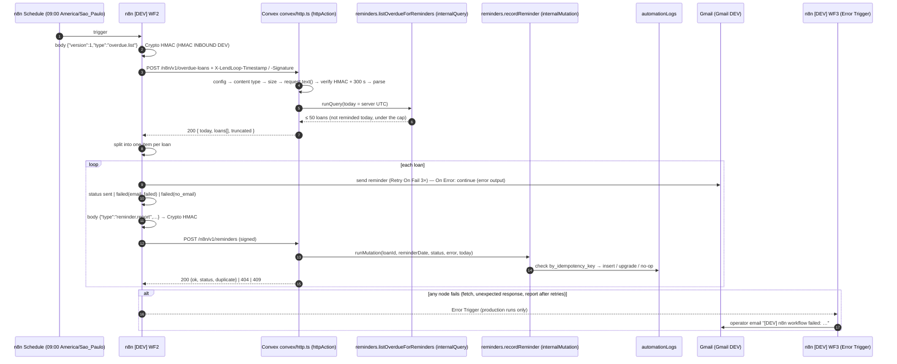

# Overdue Reminders — n8n Workflow 2 (Daily Reminders) + Workflow 3 (Error Workflow) (DEV)

## Overview

Once a day, n8n asks Convex for **overdue loans** through a **signed** HTTP request. It emails each borrower a reminder and **reports every result back** to Convex through a second signed, **idempotent** endpoint. Convex records each result as an `automationLogs` row of `kind: "reminder"`. Every failed execution of Workflow 1 (loan notifications) and Workflow 2 (overdue reminders) is caught by **Workflow 3**, an error workflow that emails an operator.

- **Authenticated both ways:** Convex → n8n already uses HMAC (WF1). This spec adds n8n → Convex HMAC with its **own secret** (Decision 1), verified with the existing constant-time `verifyWebhookSignature` **before** the body is parsed or the database is touched.
- **Idempotent:** one reminder row per loan per UTC day (`reminder:<loanId>:<YYYY-MM-DD>`). Re-running the workflow or retrying a report never creates a second row, and the list endpoint skips loans already reminded today.
- **Partial failures handled:** one failing email does not stop the others. It is reported as `failed` and stays visible in `automationLogs`.
- **Failures visible:** failed executions trigger the error workflow (operator email). Handled per-loan failures live in `automationLogs` (`by_kind_status`).



Targets **DEV** only (Convex dev `effervescent-squid-656`, `[DEV]` workflows, `HMAC INBOUND DEV` / `Gmail DEV`). The endpoints reach Convex **prod** on the next `main` push **without** `N8N_INBOUND_SECRET`. They then answer **503** before reading the body and leak nothing (see *PROD Impact*).

## Prerequisites

### Already done (see `context/current-feature.md` → *History*)

- `loans` with `status`, `startDate` / `endDate` as inclusive `YYYY-MM-DD` strings (UTC calendar days), index `by_status_end` (`["status", "endDate"]`).
- `isOverdue(loan, today)` (`approved` and `endDate < today`; `endDate === today` is **not** overdue) and `listOverdue(ctx, today, limit)` in `convex/lib/loans.ts`: `by_status_end` range `status = "approved", endDate < today`, oldest end date first, `.take(limit)`. Both are unchanged and reused.
- `utcToday(nowMs)`, `addDays`, `daysBetweenInclusive`, `isIsoDate` in `convex/lib/dates.ts`.
- `convex/lib/hmac.ts`: `signWebhook` (`v1=<hex>` of HMAC-SHA256 over `` `${ts}.${rawBody}` ``, secret as UTF-8 bytes) and `verifyWebhookSignature` (Web Crypto `verify`, constant time, ±300 s, at most 5 `v1=` candidates, never throws). Built and tested for exactly this spec.
- `automationLogs` (`kind: "notification"` only today) with `by_idempotency_key`, `by_loan`, `by_kind_status`. Short `lastError` codes. Written only by `emitLoanEvent` and `notifications.recordAttempt`.
- `[DEV] LendLoop — Loan notifications (WF1)` built with the Crypto node + `HMAC DEV` + `Gmail DEV`, sanitized export `n8n/workflows/loan-notifications.dev.json` (settings: `saveDataErrorExecution` / `saveDataSuccessExecution` = `all`, no error workflow yet).
- Known gotchas: a *Respond to Webhook* 401 run shows as "Succeeded" in n8n; `failed` WF1 rows are never resent; the secret must match the n8n credential **byte for byte**.
- There is **no** `convex/http.ts` yet. Versions: `convex` 1.49.0, `convex-test` 0.0.69, Vitest 5 (`environment: "edge-runtime"`).

### User prerequisites (before `/feature load overdue-reminders`)

See *Manual Steps (User) → Before implementation*. In short:

1. A **new random secret** for the inbound direction and the n8n Crypto credential **`HMAC INBOUND DEV`**
2. `N8N_INBOUND_SECRET` set in Convex **DEV** env (same string)
3. The **operator address** for WF3 alerts (recommended: the dedicated LendLoop Gmail account itself)
4. The Convex DEV **HTTP Actions URL** (`https://effervescent-squid-656.convex.site`, confirm it in the dashboard)

The Convex code is implemented and unit-tested before any n8n work. WF2 is built **after** the endpoints exist in DEV. WF3 can be built at any time.

## Requirements

- Two `httpAction` routes in a new `convex/http.ts`: list overdue loans and record a reminder result. POST only, versioned path, other methods → 405.
- Inbound HMAC with a dedicated secret, verified (constant time + 300 s window) **before** the body is parsed or any `runQuery` / `runMutation`. Generic JSON error bodies.
- Overdue list computed by Convex with **server UTC today**, bounded, minimal fields, skipping loans already reminded today and loans past the reminder cap.
- Reminder results stored in `automationLogs` (`kind: "reminder"`), one row per loan per day, idempotent under retries and re-runs.
- n8n `[DEV]` WF2 (schedule, sign, fetch, split, Gmail, report, partial failure handling) and `[DEV]` WF3 (Error Trigger → operator email), set as the error workflow of WF1 and WF2. Sanitized exports.
- Docs: `CLAUDE.md`, `.env.example`, `context/project-overview.md`, webhook-auditor context line.
- convex-test coverage through `t.fetch`. webhook-auditor reports no critical/high findings.

## Decisions

| # | Topic | Options considered | Decision and why |
|---|---|---|---|
| 1 | **Secret per direction** | (a) Reuse `N8N_WEBHOOK_SECRET` + `HMAC DEV` for both directions; (b) a separate inbound secret: Convex env `N8N_INBOUND_SECRET` + n8n Crypto credentials `HMAC INBOUND DEV` / `HMAC INBOUND PROD` | **(b).** *Key separation:* the outbound key only proves "this event came from Convex"; the inbound key authorizes **reading borrowers' emails** and **writing** logs, a more valuable capability. With (a), anything holding the WF1 key (or a signature it produced) can call the Convex endpoints. With (b), a leak or rotation of one direction never touches the other. *Reflection:* n8n stores WF1's received headers and raw body (including valid signatures) in its execution history. With one shared key those signed strings are also valid **inbound** signatures for 300 s. Body validation would still reject them, but (b) removes the class of bug entirely. Cost: one extra credential and env var per environment, the same steps the user already did for WF1. New variable means updates to `CLAUDE.md` *Secrets*, `.env.example` and the webhook-auditor context (it currently says n8n signs with `HMAC DEV` / `HMAC PROD`, see *Doc Conflicts*). Same rules as the outbound secret: ≥ 32 chars (`MIN_SECRET_LENGTH`), 64-char hex recommended, used as **UTF-8 bytes**, never decoded. |
| 2 | **HTTP methods and paths** | (a) `GET /overdue` (signature over `ts.` + empty body) + `POST /reminders`; (b) both `POST` under `/n8n/v1/`, each body naming its operation (`type`); (c) GET with method + path inside the signed string | **(b): `POST /n8n/v1/overdue-loans` and `POST /n8n/v1/reminders`.** The signature covers only `timestamp.body`. With (a), the list signature binds nothing but the timestamp, so it is valid on **any** empty-body endpoint for 300 s. Putting `"type": "overdue.list"` / `"reminder.report"` in the signed body binds each signature to one operation and keeps **one** signing scheme and one verifier for both directions. (c) would fork the scheme (n8n Code + Crypto nodes and `hmac.ts` would need a second format). `/n8n/` namespaces machine endpoints and `/v1/` allows a breaking change later without breaking a live workflow. **405:** the Convex router returns **404** for an unregistered method on a known path (`HttpRouter.lookup` matches path **and** method, verified in `node_modules/convex/dist/esm/server/router.js`), so each path also registers `GET`, `PUT`, `PATCH`, `DELETE`, `OPTIONS` → 405 with `Allow: POST` (`HEAD` is normalized to `GET`). Unknown paths keep Convex's default 404. **No CORS**: server-to-server only, and a browser would not have the secret. |
| 3 | **Who computes "today"** | (a) Convex: `utcToday(Date.now())` inside the httpAction; (b) n8n sends its local date (`$today` in the workflow timezone) | **(a).** Loan dates are UTC calendar days everywhere on the server (`validatePeriod`, `resolveToday`). A second source of truth would make "overdue" depend on n8n's timezone setting, which the docs default differently (instance timezone, New York or GMT; see *Doc Conflicts*). The list response returns `today`, and n8n **echoes it** as `reminderDate` in each report, so the list and its reports always use the same day even if a run crosses midnight UTC. `recordReminder` accepts `reminderDate` only when it equals server today or yesterday (UTC), which absorbs a run started at 23:59 UTC. **Schedule:** 09:00 with the workflow timezone set **explicitly** to `America/Sao_Paulo` (UTC−3, no DST since 2019) = 12:00 UTC, as far as possible from UTC midnight, so the local and UTC dates are the same at run time. Known gap (accepted): the UI computes `isOverdue` with the **client's** local day (`useToday`), so near midnight the UI and the reminder can disagree by a few hours. |
| 4 | **Cadence / cap** | (a) Daily until returned, no cap; (b) daily, at most `MAX_REMINDER_DAYS = 7` reminder days per loan; (c) escalating (day 1, 3, 7) | **(b).** Daily matches the overview ("scheduled daily … reminder to each borrower") and is the simplest rule n8n does not need to know about. Without a cap, a loan nobody closes gets an email every day forever: noise for the borrower, a spam-reputation risk for the dedicated Gmail account (whose daily quota WF1 shares), and an unbounded number of rows per loan for the bonus UI's `by_loan` reads. After 7 reminder days the loan is still visible as overdue in `/admin/loans` (filter `overdue`), which is the human escalation path. The cap counts **reminder rows of any status** (one per day at most), so rows per loan stay ≤ 7 + 5 notifications. A Gmail outage day consumes one of the 7 (accepted; the operator sees the failures). (c) needs per-loan schedule logic and gives little over (b) for a neighborhood app. |
| 5 | **Idempotency key** | (a) `reminder:<loanId>:<reminderDate>`; (b) `reminder:<loanId>:<n8nExecutionId>`; (c) a nonce per request | **(a).** The business rule is "one reminder per loan per day", so the key must not change when the same day's work is redone. With (b), a manual re-run, a whole-execution retry or two overlapping runs would each create a row. Checked with `by_idempotency_key` **inside** `recordReminder` (check-then-insert in one transaction). Convex OCC makes concurrent duplicates conflict on the index range read, and the retried mutation sees the first row (the same pattern as `emitLoanEvent`). Re-reporting: an existing `sent` row is never changed (`duplicate: true`); a `failed` row is **upgraded** by a later `sent` report (the operator re-ran the workflow after fixing Gmail); `failed` + `failed` increments `attempts` and updates `lastError`. The n8n execution id is not stored (it would add an n8n-specific field for no rule). |
| 6 | **Replay protection** | (a) Timestamp window only (300 s, shared `SIGNATURE_TOLERANCE_SEC`); (b) also store a nonce / request id per request | **(a).** A replayed report is harmless: it hits the idempotency key (no new row, no state regression, since `sent` never goes back to `failed`). A replayed list request returns data the replayer could only obtain by already having a signed request from n8n's execution data, and that same execution data already contains the list response (the HTTP node output). A nonce store would turn the read endpoint into a write (a mutation per call) and add a table, for no gain. |
| 7 | **Overdue list shape and skips** | (a) Return every overdue loan; (b) skip loans with a `sent` reminder for today and loans at the cap, bounded | **(b), bounded.** Reads `listOverdue(ctx, today, MAX_OVERDUE_SCAN = 200)` (index range only), then for each loan reads its rows through `by_loan` (`take(MAX_LOAN_LOG_SCAN = 50)`) to find today's reminder row and count reminder days. Excluded: today's row is `sent`; or there is no row today and the loan already has ≥ `MAX_REMINDER_DAYS` reminder rows. Included: no row today (under the cap) or today's row is `failed` (a re-run retries it). Returns at most `MAX_REMINDERS_PER_RUN = 50` loans, oldest end date first, with `truncated: true` when the scan or the run limit was hit (the rest go out on the next run). 50/run keeps WF2 far below Gmail quotas shared with WF1 (*References*). Fields: `loanId`, `toolName`, `borrowerName`, `borrowerEmail` (the **borrower's own** email, or `null`; same rule as WF1's `recipient.email`), `endDate`, `daysOverdue` (`daysBetweenInclusive(endDate, today) − 1`, ≥ 1). Never the lender's name or email, ids of users, `tokenIdentifier`, tool description or start date. |
| 8 | **Reporting on a loan that is no longer overdue** | (a) Reject with 409 if the loan is not currently overdue; (b) record when the loan **was** overdue on `reminderDate`; (c) always record | **(b).** The report states a fact: an email was (or wasn't) sent. If the lender marked the loan returned between the list and the report, the email still went out and must be recorded. Accepted when `loan.endDate < reminderDate` **and** (`status === "approved"`, or `status === "returned"` and `utcToday(returnedAt) >= reminderDate`). Anything else (pending/rejected/cancelled, not yet past its end date, returned before that day) can only come from a bug or a forged request → **409** `{"error":"not overdue"}`, nothing written. Unknown or malformed `loanId` → **404** `{"error":"not found"}`. (a) would lose real emails from the log. (c) would let a buggy workflow log reminders for loans that never were overdue. |
| 9 | **Partial failure handling in n8n** | (a) Default per-item processing, Gmail *On Error: Continue (using error output)*, one report per item; (b) Loop Over Items (batch size 1); (c) one batch report with all results | **(a).** n8n nodes run once per item by default, so Gmail, Crypto and HTTP Request each handle every loan without a loop node. Gmail has *Retry On Fail* (3 × 2 s). Items that still fail leave through the **error output** and are reported `failed` / `email_failed`; the other items continue. A borrower without email is reported `failed` / `no_email` without calling Gmail. The **Report** HTTP node has *Retry On Fail* (3 × 5 s) and *On Error: Continue (using error output)* → **Stop and Error**: every item is reported first, then the execution fails if any report could not be delivered, which fires WF3. Handled email failures do **not** fail the execution; they are visible as `failed` rows (`by_kind_status`) and in the execution data. (b) adds a node for behavior n8n already has. (c) needs partial-success semantics in one response and loses per-loan retry. |
| 10 | **What the error workflow does** | (a) Gmail email to an operator; (b) a mock log only; (c) report to Convex through a third signed endpoint; (d) Slack/Discord | **(a).** Its job is to make failed runs **noticed**. A mock log in n8n is only seen by someone already looking at n8n. (c) needs another endpoint, payload and secret use for failures that are not loan-scoped, and is useless when the failure is "Convex unreachable". (d) needs a new service. WF3 reuses `Gmail DEV`, so it adds no credential. It sends workflow name, execution id + URL, failed node, mode and the error message truncated to 300 chars, plain text. Recipient: the **dedicated LendLoop Gmail account** (self-addressed; the user can add a forward/filter to their personal inbox), so no personal address lives in the workflow. **Not caught by WF3:** any execution n8n considers successful: WF1 *Respond to Webhook* 401/400 runs ("Succeeded"), WF2 items whose email failed but were reported, WF1 deliveries Convex gave up on (`failed` rows, Convex-side). Those are visible in `automationLogs` (`by_kind_status` = `failed`) and Convex Logs. WF3 also never fires for **manual** test runs (n8n docs), and if its own Gmail send fails, the failure is visible only in n8n *Executions*. |
| 11 | **DEV test data (overdue loans)** | (a) Convex dashboard *Data* tab: edit an approved loan's `startDate` / `endDate` into the past; (b) an internal DEV-only seed mutation (e.g. `dev:makeOverdue`); (c) `vi.useFakeTimers` / `vi.setSystemTime` in tests | **(a) for end-to-end + (c) for unit tests.** `loans.request` rejects past dates on purpose. (a) needs no code and does not exist in PROD. The dashboard edit is reactive (it worked for `role` in the admin spec). Edit **both** dates so `startDate <= endDate`, keep `status: "approved"`. (b) would deploy to PROD with `main` as an internal function runnable from the PROD dashboard, which needs an env guard and code to maintain for a one-off. (c) is how the suites already create past loans (`insertLoan` via `t.run`, fake `Date`). |
| 12 | **Signing the response (Convex → n8n) of the list endpoint** | (a) No response signature; (b) HMAC over the response body | **(a).** n8n calls a fixed `https://<deployment>.convex.site` URL: TLS authenticates Convex. The HMAC requirement is about the **inbound** side of each hop (n8n proves itself to Convex here; Convex proves itself to n8n in WF1). (b) would add a verifier Code node in n8n for no threat in scope. |

## Endpoint Contracts

Base URL: Convex **HTTP Actions URL** `https://<deployment>.convex.site` (DEV `https://effervescent-squid-656.convex.site`, PROD `https://enchanted-raven-234.convex.site`). Not secret, so it may appear in the exported workflow.

### Common processing order (both routes)

| Step | Check | Failure response |
|---|---|---|
| 0 | Router: path + method (`POST` only) | unknown path → Convex default **404**; known path, other method → **405** `{"error":"method not allowed"}` + `Allow: POST` |
| 1 | `readInboundConfig()`: `N8N_INBOUND_SECRET` present and ≥ 32 chars | **503** `{"error":"unavailable"}` (+ one `console.warn("inbound: not_configured")`, no values). Body never read |
| 2 | `Content-Type` starts with `application/json` | **415** `{"error":"unsupported media type"}` |
| 3 | `Content-Length` header, if present, ≤ `MAX_INBOUND_BODY_BYTES` (2,048) | **413** `{"error":"payload too large"}` |
| 4 | `rawBody = await request.text()` (read **once**), UTF-8 byte length ≤ 2,048 | **413** |
| 5 | `verifyWebhookSignature({ secret, rawBody, timestampHeader, signatureHeader, nowSec })` | **401** `{"error":"invalid signature"}`. Same body for missing header, bad format, wrong signature and stale/future timestamp |
| 6 | `JSON.parse(rawBody)` + strict shape check (pure parser, exact keys, types) | **400** `{"error":"bad request"}` |
| 7 | Business logic through `ctx.runQuery` / `ctx.runMutation` (internal functions only) | see each route |
| — | Any unexpected exception in steps 1–7 | **500** `{"error":"internal"}`, `console.error("inbound: <route> internal")` without the error text, body, headers or secret |

Steps 1–4 do not interpret the body (they only look at headers and length), so "verify before parsing or touching the DB" holds: nothing is parsed and no `runQuery`/`runMutation` happens before step 5 succeeds. All responses are `application/json` with a fixed body. Headers: `X-LendLoop-Timestamp` (integer Unix seconds) and `X-LendLoop-Signature` (`v1=<hex>`); n8n sends them via the HTTP Request node. `ctx.auth` is not used (no Clerk identity on these calls).

### `POST /n8n/v1/overdue-loans`

| Item | Value |
|---|---|
| Signed string | `` `${timestamp}.${rawBody}` `` |
| Request body (exact) | `{"version":1,"type":"overdue.list"}` (keys exactly `version`, `type`; anything else → 400) |
| **200** | `{"version":1,"today":"2026-11-13","truncated":false,"loans":[{"loanId":"<id>","toolName":"Drill","borrowerName":"Bob","borrowerEmail":"bob@example.com","endDate":"2026-11-10","daysOverdue":3}]}`. `borrowerEmail` is `string \| null`. Up to 50 loans, oldest `endDate` first. `loans: []` when there is nothing to send |
| 400 / 401 / 405 / 413 / 415 / 500 / 503 | see the common table |

### `POST /n8n/v1/reminders`

| Item | Value |
|---|---|
| Signed string | `` `${timestamp}.${rawBody}` `` |
| Request body | `{"version":1,"type":"reminder.report","loanId":"<id>","reminderDate":"2026-11-13","status":"sent","error":null}`. Exact keys. `loanId`: non-empty string ≤ 64 chars. `reminderDate`: valid `YYYY-MM-DD`. `status`: `"sent"` \| `"failed"`. `error`: `null` when `sent`; one of `"email_failed"`, `"no_email"` when `failed`. Every value is ASCII (no names or emails in reports) |
| **200** | `{"ok":true,"status":"sent","duplicate":false}`. `status` = the row's status **after** the call; `duplicate: true` when nothing changed (existing `sent` row) |
| **400** | parse/shape errors, or `reminderDate` not equal to server today / yesterday (UTC) |
| **404** | `{"error":"not found"}`: `loanId` is not a valid `loans` id or the loan doesn't exist |
| **409** | `{"error":"not overdue"}`: Decision 8 |
| 401 / 405 / 413 / 415 / 500 / 503 | see the common table |

## Signature Spec (n8n → Convex)

Same scheme as WF1 (see `loan-notifications.md` → *Signature Spec*): HMAC-SHA256, lowercase hex, `v1=` prefix, signed string `timestamp + "." + rawBody`, 300 s tolerance in both directions, multiple space-separated signatures allowed (Convex accepts up to 5 candidates). **Differences only:**

| Item | WF1 (Convex → n8n) | WF2 (n8n → Convex) |
|---|---|---|
| Secret | `N8N_WEBHOOK_SECRET` ↔ `HMAC DEV` / `HMAC PROD` | `N8N_INBOUND_SECRET` ↔ **`HMAC INBOUND DEV`** / **`HMAC INBOUND PROD`** |
| Signer | `signWebhook` in `notifications.deliver` | n8n Code node (timestamp + body string) → **Crypto** node (Hmac, SHA256, HEX, credential) |
| Verifier | n8n Code node, `timingSafeEqual` | Convex `verifyWebhookSignature` (Web Crypto `verify`) in `convex/http.ts` |
| Headers | `X-LendLoop-Event-Id`, `-Timestamp`, `-Signature` | `X-LendLoop-Timestamp`, `-Signature` (no event id; the report body carries `loanId` + `reminderDate`) |
| Body binding | event id in body | `type` in body (Decision 2) |

**Byte-identical body rule (n8n side).** The Code node builds the body **once** with `JSON.stringify({...})` and stores it as a string (`$json.body`). The Crypto node signs `` `${timestamp}.${$json.body}` ``, and the HTTP Request node sends **the same string** with *Body Content Type* = **Raw**, *Content Type* = `application/json`, *Body* = `{{ $json.body }}`. Never use *Body Content Type = JSON* (n8n parses and re-serializes the object, and any spacing/escaping difference breaks the HMAC; the community threads report exactly this on the receiving side). Report bodies contain only ASCII values (ids, dates, fixed codes), which also removes UTF-8 normalization risks. Retries of the HTTP node resend the same timestamp and signature; with ≤ 3 tries × 5 s they stay well inside 300 s.

## Data Model

```ts
// convex/lib/validators.ts (changes)
export const AUTOMATION_KINDS = ["notification", "reminder"] as const;          // + "reminder"
/** automationLogs.event: notification events + the reminder event. */
export const AUTOMATION_EVENTS = [...LOAN_EVENT_TYPES, "loan.overdue"] as const;
export const automationEventValidator = v.union(...AUTOMATION_EVENTS.map((e) => v.literal(e)));
export const REMINDER_ERROR_CODES = ["email_failed", "no_email"] as const;
export const reminderErrorValidator = v.union(...REMINDER_ERROR_CODES.map((c) => v.literal(c)));
export type AutomationEvent = Infer<typeof automationEventValidator>;
// LOAN_EVENT_TYPES / loanEventTypeValidator stay unchanged (WF1 payload + transitionLoan).
```

```ts
// convex/schema.ts — automationLogs (changes only)
kind: automationKindValidator,                // "notification" | "reminder"
event: automationEventValidator,              // was loanEventTypeValidator; reminders use "loan.overdue"
// reminder rows only: the UTC day the reminder belongs to (also inside the key)
reminderDate: v.optional(v.string()),
// idempotencyKey comment: + reminder: `reminder:${loanId}:${reminderDate}`
// lastError comment: + email_failed | no_email
// writers comment: + reminders.recordReminder
```

**Reminder row values:**

| Field | Value |
|---|---|
| `loanId` | the loan |
| `kind` / `event` | `"reminder"` / `"loan.overdue"` |
| `recipientId` | `loan.borrowerId` |
| `idempotencyKey` | `reminder:<loanId>:<reminderDate>` |
| `reminderDate` | `YYYY-MM-DD` (UTC, from the list's `today`) |
| `status` | `sent` \| `failed`. **Never `pending`**: the row is written only when n8n reports a result |
| `attempts` | number of reports received for that key (1 on insert) |
| `lastError` | `email_failed` \| `no_email` (absent when `sent`) |
| `occurredAt` / `updatedAt` | first report time / last change |
| `sentAt` | set when the row becomes `sent` |
| `lastStatusCode`, `nextAttemptAt` | unused for reminders |

**Coexistence with notification rows:** both kinds share the table and the three indexes. Keys never collide (`notification:` vs `reminder:` prefixes). `by_kind_status` separates them (`["reminder","failed"]`). `by_loan` returns both for the bonus UI. Notification code must ignore reminder rows: `notifications.getDelivery` and `notifications.recordAttempt` return early unless `log.kind === "notification"` (also narrows `log.event` back to `LoanEventType` for `buildPayload` / `counterpartFor`). `deliver` is never scheduled for a reminder row.

**Schema-evolution safety:** widening the `kind` and `event` unions and adding an optional field are safe pushes. Every existing row (all `kind: "notification"` with a `loan.*` event, no `reminderDate`) still validates. No migration and no new index. `loans` / `tools` / `users` are unchanged.

## Convex Functions

New file `convex/reminders.ts` (default runtime). **No public functions**: `api.reminders` must not exist.

| Function | Type | Caller | Args | Returns |
|---|---|---|---|---|
| `reminders.listOverdueForReminders` | `internalQuery` | `POST /n8n/v1/overdue-loans` | `{ today: v.string() }` | `{ truncated: v.boolean(), loans: v.array(v.object({ loanId: v.id("loans"), toolName: v.string(), borrowerName: v.string(), borrowerEmail: v.union(v.string(), v.null()), endDate: v.string(), daysOverdue: v.number() })) }` (Decision 7). Missing tool → `"Removed tool"`, missing borrower → `missingPublicUser` name + `null` email (defensive) |
| `reminders.recordReminder` | `internalMutation` | `POST /n8n/v1/reminders` | `{ loanId: v.string(), reminderDate: v.string(), status: v.union(v.literal("sent"), v.literal("failed")), error: v.union(reminderErrorValidator, v.null()), today: v.string() }` | `v.union(v.object({ result: v.literal("recorded"), status: automationStatusValidator, duplicate: v.boolean() }), v.object({ result: v.literal("not_found") }), v.object({ result: v.literal("not_overdue") }), v.object({ result: v.literal("invalid_date") }))`. Normalizes `loanId` with `ctx.db.normalizeId("loans", …)`; checks the date window (Decision 3), overdue-on-date (Decision 8), then the key (Decision 5). Logs one line `reminders.record: <loanId> <date> -> <status>[ duplicate]` (ids only) |

`convex/http.ts` (default export `httpRouter()`), two `httpAction` handlers plus the 405 handler. The handlers are thin: common pipeline (`readSignedJson`), then map the internal result to a status code. `today = utcToday(Date.now())` is computed in the httpAction and passed down (queries stay deterministic).

Helpers (plain functions, not registered):

| Helper | File | Responsibility |
|---|---|---|
| `readInboundConfig(): { secret } \| null` | `convex/lib/inbound.ts` | `process.env.N8N_INBOUND_SECRET`, null when missing or shorter than `MIN_SECRET_LENGTH`. Never logs the value |
| `readSignedJson(request, nowSec): Promise<{ ok: true; body: unknown } \| { ok: false; response: Response }>` | same | Steps 1–6 of the common table, in order |
| `jsonResponse(status, body, headers?)`, `methodNotAllowed` | same | Fixed JSON bodies, `Allow: POST` |
| `parseOverdueListRequest(body: unknown): boolean` | `convex/lib/reminders.ts` | Exact `{ version: 1, type: "overdue.list" }` |
| `parseReminderReport(body: unknown): ReminderReport \| null` | same | Exact keys, types, lengths, status/error pairing (`sent` ⇒ `error === null`) |
| `reminderKey(loanId, date)`, `daysOverdue(endDate, today)` | same | Pure |
| `wasOverdueOn(loan, date): boolean` | same | Decision 8 (`approved`, or `returned` with `utcToday(returnedAt) >= date`, and `endDate < date`) |
| `isReminderDateAccepted(date, today): boolean` | same | `date === today \|\| date === addDays(today, -1)`, valid ISO |

Constants added to `convex/lib/automationRules.ts`: `MAX_INBOUND_BODY_BYTES = 2_048`, `MAX_OVERDUE_SCAN = 200`, `MAX_REMINDERS_PER_RUN = 50`, `MAX_REMINDER_DAYS = 7`, `MAX_LOAN_LOG_SCAN = 50`. `SIGNATURE_TOLERANCE_SEC` and `MIN_SECRET_LENGTH` are reused.

**Shape sketch (`convex/http.ts`):**

```ts
const http = httpRouter();
http.route({ path: "/n8n/v1/overdue-loans", method: "POST", handler: overdueLoans });
http.route({ path: "/n8n/v1/reminders", method: "POST", handler: reminderReport });
for (const path of ["/n8n/v1/overdue-loans", "/n8n/v1/reminders"]) {
  for (const method of ["GET", "PUT", "PATCH", "DELETE", "OPTIONS"] as const) {
    http.route({ path, method, handler: methodNotAllowed });
  }
}
export default http;

// overdueLoans = httpAction(async (ctx, request) => {
//   const input = await readSignedJson(request, Math.floor(Date.now() / 1000));
//   if (!input.ok) return input.response;
//   if (!parseOverdueListRequest(input.body)) return badRequest();
//   const today = utcToday(Date.now());
//   const { loans, truncated } = await ctx.runQuery(internal.reminders.listOverdueForReminders, { today });
//   return jsonResponse(200, { version: 1, today, truncated, loans });
// });   // wrapped in try/catch → 500 {"error":"internal"}
```

## n8n `[DEV]` Workflow 2 — Build Guide

**Name:** `[DEV] LendLoop — Overdue reminders (WF2)` · **Credentials:** `HMAC INBOUND DEV` (Crypto, *Hmac Secret* = Convex DEV `N8N_INBOUND_SECRET`), `Gmail DEV` (existing) · **Export:** `n8n/workflows/overdue-reminders.dev.json`

| # | Node | Settings |
|---|---|---|
| 1 | **Schedule Trigger** "Daily 09:00" | Trigger Interval **Days**, Days Between Triggers **1**, Hour **9**, Minute **0** (timezone from workflow settings) |
| 2 | **Code** "Build list request" (*Run Once for All Items*) | `const body = JSON.stringify({ version: 1, type: 'overdue.list' }); const timestamp = String(Math.floor(Date.now() / 1000)); return [{ json: { body, timestamp, signedPayload: `${timestamp}.${body}` } }];` No secret here |
| 3 | **Crypto** "Sign list" | Action **Hmac**, Type **SHA256**, Value `{{ $json.signedPayload }}`, Encoding **HEX**, Property Name `signature`, Credential **`HMAC INBOUND DEV`** |
| 4 | **HTTP Request** "Fetch overdue" | Method **POST**, URL `https://effervescent-squid-656.convex.site/n8n/v1/overdue-loans`. Authentication **None**. Send Headers: `X-LendLoop-Timestamp` = `{{ $json.timestamp }}`, `X-LendLoop-Signature` = `v1={{ $json.signature }}`. Send Body: Content Type **Raw**, raw content type `application/json`, Body `{{ $json.body }}`. Options: **Timeout 15000**. Settings: **Retry On Fail ON**, Max Tries **3**, Wait Between Tries **5000**; On Error **Stop Workflow** (→ WF3) |
| 5 | **Code** "Split loans" (*Run Once for All Items*) | `const r = $input.first().json; if (r.version !== 1 \|\| typeof r.today !== 'string' \|\| !Array.isArray(r.loans)) throw new Error('Unexpected overdue response');` → `return r.loans.map((l) => ({ json: { ...l, reminderDate: r.today } }));`. An empty list returns `[]`: the execution ends successfully with no emails. A thrown error fails the execution (→ WF3). Optionally log `r.truncated` in the item for visibility |
| 6 | **IF** "Has email?" | `{{ $json.borrowerEmail }}` is not empty → node 7; else → node 8c |
| 7 | **Gmail** "Send reminder" | Credential **`Gmail DEV`**. Resource **Message**, Operation **Send**. To `{{ $json.borrowerEmail }}`. Subject `[DEV] Reminder: please return {{ $json.toolName }}`. Email Type **Text**. Message: see template. Options: Sender Name `LendLoop`, **Append n8n attribution OFF**. Settings: **Retry On Fail ON**, Max Tries **3**, Wait **2000**; **On Error: Continue (using error output)** → success → 8a, error → 8b |
| 8a | **Code** "Mark sent" (*Run Once for Each Item*) | `const l = $('Split loans').item.json; return { json: { loanId: l.loanId, reminderDate: l.reminderDate, status: 'sent', error: null } };` |
| 8b | **Code** "Mark email failed" (each item) | Same with `status: 'failed', error: 'email_failed'` |
| 8c | **Code** "Mark no email" (each item) | Same with `status: 'failed', error: 'no_email'` |
| 9 | **Code** "Build report" (each item; input from 8a, 8b, 8c) | `const body = JSON.stringify({ version: 1, type: 'reminder.report', loanId: $json.loanId, reminderDate: $json.reminderDate, status: $json.status, error: $json.error }); const timestamp = String(Math.floor(Date.now() / 1000)); return { json: { loanId: $json.loanId, body, timestamp, signedPayload: `${timestamp}.${body}` } };` |
| 10 | **Crypto** "Sign report" | As node 3 (credential `HMAC INBOUND DEV`, Property Name `signature`) |
| 11 | **HTTP Request** "Report result" | POST `https://effervescent-squid-656.convex.site/n8n/v1/reminders`, same headers/raw-body setup as node 4, Timeout 15000. Settings: **Retry On Fail ON**, 3 tries, 5000 ms; **On Error: Continue (using error output)** → error output → node 12 |
| 12 | **Stop and Error** "Report failed" | Error Message `Reminder report failed for {{ $json.loanId ?? 'unknown loan' }}`. Runs after node 11 has processed **all** items, so every report is attempted before the execution fails (→ WF3) |

**Paired items:** nodes 8a–8c read the loan through `$('Split loans').item`. Gmail's success and error outputs keep item pairing; check it on the first build (node 8b's input must show the right `loanId`). If pairing is lost on the error output, switch 8a–8c to read `loanId` / `reminderDate` passed through by node 7's error item instead, and record what worked in the build notes.

**Reminder template (plain text, English like the app):**

```
Hi {{borrowerName}},

The {{toolName}} you borrowed was due back on {{endDate}} ({{daysOverdue}} day(s) ago).
Please return it to its owner and ask them to mark it as returned in LendLoop.

— LendLoop
```

No HTML, no link required, no lender data.

**Workflow settings:** **Timezone `America/Sao_Paulo`** (explicit; never rely on the instance default). *Error workflow* = `[DEV] LendLoop — Error handler (WF3)`. *Save failed production executions* = Save. *Save successful production executions* = Save (they contain borrower names/emails, same accepted trade-off as WF1). *Save manual executions* = Save (handy while building). **Publish** the workflow so the schedule runs (Schedule Trigger needs it).

**Executions budget:** one execution per day, whatever the number of loans (reports run inside the same execution). HTTP retries add no executions.

## n8n `[DEV]` Workflow 3 — Error Workflow Build Guide

**Name:** `[DEV] LendLoop — Error handler (WF3)` · **Credential:** `Gmail DEV` · **Export:** `n8n/workflows/error-handler.dev.json`

| # | Node | Settings |
|---|---|---|
| 1 | **Error Trigger** | — |
| 2 | **Code** "Format alert" (*Run Once for All Items*) | Reads `workflow.name`, `execution.id`, `execution.url`, `execution.lastNodeExecuted`, `execution.mode`, `execution.error.message` (truncate to 300 chars; strip newlines from the subject parts). When `execution` is missing (the failed node was the **trigger**), use `trigger.error.message` instead. Outputs `{ subject: "[DEV] n8n workflow failed: <workflow name>", text }`. Never includes `error.stack` or item data |
| 3 | **Gmail** "Alert operator" | Credential `Gmail DEV`. To = the **dedicated LendLoop Gmail address** (operator). Subject `{{ $json.subject }}`, Email Type Text, Message `{{ $json.text }}`, Sender Name `LendLoop`, attribution OFF. Retry On Fail 3 × 2000 ms |

**Settings:** no error workflow for WF3 itself (if its own Gmail send fails, the failure stays in n8n *Executions*). WF3 doesn't need to be published (n8n docs), but it must be **saved**. Then open **WF1** and **WF2** → *Settings → Error workflow* → select WF3 → Save, and re-export WF1 (`loan-notifications.dev.json` changes only in `settings.errorWorkflow`).

**What WF3 catches:** WF2 fetch failures (Convex down, 401/5xx after retries, timeouts), an unexpected list response (node 5 throws), report failures (node 12), WF1 executions that error before *Respond to Webhook* (e.g. Gmail failing 3×). **What it does not catch** (see Decision 10): "Succeeded" executions such as WF1 401/400 responses, handled WF2 email failures, Convex-side final failures, and manual test runs. Those are in `automationLogs` / Convex Logs / n8n *Executions*.

**Operator address in the export:** the Gmail *To* holds the dedicated LendLoop address. Before committing, replace it with `operator@example.invalid` in the JSON (and note it in the commit). After re-importing, set the real address again. No personal address is ever used.

## Export Rules (`overdue-reminders.dev.json`, `error-handler.dev.json`, updated `loan-notifications.dev.json`)

- `credentials` blocks contain only `{ id, name }` (`HMAC INBOUND DEV`, `Gmail DEV`)
- **no `pinData`** (pinned outputs would contain names, emails and signatures)
- no secret, no computed `signature`/`timestamp` values, no example request with headers in parameters, notes or sticky notes
- no personal email address. The WF3 operator address is replaced by `operator@example.invalid`; the WF2 Gmail *To* is an expression
- the `.convex.site` URL and the WF1 webhook path are allowed (not secrets)
- `settings.errorWorkflow` (the WF3 id) is allowed
- reviewed by webhook-auditor

## Failure Matrix

| Failure | n8n execution | WF3 email | `automationLogs` / Convex Logs |
|---|---|---|---|
| Convex unreachable / 5xx / timeout on *Fetch overdue* (after 3 tries) | failed at node 4 | **yes** | — (no request reached Convex, or Logs show the 500 line) |
| Wrong `HMAC INBOUND DEV` / `N8N_INBOUND_SECRET` mismatch / n8n clock skew > 300 s | failed at node 4 (401) | **yes** | — (401 before any read) |
| `N8N_INBOUND_SECRET` missing in Convex | failed at node 4 (503) | **yes** | Convex Logs `inbound: not_configured` |
| Unexpected list response shape | failed at node 5 | **yes** | — |
| No overdue loans | success, ends after node 5 | no | — |
| Gmail fails for one borrower (after 3 tries) | success; item on node 7's error output | no | row `failed` / `email_failed` (`by_kind_status`) |
| Borrower has no email | success | no | row `failed` / `no_email` |
| Report fails (network, 5xx after 3 tries, 404/409/400 bug) | failed at node 12 after all reports | **yes** | that loan has **no** row for the day (the email may have gone out); the other loans have rows |
| Workflow re-run the same day | success, list skips `sent` loans | no | no new rows; `failed` rows can be upgraded to `sent` |
| Report replayed / retried | success | no | 200 `duplicate: true`, row unchanged |
| WF1 Gmail fails 3× | failed before *Respond* (500) | **yes** | WF1 row retried by Convex, finally `failed` / `http_500` |
| WF1 bad signature (401) | **"Succeeded"** | **no** | WF1 row `failed` / `http_401` |
| Scheduled run missed (n8n outage) | none (missed runs discarded by default) | no | none: the next day's run reminds again (overdue loans persist) |
| WF3's own Gmail fails | WF3 execution failed | — | — (n8n *Executions* only) |

## Files to Create / Modify

| Path | Action | Responsibility |
|---|---|---|
| `convex/http.ts` | create | `httpRouter`: two POST routes, 405 routes, thin handlers (try/catch → 500) |
| `convex/lib/inbound.ts` | create | `readInboundConfig`, `readSignedJson` (steps 1–6), `jsonResponse`, `methodNotAllowed`, fixed error bodies |
| `convex/lib/reminders.ts` | create | `parseOverdueListRequest`, `parseReminderReport`, `reminderKey`, `daysOverdue`, `wasOverdueOn`, `isReminderDateAccepted`, `ReminderReport` / `OverdueItem` types + validators |
| `convex/reminders.ts` | create | `listOverdueForReminders` (internalQuery), `recordReminder` (internalMutation) |
| `convex/reminders.test.ts` | create | convex-test + `t.fetch` (see *Testing*) |
| `convex/lib/reminders.test.ts` | create | Pure helper tests |
| `convex/lib/automationRules.ts` | modify | New constants |
| `convex/lib/validators.ts` | modify | `AUTOMATION_KINDS` + `"reminder"`, `AUTOMATION_EVENTS`, `automationEventValidator`, `REMINDER_ERROR_CODES` |
| `convex/schema.ts` | modify | `automationLogs.event` → `automationEventValidator`, `reminderDate?`, comments |
| `convex/notifications.ts` | modify | `getDelivery` / `recordAttempt` ignore non-`notification` rows (type narrowing) |
| `convex/notifications.test.ts` | modify | One test: a reminder row is never delivered |
| `convex/lib/hmac.test.ts` | modify | Inbound vector: a body signed with `node:crypto` `createHmac` (what n8n computes) verifies; a signature made with a different secret (outbound) fails |
| `n8n/workflows/overdue-reminders.dev.json` | create (from the user's export) | Sanitized WF2 |
| `n8n/workflows/error-handler.dev.json` | create (from the user's export) | Sanitized WF3 |
| `n8n/workflows/loan-notifications.dev.json` | modify (re-export) | `settings.errorWorkflow` = WF3 |
| `CLAUDE.md` | modify | n8n row: WF2/WF3 names and `HMAC INBOUND DEV` / `HMAC INBOUND PROD`; add the Convex HTTP Actions URLs (`*.convex.site`) per environment; *Secrets*: `N8N_INBOUND_SECRET` (same rules as `N8N_WEBHOOK_SECRET`, must equal the `HMAC INBOUND *` *Hmac Secret*); *Environment rules* NEVER list: `HMAC INBOUND PROD` and the `[PROD]` WF2/WF3 |
| `.env.example` | modify (comments only) | Add `N8N_INBOUND_SECRET` to the "live in Convex env vars" list + the DEV `npx convex env set` hint |
| `context/project-overview.md` | modify | Automation: WF2 endpoints, daily 09:00 America/Sao_Paulo, cap 7, WF3 = operator email; Data model: `kind: "notification" \| "reminder"`, `event` includes `loan.overdue`, `reminderDate?`, reminder key, new `lastError` codes, writer `reminders.recordReminder` |
| `.claude/agents/webhook-auditor.md` | modify (one line) | Project Context: n8n signs inbound requests with `HMAC INBOUND DEV` / `HMAC INBOUND PROD` (separate from WF1's `HMAC DEV` / `HMAC PROD`) |

No new npm package, no Convex component, no UI change, no cron in Convex (the schedule lives in n8n).

## Manual Steps (User)

### Before implementation

1. **Generate the DEV inbound secret** (printed once; don't paste it in files or chat):
   ```powershell
   node -e "console.log(require('crypto').randomBytes(32).toString('hex'))"
   ```
2. **n8n → Credentials → New → Crypto** → name **`HMAC INBOUND DEV`** → *Hmac Secret* = the string → Save.
3. **Convex DEV env** (DEV is the default target; never `--prod`):
   ```powershell
   npx convex env set N8N_INBOUND_SECRET "<the generated string>"
   ```
   Or the dashboard: dev deployment → *Settings → Environment Variables*. Paste the **same** string in both places (the WF1 PROD 401 gotcha).
4. **Convex DEV HTTP Actions URL:** dashboard → dev deployment → *Settings → URL & Deploy Key* → *HTTP Actions URL*. Expect `https://effervescent-squid-656.convex.site`.
5. **Operator address:** confirm that WF3 alerts go to the dedicated LendLoop Gmail account (optionally add a Gmail forward/filter to your inbox).
6. *(Optional now, required before step 9 below)* Build **WF3** from its guide and save it.

### After implementation (DEV, translation off, `npx convex dev` + `npm run dev` running)

Accounts: **A** (owner), **B** (borrower), **Admin**.

1. **Make a loan overdue:** B requests A's Drill for future dates, A approves. Convex dashboard (DEV) → *Data* → `loans` → that row → set `startDate` = `2026-11-08`, `endDate` = `2026-11-10` (any past dates, `startDate <= endDate`), keep `status: "approved"`. The UI shows it as overdue.
2. **Build WF2** from the guide (Claude can walk through it node by node), save, and run it with **Execute workflow** (manual). Expect: node 4 → 200 with 1 loan (`daysOverdue` matches); B's inbox gets `[DEV] Reminder: please return Drill`; node 11 → 200 `{"ok":true,"status":"sent","duplicate":false}`. Convex *Data* → `automationLogs`: one row `kind: reminder`, `event: loan.overdue`, recipient B, `reminderDate` = today (UTC), `status: sent`, `attempts: 1`.
3. **Same day again:** run WF2 again → node 4 returns `loans: []`, no email, no new row.
4. **Replay a report:** sign and send the same report by hand (fresh timestamp) → 200 `duplicate: true`, still one row:
   ```powershell
   $env:IN_SECRET = "<the generated string>"
   node -e "const c=require('crypto');const ts=Math.floor(Date.now()/1000);const b=JSON.stringify({version:1,type:'reminder.report',loanId:process.argv[1],reminderDate:process.argv[2],status:'sent',error:null});console.log(ts);console.log('v1='+c.createHmac('sha256',process.env.IN_SECRET).update(ts+'.'+b).digest('hex'));console.log(b)" "<loanId>" "<today>"
   # then: curl.exe -s -w "%{http_code}" -X POST "https://effervescent-squid-656.convex.site/n8n/v1/reminders" -H "Content-Type: application/json" -H "X-LendLoop-Timestamp: <ts>" -H "X-LendLoop-Signature: <sig>" --data-raw "<body>"
   ```
   Close the terminal afterwards (the secret lives only in that session).
5. **Tampered / stale / wrong method:** `X-LendLoop-Signature: v1=deadbeef` → **401**. A valid signature with `ts − 600` → **401**. `curl.exe -X GET …/n8n/v1/overdue-loans` → **405**. `…/n8n/v1/nope` → **404**. None of these create rows.
6. **Returned in between (optional):** A marks the loan returned, then replay a report for **today** → 200 (it was overdue today). A report for a loan that was never overdue (e.g. a pending request id) → **409**.
7. **Partial failure (optional):** make a second loan overdue for a borrower whose email is missing or invalid (e.g. edit `users.email` in DEV *Data* to `invalid@@x`) → that item is reported `failed` / `email_failed`, the other is `sent`; the execution succeeds.
8. **Set WF3** as *Error workflow* in WF1 and WF2 settings. **Publish** WF2.
9. **Error workflow fires** (needs a production run, not a manual one): add a temporary second rule to WF2's Schedule Trigger (*Minutes*, every 2 minutes), republish, then `npx convex env set N8N_INBOUND_SECRET "wrong-but-at-least-32-characters-long-xx"` (DEV). Within ~2 min the scheduled run fails at *Fetch overdue* (401 × 3) and the operator inbox receives `[DEV] n8n workflow failed: [DEV] LendLoop — Overdue reminders (WF2)`. **Restore** the real secret, remove the temporary rule, republish.
10. **Exports:** download WF2, WF3 and WF1 again, send them to Claude for sanitizing. Check the diff: credential names only, no `pinData`, operator address replaced.

## Implementation Steps (Claude)

All against **DEV**. Re-check `httpAction` / `t.fetch` details with Context7 while implementing.

1. Branch `feature/overdue-reminders` from `main`.
2. `validators.ts`, `automationRules.ts`, `schema.ts`; narrow `notifications.getDelivery` / `recordAttempt` to `kind === "notification"`. Let `npx convex dev` push; confirm existing rows still validate.
3. `convex/lib/reminders.ts` + tests (pure helpers).
4. `convex/reminders.ts` (`listOverdueForReminders`, `recordReminder`).
5. `convex/lib/inbound.ts` + `convex/http.ts`.
6. `convex/reminders.test.ts`, `hmac.test.ts` additions, the notifications guard test. `npm run test:run`.
7. Guide the user through *Before implementation* (if not done) and the WF2 / WF3 builds. Run the DEV end-to-end checks with the user.
8. Sanitize and save the three exports.
9. Docs: `CLAUDE.md`, `.env.example`, `project-overview.md`, webhook-auditor context line.
10. `npm run lint`, `npm run test:run`, `npm run build`.
11. Run **webhook-auditor** on `convex/http.ts`, `convex/lib/inbound.ts`, `convex/lib/reminders.ts`, `convex/reminders.ts`, `convex/notifications.ts`, the three exports. Fix critical/high. Record the inbound secret name, paths and reminder key format in its agent memory.
12. Ask before committing. Go through *PROD Impact* before merging.

## Hooks for the Bonus Spec (Automation Activity UI)

- Per-loan activity: `automationLogs` `by_loan` + `.order("desc")`, newest rows for the **visible page only** (like `loadLoanRefs`), covering both kinds. Expose `{ kind, event, status, occurredAt, sentAt, reminderDate }` to the loan's parties only (and admins). Labels: `notification` + `loan.approved` → "Approval email sent 2 min ago"; `reminder` + `sent` → "Reminder sent 2 days ago"; `failed` → a friendly "Couldn't send", never `lastError` codes verbatim.
- Rows per loan are bounded (≤ 5 notifications + ≤ 7 reminder days), so `take(20)` is enough.
- An admin view of `by_kind_status` = `failed` (both kinds) would be the natural "automation health" page.

## PROD Impact

Merging to `main` runs `npx convex deploy` on Convex prod (`enchanted-raven-234`):

- **Schema:** `automationLogs` unions widened + optional `reminderDate`. Additive; existing PROD rows validate. No migration.
- **Functions:** `reminders:*` (internal) and the HTTP router. The routes become live at `https://enchanted-raven-234.convex.site/n8n/v1/*`.
- **No `N8N_INBOUND_SECRET` in prod** → every request gets **503** `{"error":"unavailable"}` at step 1, **before** the body is read or anything is queried. No data leaks; nothing is written. (A probe can learn only that the route exists and isn't configured.)
- WF1 behavior is unchanged in PROD (only the `kind` guard was added).

**Only when the user asks** (never as part of this merge, and only with explicit confirmation, per `CLAUDE.md`):

1. Generate a **different** inbound secret for PROD; create the n8n Crypto credential **`HMAC INBOUND PROD`**.
2. Set `N8N_INBOUND_SECRET` on Convex **prod** via the dashboard (prod deployment → *Environment Variables*). Claude does not run `--prod` commands.
3. Duplicate WF3 as `[PROD] LendLoop — Error handler (WF3)` (`Gmail PROD`, subject without `[DEV]`).
4. Duplicate WF2 as `[PROD] LendLoop — Overdue reminders (WF2)`: URLs → `https://enchanted-raven-234.convex.site/…`, Crypto nodes → `HMAC INBOUND PROD`, Gmail → `Gmail PROD`, subject without `[DEV]`, timezone `America/Sao_Paulo`, error workflow = `[PROD]` WF3. Publish.
5. Set `[PROD]` WF3 as the error workflow of `[PROD]` WF1 (re-export `loan-notifications.prod.json`).
6. Export `overdue-reminders.prod.json` and `error-handler.prod.json` (same rules).
7. Smoke test: a manual run of `[PROD]` WF2 → 200 (likely `loans: []`), no row; a curl with a bad signature → 401.

Check before merging:

- [ ] `npm run build` / `lint` / `test:run` pass
- [ ] DEV end-to-end verified (*After implementation* 1–10)
- [ ] webhook-auditor: no critical/high findings
- [ ] `api.reminders` doesn't exist. No secret, signature or body in code, logs, tests or exports
- [ ] User confirms the merge and understands that PROD answers 503 until the PROD steps are done

Rollback: Vercel Instant Rollback doesn't revert Convex. Revert the commit on `main`. If the revert narrows the `automationLogs` unions while `reminder` rows exist in PROD, the push fails, so keep the widened schema until those rows are deleted.

## Acceptance Criteria

- [ ] `convex/http.ts` exposes exactly `POST /n8n/v1/overdue-loans` and `POST /n8n/v1/reminders`; other methods → 405 with `Allow: POST`; unknown paths → 404
- [ ] Missing/short `N8N_INBOUND_SECRET` → 503 before reading the body. Wrong content type → 415. Body > 2,048 bytes → 413
- [ ] Missing, malformed, wrong or stale (> 300 s, past or future) signature → 401 with a generic body, **before** `JSON.parse` and before any `runQuery`/`runMutation`. Verification uses `verifyWebhookSignature` (constant time); no `===` on signatures
- [ ] A signature made with `N8N_WEBHOOK_SECRET` is rejected (separate secrets)
- [ ] Overdue list: only `approved` loans with `endDate < server UTC today`; returned/pending/rejected/cancelled and `endDate === today` excluded; exactly the documented keys; ≤ 50 items; oldest first; `truncated` correct; loans with a `sent` reminder today or ≥ 7 reminder days excluded; `failed`-today loans included
- [ ] Report: one row per `reminder:<loanId>:<date>`; repeated reports idempotent (`sent` never regresses; `failed` → `sent` upgrade; `failed` + `failed` increments `attempts`); 404 unknown loan; 409 not overdue on that date; 400 date outside today/yesterday or bad shape
- [ ] Reminder rows: `kind: "reminder"`, `event: "loan.overdue"`, `recipientId` = borrower, never `pending`, never scheduled for delivery; notification rows and WF1 delivery unaffected
- [ ] Errors never echo input, signatures, secrets or stack traces; logs contain ids/codes only
- [ ] n8n `[DEV]` WF2 per the guide (explicit timezone, raw body signing, retries, error outputs, Stop and Error), published; `[DEV]` WF3 set as error workflow of WF1 and WF2; the error email arrives from a scheduled failing run
- [ ] Exports committed with credential references only, no `pinData`, no personal email
- [ ] Docs updated (`CLAUDE.md`, `.env.example`, `project-overview.md`, webhook-auditor context)
- [ ] webhook-auditor: no critical/high findings
- [ ] No new npm package / component. `npm run lint`, `npm run test:run`, `npm run build` pass
- [ ] No `--prod` command run. No secrets in tracked files

## Testing

### Setup (`convex/reminders.test.ts`)

Reuse the loans fixtures (Alice owner, Bob borrower, Carol admin, Drill, `insertLoan` via `t.run` for past periods). `vi.useFakeTimers({ toFake: ["Date"] })` + `vi.setSystemTime(new Date("2026-11-13T12:00:00Z"))`. `vi.stubEnv("N8N_INBOUND_SECRET", "i".repeat(64))` and `vi.stubEnv("N8N_WEBHOOK_URL", "")` (any WF1 events from fixtures → `not_configured`, no `fetch`). A helper `signedPost(t, path, bodyObject | rawString, { secret?, tsOffset?, signature?, contentType? })` builds the raw body, signs it with `signWebhook` and calls `t.fetch(path, { method: "POST", headers, body })`. Check during implementation that `vi.stubEnv` reaches the httpAction (it does for actions in WF1 tests). `t.fetch` routes through the real `convex/http.ts` default export (convex-test 0.0.69 source: `router.lookup(pathname, method)`, 404 when unmatched).

### Cases

**Authentication (before any read)**
- No signature header / no timestamp header / `v2=` / non-hex → 401
- Wrong secret (sign with `N8N_WEBHOOK_SECRET`-like other string) → 401
- Timestamp ±301 s → 401; ±300 s → passes
- Valid signature over a different body than the one sent → 401
- **Order proofs:** bad signature + body `not json` → 401 (not 400); bad signature + report for a non-existent loan → 401 (not 404); bad signature → `automationLogs` count unchanged
- `N8N_INBOUND_SECRET` unset or 31 chars → 503 (even with a "valid" signature for another secret)

**Transport**
- `GET`, `PUT`, `PATCH`, `DELETE`, `OPTIONS` on both paths → 405 + `Allow: POST`; `/n8n/v1/unknown` → 404
- `Content-Type: text/plain` → 415; body of 2,049 bytes → 413; `Content-Length: 999999` header → 413
- Bodies with extra keys, wrong `version`, wrong `type`, `status: "pending"`, `sent` with an error code, `failed` without one, bad date, 65-char `loanId` → 400
- Error bodies are exactly the documented JSON and never contain the input

**Overdue list**
- Seeds: approved past end (included), approved ending today (excluded), approved future (excluded), returned past (excluded), pending/rejected/cancelled past (excluded) → only the first
- Item keys exactly `["borrowerEmail","borrowerName","daysOverdue","endDate","loanId","toolName"]`; `daysOverdue` correct; borrower without email → `null`; the lender's name/email never appear in the raw response text
- Order oldest `endDate` first; 51 overdue loans → 50 items + `truncated: true` (constants mockable if the seed is slow)
- Loan with a `sent` row for today → excluded; with a `failed` row for today → included; with 7 reminder rows on earlier days → excluded; with 6 → included
- Response `today` = server UTC date (fake time)

**Report / idempotency**
- First `sent` report → row with the documented values, `attempts: 1`, `sentAt` set, 200 `duplicate: false`
- Same report again → 200 `duplicate: true`, one row, unchanged
- `failed`/`email_failed` then `sent` → one row, `sent`, `attempts: 2`, `lastError` cleared
- `sent` then `failed` → stays `sent`, `duplicate: true`
- `failed` + `failed` → `attempts: 2`, latest `lastError`
- `reminderDate` = yesterday → accepted; 2 days ago or tomorrow → 400
- Unknown id string / id of another table → 404; pending loan → 409; approved loan ending today → 409; returned **before** `reminderDate` → 409; returned **on** `reminderDate` → 200
- Two reports for the same key inside one `t.run` via `recordReminder` → one row

**Coexistence**
- Notification rows created by the fixtures are unchanged after reminder writes; `notifications.getDelivery` on a reminder row → `null`; `deliver` on a reminder row → no `fetch`, row unchanged
- `api.reminders` is `undefined`; `api.loans`, `api.tools`, `api.admin`, `api.users` unchanged

### Unit — `convex/lib/reminders.test.ts` / `hmac.test.ts`

- `parseReminderReport` / `parseOverdueListRequest` table tests; `daysOverdue`; `wasOverdueOn` for every status; `isReminderDateAccepted` around month/year boundaries
- **n8n-compatible vector:** `createHmac("sha256", secret).update(`${ts}.${body}`).digest("hex")` from `node:crypto` (what the Crypto node computes) prefixed with `v1=` → `verifyWebhookSignature` true; the same body signed with a different secret → false

### Manual

See *Manual Steps (User) → After implementation*.

## Out of Scope

- The bonus **automation activity UI** on loans (next spec; hooks above)
- Layout colors and theme (later spec)
- Resending `failed` WF1 notifications, a sweeper for stale WF1 `pending` rows, resending `failed` reminders on another day (the next day simply sends a new reminder)
- Reminders to lenders, escalation emails, per-user notification preferences / unsubscribe, HTML emails
- A Convex-side cron (the schedule lives in n8n), a nonce store, response signing (Decisions 6, 12)
- A DEV seed mutation (Decision 11)
- **PROD:** `[PROD]` WF2/WF3, `HMAC INBOUND PROD`, `Gmail PROD` changes, Convex prod env vars, the PROD error-workflow assignment. Described in *PROD Impact* only as steps the user runs when asked

## Doc Conflicts

| Topic | Conflict | Followed |
|---|---|---|
| Inbound credential | webhook-auditor *Project Context* and `loan-notifications.md` *Hooks*: "n8n signs requests with the Crypto node using `HMAC DEV` / `HMAC PROD`" | Separate `HMAC INBOUND DEV` / `HMAC INBOUND PROD` + `N8N_INBOUND_SECRET` (Decision 1). The auditor's context line is updated in this feature |
| `automationLogs.event` | `loan-notifications.md` / schema comment: "the reminders spec may make `event` optional" | Widened union with `loan.overdue` instead: `event` stays required and the bonus UI reads one field for both kinds |
| "Verify before anything else" | coding-standards: verify HMAC and timestamp "before doing anything else" | Config (503), content type (415) and size (413) checks run first. They read only headers/length, never parse the body or touch the DB, and bound the work an unauthenticated caller can cause |
| HTTP action size limits | Context7 snippet of the HTTP actions page: "Request and response size is limited to 20MB". Live page: response 100 MiB, `multipart/form-data` 20 MiB, 64 MiB memory | Irrelevant: the endpoints enforce 2,048 bytes themselves. The live page was treated as current |
| Unmatched method status | No Convex doc states it | Source code (`convex` 1.49.0 `HttpRouter.lookup` / `runRequest`): unmatched path **or** method → 404. Hence explicit 405 routes |
| Default timezone | Schedule Trigger docs: instance timezone; self-hosted default America/New York; Cloud detects the owner's timezone, fallback GMT. Workflow settings docs: "defaults to the EDT (New York) timezone" | Set the workflow timezone explicitly (`America/Sao_Paulo`); Convex computes the date in UTC anyway (Decision 3) |
| Error workflow publishing | Error Trigger docs: the error workflow doesn't need to be published | Followed. WF2 itself **must** be published (Schedule Trigger docs) |
| Error Trigger on Cloud trial | Not documented either way | Assumed available; the manual check 9 confirms it. If it doesn't fire, stop and report |
| Gmail limits | Google Workspace help: 2,000 messages/day per user (500 for trial Workspace accounts). Consumer Gmail: only third-party "≈ 500/day" | Treated as ≈ 500/day shared by WF1 + WF2 + WF3; `MAX_REMINDERS_PER_RUN = 50` |
| Raw body on send | n8n HTTP Request docs don't state that *Raw* sends the string unchanged | Followed the community guidance "build the string once, sign it, send it unchanged"; manual check 2 proves it (a mismatch would be a 401) |
| WF1 retries on the n8n side | webhook-auditor: "retry on fail enabled on HTTP nodes" | WF2's HTTP nodes have *Retry On Fail* (3 × 5 s; n8n caps at 5 tries / 5 s). Long outages: the next daily run |

## References

- Convex — HTTP actions (`httpRouter`, `path` / `pathPrefix`, `httpAction(ctx, request)`, `.text()` / `.json()`, `ctx.runQuery` / `runMutation`, `.convex.site` URL, CORS only for browsers, not retried, limits): https://docs.convex.dev/functions/http-actions
- Convex — `HttpRouter` API (`route`, `lookup`): https://docs.convex.dev/api/classes/server.HttpRouter
- Convex — `convex/http.ts` config (router as default export): https://docs.convex.dev/config/http.ts
- Convex — convex-test (`t.fetch(path, init)`, path must start with `/`, global `fetch` stubs don't affect `t.fetch`, fake timers): https://docs.convex.dev/testing/convex-test
- Convex — Environment variables (`process.env`, per deployment): https://docs.convex.dev/production/environment-variables
- Convex — OCC (serializable transactions; check-then-insert on an index range): https://docs.convex.dev/database/advanced/occ
- Convex — Limits: https://docs.convex.dev/production/state/limits
- n8n — Schedule Trigger (intervals, workflow vs instance timezone, must be published, missed runs discarded): https://docs.n8n.io/integrations/builtin/core-nodes/n8n-nodes-base.scheduletrigger/
- n8n — Workflow settings (Timezone, Error workflow, save execution data): https://docs.n8n.io/workflows/settings/
- n8n — Error handling (error workflow setup, Error Trigger data, Stop And Error): https://docs.n8n.io/flow-logic/error-handling/
- n8n — Error Trigger (production-only, not manual; doesn't need publishing; `execution` vs `trigger` data): https://docs.n8n.io/integrations/builtin/core-nodes/n8n-nodes-base.errortrigger/
- n8n — Stop and Error node: https://docs.n8n.io/integrations/builtin/core-nodes/n8n-nodes-base.stopanderror/
- n8n — Node settings (Retry On Fail, On Error: Stop Workflow / Continue / Continue (using error output), Execute Once): https://docs.n8n.io/workflows/components/nodes/
- n8n — Looping (nodes run once per item; Loop Over Items only when needed; HTTP Request pagination exception): https://docs.n8n.io/flow-logic/looping/
- n8n — HTTP Request node (Raw body + content type, headers, Timeout, Never Error, batching): https://docs.n8n.io/integrations/builtin/core-nodes/n8n-nodes-base.httprequest/
- n8n — Crypto node (Hmac, SHA256, HEX, Crypto credential): https://docs.n8n.io/integrations/builtin/core-nodes/n8n-nodes-base.crypto/
- n8n — Gmail message operations: https://docs.n8n.io/integrations/builtin/app-nodes/n8n-nodes-base.gmail/message-operations/
- n8n — Retry On Fail cap (5 tries / 5,000 ms, community): https://community.n8n.io/t/node-max-tries-wait-values-limits-too-low/46284
- n8n community — re-serialized JSON breaks HMAC; sign the exact bytes: https://community.n8n.io/t/unable-to-verify-raw-body-from-webhook-with-crypto-node/9325 · https://community.n8n.io/t/how-to-stringify-the-raw-binary-data-received-by-a-webhook-trigger/18246
- Google Workspace — Gmail sending limits (official, Workspace accounts): https://knowledge.workspace.google.com/admin/gmail/gmail-sending-limits-in-google-workspace · consumer Gmail figure (third-party, unconfirmed): https://overloop.com/blog/gmail-sending-limits
- Stripe — manual signature verification (timestamp tolerance, constant-time compare): https://docs.stripe.com/webhooks#verify-manually
- Local package sources (read 2026-11-13): `node_modules/convex/dist/esm/server/router.js` (`ROUTABLE_HTTP_METHODS`, `HEAD` → `GET`, unmatched → 404), `node_modules/convex-test/dist/index.js` (`fetch` uses the `http` module's default export and `router.lookup`), `convex` 1.49.0, `convex-test` 0.0.69
- Project: `CLAUDE.md`, `context/project-overview.md`, `context/coding-standards.md`, `context/ai-interaction.md`, `context/current-feature.md`, `context/features/loan-notifications.md`, `.claude/agents/webhook-auditor.md`; code in `convex/` and `n8n/workflows/loan-notifications.dev.json` (read 2026-11-13)

Source notes: Convex behavior comes from the official docs plus the installed package source where the docs are silent (405 vs 404, `t.fetch` routing). n8n behavior comes from the official node and settings docs. The only community-sourced points are the Retry On Fail cap and the "sign the exact string" practice, and the build guide verifies both (manual checks 2 and 9). Consumer Gmail limits are unconfirmed and treated as an estimate.
