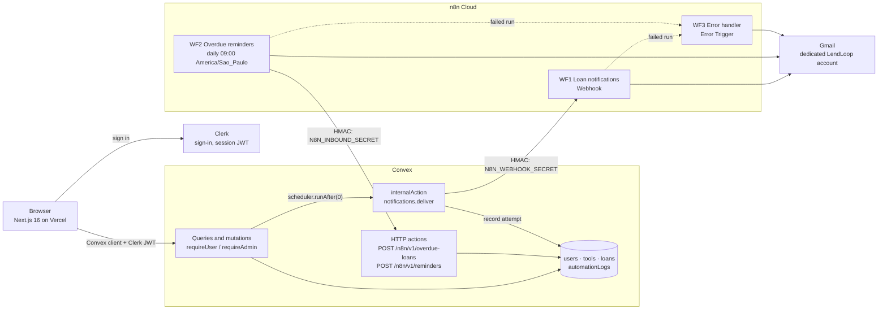

# README — Project README for Evaluators

## Overview

Replace the create-next-app default `README.md` with a project README that lets an **evaluator / reviewer** understand LendLoop, run it locally and verify its claims (RBAC in Convex, signed n8n integration in both directions, idempotency, visible failures) **from the README alone**, without reading `context/`.

Target reader: a technical reviewer who has ~10 minutes for a first pass (pitch, live URL, screenshots, architecture) and possibly an hour to clone, run and poke at it. They know Next.js / TypeScript but not necessarily Convex, Clerk or n8n.

Docs only. No code, CSS, Convex, n8n or env var change. Targets **DEV** (local files); PROD changes only through the normal `main` push.

## Prerequisites

### Already done (see `context/current-feature.md` → *History*)

All features A–F are implemented and in PROD (bonus F *Automation activity* included), plus *Theme Colors* (palette, Light/Dark toggle, logo, favicon) and the canonical Tailwind class fix. State read on 2026-11-15:

- `README.md` = the untouched create-next-app default (mentions `yarn` / `pnpm` / `bun`, `app/page.tsx`, Vercel template links). Nothing in it is kept.
- No `docs/` folder, no `LICENSE`, no `.nvmrc` / `engines` field. Local Node is v24.15.0; Next.js 16 requires **Node ≥ 20.9**.
- `npm run test:run` → **382 tests in 16 files, all passing** (run 2026-11-15).
- GitHub repo `lendloop` is currently **private**, homepage set to the live URL (see *Doc Conflicts* → repo visibility).

### User prerequisites

Answer *Decisions for the User* before `/feature start`. Screenshots are captured by the user (*Manual Steps*) before the README can be finished.

## Requirements

- One page an evaluator can read top-down: pitch → live demo → screenshots → architecture → how it works → run it → test it → limits.
- Every fact comes from a source of truth in the repo (listed per section in *README Outline*); no claim the code does not back.
- **No secrets, deploy keys, credential values, webhook URLs or personal emails** anywhere in the README or the screenshots.
- Every command matches `package.json` / `CLAUDE.md`; every env var name matches `.env.example` / `CLAUDE.md` / `convex/`.
- Link to official Convex / Clerk / n8n docs for vendor steps instead of copying them.
- English (repo rule). Renders correctly on github.com in light and dark theme.

## Decisions

| # | Topic | Options considered | Decision and why |
|---|---|---|---|
| 1 | **Structure** | (a) **One `README.md`** + `docs/screenshots/` (images only); (b) short README + `docs/setup.md`, `docs/architecture.md`, `docs/automation.md`; (c) GitHub wiki | **(a).** GitHub's own guidance: a README covers what the project does, why it is useful and how to get started, longer docs go elsewhere — and LendLoop already *has* the long docs (`context/features/*.md`, `CLAUDE.md`). A second layer in `docs/*.md` would duplicate them and drift. One page also means the evaluator never hunts for files, and GitHub's auto-generated **Outline** gives navigation for free. Target size ≈ 350–450 lines of Markdown (far below GitHub's 500 KiB truncation). The deep detail is reached by links ("Details: `context/features/overdue-reminders.md`"). (b) is the fallback only if the README passes ~600 lines. (c) is not versioned with the code. |
| 2 | **Table of contents** | (a) Rely on GitHub's Outline button; (b) **short manual TOC** (H2 links only) under the opening | **(b).** The Outline icon is easy to miss; a 10-line list of anchors costs nothing and works in VS Code / clones too. H2 only, no nested list. |
| 3 | **Quick start vs deep detail** | (a) One long setup section; (b) **two tracks**: *Quick start (app only)* then *Full setup (automation)* | **(b).** The app runs without n8n: missing `N8N_*` vars → notification rows `failed` / `not_configured` (no fetch) and `/n8n/v1/*` → 503, both by design. So an evaluator gets a working board with Clerk + Convex in ~10 minutes, and only follows the n8n track if they want to verify WF1–WF3. README best-practice sources agree on "quick start before deep detail". |
| 4 | **Publishing deployment names, `.convex.site` URLs, n8n names** | (a) Publish everything (as `CLAUDE.md` does); (b) **publish the live app URL and n8n workflow names; show Convex HTTP endpoints as `https://<deployment>.convex.site/n8n/v1/...` placeholders; never print the WF1 webhook URL**; (c) publish nothing | **(b).** None of these are secrets (the endpoints reject anything unsigned with 401/503 before parsing, and the WF1 webhook verifies HMAC + 300 s window), but each published hostname is a free target for junk traffic that burns Convex function calls / n8n executions, and the README is the most-indexed, most-copied file of a repo. The evaluator gains nothing from our deployment names — they run their own deployment, so a placeholder is *more* useful. The live URL must be public (it is the demo). Workflow names (`[DEV] LendLoop — Loan notifications (WF1)`, …) help the import step and expose nothing. The README links to `CLAUDE.md` → *Environments* for the real table (already in the repo, see *Doc Conflicts*). (a) adds abuse surface for no reader value; (c) makes the architecture harder to follow. |
| 5 | **Screenshots: what and how** | (a) None; (b) **7 PNGs in `docs/screenshots/`**, light + one dark, shown as fixed-width HTML ``; (c) `<picture>` with `prefers-color-scheme` light/dark pairs for every shot | **(b).** See *Screenshot List*. `<picture>` (supported by GitHub, documented on the GitHub blog) swaps the image by the *viewer's* GitHub theme, so each evaluator would see only one theme — hiding the dark mode we want to show — and it doubles the capture work. Instead: light shots everywhere, plus one explicit dark shot next to its light twin. Relative paths (GitHub: "use relative links … easier for users who clone"). `` because Markdown `` cannot set a width. |
| 6 | **Architecture diagram** | (a) Mermaid `flowchart` only; (b) flowchart + a `sequenceDiagram` per workflow; (c) a PNG/SVG drawing | **(a), one diagram.** GitHub renders `mermaid` fenced blocks (flowcharts, sequence diagrams, …). One flowchart shows all pieces and both HMAC directions; the per-workflow sequences already live in `context/features/loan-notifications.md` / `overdue-reminders.md` and are linked. **No `classDef`, `style` or `%%{init}%%` theme directives**: custom fills are the documented cause of unreadable Mermaid text in GitHub dark mode (community discussion #35733); the default theme adapts. (c) needs a second source of truth. |
| 7 | **Badges / shields** | (a) None; (b) a few (Next.js, Convex, tests) | **(a).** The live-URL link and the tech-stack table say the same thing; static badges add noise and a CI badge would need a CI that does not exist. |
| 8 | **Project workflow section** | (a) Omit; (b) **short section (≤ 12 lines)**: specs in `context/features/`, `/feature` skill lifecycle, auditor agents, AI-assisted development note; (c) a long write-up | **(b), recommended — user decides.** For a portfolio / evaluation project, *how* it was built (spec-first, auditors per feature, DEV-first, PROD by `main` push) is part of what is evaluated, and it explains why `context/` and `.claude/` exist in the repo. Kept short and linking out. |
| 9 | **LICENSE** | (a) No license (all rights reserved by default); (b) MIT; (c) other | **Ask the user.** Creating a `LICENSE` file is out of scope unless the user says yes. If (a): the README has no License section. If (b): add `LICENSE` (MIT, holder = the user's chosen name) and a one-line *License* section. |
| 10 | **Language** | English / Portuguese / both | **English only** (repo rule in `CLAUDE.md`). |

## README Outline

Each section: content (1–3 lines) → source of truth. H1 = project name; every item below is an H2 unless marked.

| # | Section | Content | Source of truth |
|---|---|---|---|
| 0 | **`# LendLoop`** + opening | Logo-free text heading; tagline *"Borrow what you need. Lend what you don't."* in bold/italics; 2-sentence pitch (problem → solution); **Live demo: https://lendloop-tawny.vercel.app** with a note that sign-in uses a Clerk development instance (email or Google); a hero screenshot (`01-public.png`) | `context/project-overview.md` → *Problem and Solution*; `CLAUDE.md` → *Environments* |
| 1 | Table of contents | H2 anchors only (Decision 2) | — |
| 2 | **Features** | Checklist A–F, one line each: A Public page, B Tool listings, C Loans, D Views (All tools + category filter, My listings, My requests, Incoming), E Admin (remove any listing, all loans, Trusted Lender), **F Automation activity — bonus ✅**. Then a 2×3 screenshot grid (`02`–`07`) with captions | `project-overview.md` → *Features*; routes in `src/app/**` |
| 3 | **Tech stack** | Table: Next.js 16 (App Router) + React 19 + TypeScript · Tailwind v4 + shadcn/ui (base-nova) · Clerk · Convex (queries, mutations, actions, HTTP actions, scheduler) · n8n Cloud · Gmail (n8n credential) · Vitest + convex-test · Vercel. Versions from `package.json` only where useful (Next 16.4, React 19.3, Convex 1.49) | `project-overview.md` → *Tech Stack*; `package.json` |
| 4 | **Architecture** | The Mermaid flowchart (*Mermaid Diagram Draft*), then 4 bullets: browser ↔ Convex over the Convex client with the Clerk JWT; side effects scheduled with `ctx.scheduler.runAfter(0, …)` from inside the loan mutation (outbox row in the same transaction); Convex → n8n (WF1) signed with `N8N_WEBHOOK_SECRET`; n8n → Convex (WF2) signed with the **separate** `N8N_INBOUND_SECRET` | `convex/notifications.ts`, `convex/http.ts`, `convex/lib/hmac.ts`, `convex/lib/inbound.ts` |
| 5 | **Roles and authorization** | One sentence: every public Convex function resolves the caller via `requireUser` / `requireAdmin`; ownership checked server-side; the UI (`auth.protect()` on every `(app)` page) is defense in depth only. Matrix (*Roles Matrix* below). Note: `role` is never writable from the client; the first admin is promoted with the internal `users:setRole` | `project-overview.md` → *Users and Roles*; `coding-standards.md` → *Convex*; `convex/lib/` helpers; History *Schema + RBAC* |
| 6 | **Automation (n8n)** | H3 per workflow, one paragraph each: **WF1 Loan notifications** (trigger: request + every status change incl. auto-rejects `period_taken` / `tool_removed`; recipient = the party who did not act; payload = counterpart as public user + recipient's own email only; Gmail). **WF2 Overdue reminders** (daily 09:00 `America/Sao_Paulo`; signed `POST /n8n/v1/overdue-loans` → ≤ 50 loans, skips loans already reminded today or with 7 reminder days; one Gmail per borrower, one failure does not stop the others; signed `POST /n8n/v1/reminders` records each result). **WF3 Error handler** (Error Trigger of WF1 and WF2 → email to the operator mailbox) | `project-overview.md` → *Automation*; History *Loan Notifications*, *Overdue Reminders* |
| 6.1 | H3 *Signing scheme* | Table, both directions: HMAC-SHA256, secret used as UTF-8 bytes; signed string `` `${timestamp}.${rawBody}` ``; headers `X-LendLoop-Timestamp` (Unix seconds), `X-LendLoop-Signature: v1=<hex>` (space-separated list, ≤ 5 candidates, for rotation), outbound also `X-LendLoop-Event-Id`; reject if \|now − ts\| > 300 s; constant-time compare (`crypto.subtle.verify` in Convex, `timingSafeEqual` in n8n). Inbound pipeline order: 503 config → 415 → 413 (2,048 bytes) → **401 signature before parsing** → 400; a `type` field inside the signed body binds a signature to one endpoint | `convex/lib/hmac.ts`, `convex/lib/inbound.ts`, `convex/lib/automationRules.ts` |
| 6.2 | H3 *Idempotency, retries, visibility* | Keys `notification:<loanId>:<event>` and `reminder:<loanId>:<reminderDate>` (unique, checked before insert); reminder reports: `sent` never regresses, `failed` → `sent` upgrade. WF1 delivery: 15 s timeout, retries on 404/408/409/425/429/5xx/network/timeout with 30 s, 2 min, 10 min, 30 min ± 20 % (+ `Retry-After`), max 5 attempts → `failed`. Where failures show: `automationLogs` (short codes only), the activity line on each loan card (party view hides the other party's reason; admins see attempts + category), WF3 email | `convex/lib/automationRules.ts`; `schema.ts`; History *Automation Activity* |
| 7 | **Data model** | Four tables, one line each + key indexes; note availability is **derived** from loans, not stored, and tools are soft-deleted to keep loan history. Link to `convex/schema.ts` | `convex/schema.ts`; `project-overview.md` → *Data Model* |
| 8 | **Quick start (app only)** | Numbered: prerequisites → clone → `npm install` → Clerk app → Convex → `npm run dev` → first admin. See *Local Setup Content* | `package.json`, `.env.example`, `CLAUDE.md`, History |
| 9 | **Full setup (automation)** | Convex env vars + n8n import/credentials + test WF2 with an overdue loan. See *Local Setup Content* | same + `n8n/workflows/*.dev.json` |
| 10 | **Testing** | Commands `npm test` / `npm run test:run` / `npm run lint` / `npm run build`; **382 tests** (Convex functions and utilities only, no component tests); what is covered (authorization matrix user vs admin / owner vs non-owner / borrower vs lender, loan status transitions and date overlap, HMAC sign/verify incl. an n8n-compatible vector, idempotency of outbox and reminder writes, HTTP routes via `t.fetch` incl. verify-before-parse order, retry/backoff). Auditor agents used per feature: `auth-auditor`, `webhook-auditor`, `code-scanner` (`.claude/agents/`) — no critical/high findings left open | `package.json`; test run 2026-11-15; History |
| 11 | **Environments and deploy** | DEV/PROD table *without* deployment names (Next.js local vs Vercel; Convex dev vs prod deployment; Clerk "LendLoop Dev" vs "LendLoop Prod"; `[DEV]` vs `[PROD]` n8n workflows + credentials). Vercel build command `npx convex deploy --cmd 'npm run build'` (pushes Convex prod functions, then builds with the injected `NEXT_PUBLIC_CONVEX_*`); deploys only on `main` push, preview builds disabled; rollback = Vercel Instant Rollback (does not revert Convex functions → revert the commit). Link `CLAUDE.md` → *Environments* | `CLAUDE.md` |
| 12 | **Security notes** | Where secrets live (Convex env vars, n8n credentials, `.env.local` / Vercel — never in the repo; `.env.example` lists names only); exported workflows are sanitized (no secrets; operator address replaced with `operator@example.invalid`; credential **names/IDs** remain, which n8n documents as not sensitive); PII: `users` stores name + optional email; other users only ever see `{ name, isTrustedLender }`; n8n receives **only the recipient's own email**, never the counterpart's; `automationLogs` hold short error codes, never bodies or stack traces | `CLAUDE.md` → *Secrets*; `coding-standards.md`; History |
| 13 | **Known limitations** | Short honest list (*Known Limitations Content*) | History (accepted findings, gotchas) |
| 14 | **How this project was built** (if Decision 8 = yes) | Spec per feature in `context/features/` → `/feature load|start|review|test|complete` (`.claude/skills/feature/`) → auditors → DEV verification → `main` push = PROD; AI-assisted (Claude Code), with `CLAUDE.md` + `context/*.md` as the project's standing instructions | `context/ai-interaction.md`, `.claude/` |
| 15 | **License** (only if Decision 9 ≠ no license) | One line | `LICENSE` |

### Roles Matrix

| Action | Visitor | user | admin |
|---|---|---|---|
| See available tools (name + category) | ✅ | ✅ | ✅ |
| See owners, availability, category filter | — | ✅ | ✅ |
| Create / edit / remove a listing | — | own only | own only (+ remove any) |
| Request a loan | — | ✅ (not on own tools) | ✅ |
| Approve / reject / mark returned | — | lender of that loan | lender of that loan |
| Cancel a request | — | borrower of that loan | borrower of that loan |
| View all loans + automation attempts | — | — | ✅ |
| Mark Trusted Lender | — | — | ✅ |

The implementer re-checks each cell against `convex/tools.ts`, `convex/loans.ts`, `convex/admin.ts` (e.g. "not on own tools", and that admins have no override on loan transitions) before publishing.

### Local Setup Content

**Quick start (app only)**

1. Prerequisites: Node.js ≥ 20.9 (developed on 24), npm, Git; free accounts on Convex and Clerk. (n8n Cloud + a Gmail account only for the full setup.)
2. `git clone …` and `npm install`.
3. Clerk: create an application (link Clerk Next.js quickstart). Copy `NEXT_PUBLIC_CLERK_PUBLISHABLE_KEY` / `CLERK_SECRET_KEY` into `.env.local` (copy `.env.example`). In the dashboard: activate the **Convex integration** and copy the **Frontend API URL**; under *Sessions → Customize session token* add the claims `name` and `email` (exact JSON with Clerk shortcodes, verified by the implementer against the DEV app; link Clerk docs).
4. Convex: `npx convex dev` (first run creates the dev deployment and writes `CONVEX_DEPLOYMENT`, `NEXT_PUBLIC_CONVEX_URL`, `NEXT_PUBLIC_CONVEX_SITE_URL` into `.env.local`). Then `npx convex env set CLERK_JWT_ISSUER_DOMAIN <Frontend API URL>` and keep `npx convex dev` running.
5. In a second terminal: `npm run dev` → http://localhost:3000. Sign in with two accounts (e.g. a normal and a private window) to play lender and borrower.
6. First admin: Convex dashboard → *Functions* → `users:setRole` → `{ "userId": "<id from the users table>", "role": "admin" }` (or `npx convex run users:setRole '{…}'`). Internal function: not callable from the browser.
7. Expected without n8n: loan actions work; the activity line shows a notification service error (`not_configured`). That is the designed failure path.

**Full setup (automation)**

1. Generate two **different** secrets, ≥ 32 characters each, used as plain UTF-8 text (never hex/base64-decoded), e.g. `openssl rand -hex 32`.
2. n8n credentials (link n8n docs): two **Crypto** credentials (`HMAC DEV` = secret 1, `HMAC INBOUND DEV` = secret 2; the *Hmac Secret* field appears only with Action = Hmac), one **Gmail OAuth2** credential (`Gmail DEV`).
3. Import, in this order, with *Workflow menu → Import from File*: `error-handler.dev.json`, `loan-notifications.dev.json`, `overdue-reminders.dev.json`. After import: re-select the credential on every Crypto and Gmail node (the exports carry the original instance's credential IDs; pasted Crypto nodes may auto-pick the wrong one); replace `operator@example.invalid` in WF3; replace the `*.convex.site` host in WF2's two HTTP nodes with your `NEXT_PUBLIC_CONVEX_SITE_URL`; publish WF3, then set it as *Error workflow* in WF1 and WF2 settings (n8n lists an error workflow only after it is published); publish WF1 and WF2.
4. Convex env vars (names only): `N8N_WEBHOOK_URL` = WF1 webhook **Production URL**; `N8N_WEBHOOK_SECRET` = secret 1; `N8N_INBOUND_SECRET` = secret 2. Rules: byte-for-byte identical to the n8n credential (re-paste both if WF1 gets 401); missing inbound secret → 503.
5. Verify WF1: request a loan → the lender gets an email; the card shows "sent".
6. Verify WF2: make a loan overdue in DEV — Convex dashboard → *Data* → `loans`: set an approved loan's `endDate` to a past date (and `startDate` before it) → run WF2 manually in n8n → borrower email + "Reminder sent" on the card; a second run the same day returns no loans.
7. Verify WF3: temporarily break WF2's URL and run it → operator email.

Troubleshooting (3–4 bullets): turn **Chrome auto-translate off** (breaks React DOM updates); run `npx convex dev`, not `npx convex codegen`, to push functions; expected `ConvexError`s appear as "Console Error" in the Next.js dev overlay; a `failed` notification is not resent after fixing config (trigger a new event).

### Known Limitations Content

- Clerk "LendLoop Prod" is a **Development instance** (`*.vercel.app` cannot host a Clerk Production instance), so the live demo shows Clerk's development-mode indicators and is not meant for real users.
- **n8n Cloud trial**: when the trial ends, the PROD workflows stop; the app keeps working and the activity line shows the failures. (Wording confirmed with the user — see *Doc Conflicts*.)
- `failed` notification rows are never resent automatically (no replay tool); a new loan event is needed.
- Throughput caps by design: ≤ 50 reminders per WF2 run, overdue scan of 200, 7 reminder days per loan; Gmail sending limits are an estimate (≈ 500/day shared).
- "Today" is the server's UTC day for reminders; WF2 runs at 09:00 São Paulo (12:00 UTC).
- Accepted audit findings (low): activity query distinguishes unknown vs foreign loan ids (id-existence oracle); the public list accepts the visitor's `today`; approved loans per tool are read without a cap; n8n's Verify step does not fully validate the payload shape; user-entered text appears in plain-text emails; WF2 Gmail node's *Retry On Fail* is likely skipped when an error output is used.
- n8n shows WF1 runs that answered 401 as "Succeeded" (Respond to Webhook).
- Theme choice is per browser (`localStorage`), not per account.

## Mermaid Diagram Draft

Structure only; the implementer checks labels against the code and previews it on GitHub. Default theme, no `classDef` / `style` / `%%{init}%%` (Decision 6). Labels with `/`, `(`, `:` are quoted.

## Screenshot List

All **captured by the user** from **DEV** (`localhost:3000`), browser translation off, light theme unless stated. Folder `docs/screenshots/`. Format **PNG**, viewport-only capture (DevTools → *Capture screenshot*, no browser chrome, no bookmarks bar, no extensions), device pixel ratio 1 for desktop (1280 × 800 viewport) so files stay small; mobile at 375 × 812, DPR 2 accepted. Target **≤ 300 KB per file** (run through an optimizer such as TinyPNG/Squoosh if larger; ≤ 2 MB total). Displayed at `width="720"` (desktop) / `width="260"` (mobile).

**Data rules:** only DEV data; accounts with fictional names (e.g. "Alice Example", "Bob Example", "Carol Admin"); **no real names, no email addresses, no avatars of real people** (Clerk default initials avatar); `UserButton` menu closed; nothing from the Convex/Clerk/n8n dashboards. Prepare ~6 tools across ≥ 3 categories, one Trusted Lender, and loans in pending / approved (on loan) / overdue / returned states with at least one sent notification and one reminder in their activity.

| File | Page | Viewport | Theme | Must show |
|---|---|---|---|---|
| `01-public.png` | `/` signed out | 1280 × 800 | light | Logo, tagline, "Sign in to lend or borrow", available-tools grid (no owner details) |
| `02-all-tools.png` | `/tools` | 1280 × 800 | light | Category filter, Available + On loan badges, Trusted Lender badge, "Request" action |
| `03-my-requests.png` | `/loans/requests` | 1280 × 800 | light | Active loans incl. an **Overdue** one, activity `
` **open** showing notification + "Reminder sent" with relative time |
| `04-incoming.png` | `/loans/incoming` | 1280 × 800 | light | A pending request with Approve / Reject, an approved loan with "Mark returned" |
| `05-admin-loans.png` | `/admin/loans` | 1280 × 800 | light | Admin nav, status/overdue filter, both parties, activity with attempts / failure category |
| `06-mobile-tools.png` | `/tools` | 375 × 812 | light | Two-row mobile header, cards stacked, no horizontal scroll |
| `07-dark-requests.png` | `/loans/requests` (same data as 03) | 1280 × 800 | **dark** (header toggle) | Same view in dark mode, badges legible |
| *(optional)* `08-n8n-wf2.png` | n8n canvas of `[DEV]` WF2 | — | — | Node graph only; no credential panel, no URLs, no execution data with emails |

Order in the README: `01` as the hero under the opening; `02`–`07` in the *Features* grid; `08` (if taken) in *Automation*.

## Files to Create / Modify

| Path | Action | Notes |
|---|---|---|
| `README.md` | **replace** | Whole file rewritten per *README Outline* |
| `docs/screenshots/*.png` | create (by the user) | 7 files (+ optional `08`) per *Screenshot List* |
| `LICENSE` | create **only if** Decision 9 = a license | |
| `CLAUDE.md` | no change expected | Optional: none needed; the README links to it, not the reverse |
| `context/project-overview.md` | modify (one row) | Tech stack UI row says "System / Light / Dark theme toggle" — fix to "Light / Dark toggle (follows the OS until the user picks)" (see *Doc Conflicts*); docs only |

No code, config, Convex, n8n or `package.json` change.

## Manual Steps (User)

1. **Decisions:** answer *Decisions for the User*.
2. **Prepare DEV data** with fictional names (*Screenshot List* → data rules) and capture the 7 screenshots (+ optional `08`); drop them in `docs/screenshots/` with the exact file names.
3. **After the push**, review the README on github.com: Mermaid renders (light **and** dark GitHub theme — Settings → Appearance), all images load, every link and TOC anchor works, nothing sensitive is visible in the images.
4. **Optional:** follow *Quick start* on a clean clone in a fresh folder (new Convex dev project, new Clerk app) and report any step that does not work as written.

## Implementation Steps (Claude)

1. Branch `feature/readme` from `main`.
2. Re-read the sources per section (*README Outline* → source of truth) and verify each cell of the *Roles Matrix* and each number (test count via `npm run test:run`, retry delays, limits) against the code.
3. Verify the Clerk session-token claims JSON used in DEV (ask the user to read it from the dashboard if it is not in the repo) so the README shows the exact snippet.
4. Write `README.md` per the outline; Mermaid from the draft; screenshot `` tags with alt text.
5. Self-check: grep the README for `@`, `sk_`, `pk_`, `convex.cloud`, `convex.site` (only the placeholder form), `webhook/`, deployment names, the Gmail address — none may appear except the live URL and placeholders.
6. Fix the `project-overview.md` tech-stack row (if the user agrees, *Doc Conflicts*).
7. Check every relative link exists (`git ls-files` for linked paths) and external links answer 200 (WebFetch).
8. Preview locally (VS Code Markdown preview renders Mermaid only with an extension — the final check is on GitHub, user step 3).
9. `npm run lint`, `npm run test:run` (382, unchanged), `npm run build` pass.
10. Ask before committing (`docs: project README for evaluators`); after the user's screenshots are in, ask before merging.

## PROD Impact

- **Docs only.** Pushing `main` triggers the Vercel build (`npx convex deploy --cmd 'npm run build'`): the Convex push is a no-op (same functions/schema) and the Next.js bundle is unchanged. Expected no-op deploy; nothing to smoke-test beyond the live URL loading.
- No Clerk, n8n or env var change in any environment.

## Acceptance Criteria

- [ ] No secrets, keys, credential values, webhook URLs, deployment names or personal / project email addresses in `README.md` or the screenshots
- [ ] Every command in the README exists in `package.json` scripts or is a documented CLI (`npx convex dev`, `npx convex env set`, `npx convex run`)
- [ ] Every env var name matches `.env.example` / `CLAUDE.md` / `convex/` (`NEXT_PUBLIC_CLERK_PUBLISHABLE_KEY`, `CLERK_SECRET_KEY`, `CONVEX_DEPLOYMENT`, `NEXT_PUBLIC_CONVEX_URL`, `NEXT_PUBLIC_CONVEX_SITE_URL`, `CLERK_JWT_ISSUER_DOMAIN`, `N8N_WEBHOOK_URL`, `N8N_WEBHOOK_SECRET`, `N8N_INBOUND_SECRET`)
- [ ] Features A–F listed, F marked as bonus; live URL present and working
- [ ] Every relative link and image resolves on GitHub; every external link resolves
- [ ] The Mermaid diagram renders on GitHub in light and dark theme
- [ ] Test count and coverage statements match `npm run test:run` at commit time
- [ ] Roles matrix matches the Convex functions
- [ ] Quick start works without n8n; full setup lists every n8n re-link step
- [ ] `npm run build`, `npm run lint`, `npm run test:run` pass
- [ ] No `--prod` command run

## Testing

No new tests (docs only). Verification = acceptance checklist + the user's GitHub review + optional clean-clone run.

## Out of Scope

- Any code, CSS, Convex, schema, n8n workflow or env var change
- Video / GIF demos
- `CONTRIBUTING.md`, `CODE_OF_CONDUCT.md`, issue templates
- A `LICENSE` file unless the user chooses one (Decision 9)
- Badges / shields (Decision 7), a CI workflow
- A `docs/*.md` documentation set or wiki (Decision 1)
- Translating the README
- Changing repo visibility or GitHub settings (user action, see *Doc Conflicts*)

## Decisions for the User

1. **Structure** (Decision 1): single `README.md` + `docs/screenshots/` (recommended) vs README + `docs/*.md`.
2. **Deployment names / URLs** (Decision 4): live URL + workflow names public, Convex endpoints as placeholders, WF1 webhook URL never (recommended) vs publish the real `.convex.site` hosts as in `CLAUDE.md`.
3. **Screenshots** (*Screenshot List*): the 7 listed (recommended); add the optional n8n canvas `08`? yes / no.
4. **LICENSE** (Decision 9): none (default) / MIT / other.
5. **Project workflow section** (Decision 8): include (recommended) / omit.
6. **n8n Cloud trial wording** (*Known Limitations*): confirm the trial status / end date to state, or drop the bullet.

## Doc Conflicts

| Topic | Conflict | Followed |
|---|---|---|
| Clerk issuer env var | Clerk's Convex guide now uses `CLERK_FRONTEND_API_URL`; Convex's Clerk guide and our `convex/auth.config.ts` use `CLERK_JWT_ISSUER_DOMAIN` | `CLERK_JWT_ISSUER_DOMAIN` (matches the code); README links both guides with a note on the name |
| Theme toggle modes | `context/project-overview.md` (Tech stack) and `theme-colors.md` Decision 3 say **System / Light / Dark**; History (Theme Colors) and `ThemeToggle.tsx` say **Light ↔ Dark, OS followed until the user picks** | Code + History; fix the overview row (Files table) |
| Deployment names in the repo | Decision 4 keeps them out of the README, but `CLAUDE.md`, `context/features/overdue-reminders.md` and the `n8n/workflows/*.json` exports already contain both `.convex.site` hosts, and `loan-notifications.*.json` contain the **WF1 webhook paths (DEV and PROD)** | README follows Decision 4; the repo files are left as is (not secrets, signatures required). **Repo is private today**: if it is made public for evaluators, the PROD WF1 webhook path becomes public too — user decides whether to accept (unsigned calls get 401 but still count as n8n executions) or to change the webhook path before going public |
| Dedicated Gmail address | The LendLoop Gmail address appears in `context/features/loan-notifications.md`; the brief says no personal emails | Not personal, but kept out of the README ("dedicated LendLoop Gmail account"); the existing spec is left unchanged |
| n8n Cloud trial | The brief lists it as a known limitation; no doc in the repo records the trial or its end date | Bullet kept pending the user's confirmation (Decision 6) |
| n8n import + credentials | n8n docs: exports include credential names and IDs; they do not say whether credentials re-link automatically | README tells the reader to re-select every credential after import (safe on any instance; our own gotcha: pasted Crypto nodes auto-pick a credential) |
| GitHub `<picture>` theme images | docs.github.com only states `<picture>` is supported; the light/dark `prefers-color-scheme` pattern is documented on the GitHub blog | Supported, but not used (Decision 5) |
| Mermaid dark mode | docs.github.com is silent on themes; third-party guides disagree on how GitHub picks the theme; a GitHub community discussion shows custom fills break dark mode | Default theme, no custom styles (Decision 6); verified visually by the user (Manual step 3) |
| Node version | No `engines` / `.nvmrc` in the repo; Next.js docs: minimum Node 20.9 | README states "Node.js ≥ 20.9 (developed on 24)"; adding `engines` is out of scope |
| `npm start` | `package.json` has `start`; `CLAUDE.md` *Commands* omits it | README lists only the commands an evaluator needs (`dev`, `build`, `lint`, `test`, `test:run`); `CLAUDE.md` unchanged |

## References

- GitHub Docs — About READMEs (what a README covers, location precedence, Outline TOC, relative links, 500 KiB truncation): https://docs.github.com/en/repositories/managing-your-repositorys-settings-and-features/customizing-your-repository/about-readmes
- GitHub Docs — Basic writing and formatting syntax (relative image links, `<picture>` supported, auto TOC): https://docs.github.com/en/get-started/writing-on-github/getting-started-with-writing-and-formatting-on-github/basic-writing-and-formatting-syntax
- GitHub Docs — Creating diagrams (Mermaid fenced blocks, flowcharts / sequence diagrams, version check, third-party plugin errors): https://docs.github.com/en/get-started/writing-on-github/working-with-advanced-formatting/creating-diagrams
- GitHub Blog — Images that adjust for dark and light mode (`<picture>` + `prefers-color-scheme`): https://github.blog/developer-skills/github/how-to-make-your-images-in-markdown-on-github-adjust-for-dark-mode-and-light-mode/
- GitHub Community — Mermaid diagram unreadable in dark mode (custom fills): https://github.com/orgs/community/discussions/35733
- Next.js — Installation (minimum Node.js 20.9): https://nextjs.org/docs/app/getting-started/installation
- Convex — Convex & Clerk (Convex integration, Frontend API URL, `CLERK_JWT_ISSUER_DOMAIN`, `auth.config.ts`, dev and prod instances): https://docs.convex.dev/auth/clerk
- Convex — Next.js quickstart: https://docs.convex.dev/quickstart/nextjs
- Convex — Environment variables (`npx convex env set`, dashboard): https://docs.convex.dev/production/environment-variables
- Convex — CLI (`convex dev`, `convex run`): https://docs.convex.dev/cli
- Clerk — Integrate Convex with Clerk: https://clerk.com/docs/guides/development/integrations/databases/convex
- Clerk — Next.js quickstart: https://clerk.com/docs/nextjs/getting-started/quickstart
- Clerk — Customize your session token (Sessions → Claims, shortcodes): https://clerk.com/docs/guides/sessions/customize-session-tokens
- n8n — Export and import workflows (Import from File; exports contain credential names and IDs; anonymize before sharing): https://docs.n8n.io/workflows/export-import/
- n8n — Create and edit credentials: https://docs.n8n.io/credentials/add-edit-credentials/
- n8n — Crypto node: https://docs.n8n.io/integrations/builtin/core-nodes/n8n-nodes-base.crypto/
- n8n — Google (Gmail) credentials: https://docs.n8n.io/integrations/builtin/credentials/google/
- n8n — Error handling / error workflows: https://docs.n8n.io/flow-logic/error-handling/
- Local sources (read 2026-11-15): `CLAUDE.md`, `context/*.md`, `context/features/*.md`, `package.json`, `.env.example`, `convex/schema.ts`, `convex/http.ts`, `convex/lib/hmac.ts`, `convex/lib/automationRules.ts`, `convex/users.ts`, `convex/auth.config.ts`, `n8n/workflows/*.json` (names, nodes, settings, credential names only), `src/app/**` routes, `src/components/theme/ThemeToggle.tsx`, `npm run test:run` output, `gh repo view` (visibility)

Source notes: GitHub, Next.js, Convex, Clerk and n8n pages were fetched live on 2026-11-15. The Mermaid dark-mode advice is community-sourced (no official GitHub statement), hence the user's visual check. README section order ("quick start before deep detail") follows GitHub's README guidance plus common practice; where GitHub's docs are silent the spec picks the simpler option.
